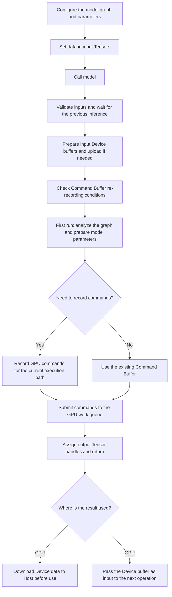

# Execution pipeline

`NeuralNet` passes input Tensors to a connected graph, performs inference on the GPU, and provides output Tensors. The runtime manages data transfers, operation ordering, and GPU command recording and execution throughout this process.

This document describes **execution from input setup through the use of inference results**. For graph construction and slot connection rules, see [NeuralNet](neural-net.md). For data storage and memory ownership, see [Tensor](tensor.md).

## 1. Inference execution flow

A single inference is one call to `model(inputs, outputs)`. Before the call, the model's graph and parameters are configured and input data is set. When the call begins, the runtime prepares inputs and execution resources, then submits compute commands to the GPU.

```text
model(inputs, outputs)
  ① Validate and assign inputs                InputNode::in0
  ② Wait for the previous inference (default) sync()
  ③ Prepare and upload inputs                 prepareInputs()
  ④ Decide whether to re-record the Command Buffer
  ⑤ Analyze the graph (once, on first run)     sortNodes()
  ⑥ Prepare model parameters (once)            uploadModelParams()
  ⑦ Record the Command Buffer (if needed)      recordCommands()
  ⑧ Submit to the GPU work queue (asynchronous)
  ⑨ Assign output Tensor handles
```

[Stages of a single inference](#3-stages-of-a-single-inference) describes the function calls and data transfers for steps ① through ⑨.

The following diagram shows the full sequence, from model configuration before the call to result use after it.



**The first inference analyzes the graph, prepares model parameters, and records GPU commands.** Subsequent inference calls reuse existing commands when the recording conditions are unchanged. GPU computation runs again on every command submission.

Also, **a return from `model(...)` does not mean the current GPU computation has finished.** An output Tensor is a handle for accessing result data. Reading the values on the CPU requires bringing Device data into Host memory.

## 2. Main execution concepts

### 2.1 Host memory and Device buffers

Host memory stores data used by the CPU, while Device buffers store data for GPU computation. To use CPU-provided inputs and weights on the GPU, Host data must be transferred to Device buffers.

Conversely, using GPU results on the CPU requires bringing Device data into Host memory. Results already in a Device buffer can be passed to the next GPU operation without going through Host memory.

A `Tensor` is a data handle that references this storage. Passing a Tensor between Nodes or assigning it to a user's output Tensor shares the internal `TensorData` without copying the data itself.

### 2.2 Vulkan and Command Buffers

Vulkan is an API for controlling GPU memory and execution commands. The runtime handles data transfers and compute commands through `eva`, a Vulkan-based GPU execution layer.

A Command Buffer is **an object that records commands for the GPU to execute**. The CPU records data copy and compute commands in a Command Buffer, then submits it to the GPU work queue. The GPU executes the submitted commands.

```text
CPU: Prepare inputs and resources -> Record GPU commands -> Submit to queue -> Return
                                                               |
GPU:                                                           +-> Execute commands -> Complete
```

Therefore, **recording, submission, execution, and waiting for completion** are separate processes. `Node::run(cmdBuffer)` records commands; it does not complete GPU computation at the time of the call.

Input transfer and compute Command Buffers are also managed separately. Even when changed input values require new transfer commands, the compute commands can be reused. Unless stated otherwise, re-recording and reuse below refer to the compute Command Buffer.

### 2.3 Model parameters and execution resources

Model parameters are data used throughout inference, such as weights. They are usually loaded into Host memory during model construction and stored in Node `persistent` slots. During the first inference, the runtime prepares Device buffers for these Tensors and transfers any Host data to the GPU.

Shapes and required buffers for intermediate results and temporary Tensors are determined during command recording. `BufferPool` retains returned Device buffers and reuses them when they fit later requests.

| Component | Role in execution |
|---|---|
| `NeuralNet` | Manage input and output boundaries, prepare execution, record and submit commands, and wait for completion |
| `GraphController` | Select Nodes to include in the current recording based on active inputs and Gate states |
| `Node` | Prepare Tensors for the operation with `prepare()` and record GPU commands with `run(cmdBuffer)` |
| `Tensor` | Reference data storage for inputs, parameters, intermediate results, and final outputs |
| `BufferPool` | Obtain Device buffers and reuse returned buffers |
| Command Buffer | Hold data transfer or compute commands for submission to the GPU |

## 3. Stages of a single inference

Inference is invoked through `NeuralNet::operator()`.

```cpp
using TensorDict = std::map<std::string, Tensor>;
using TensorRefDict = std::map<std::string, Tensor*>;

void operator()(TensorDict inputs, TensorRefDict outputs, bool syncPrev = true);
```

`inputs` maps model input names to Tensors. `outputs` maps model output names to pointers to Tensors that receive the results. The return type is `void`; result handles are provided through the output pointers.

Sections 3.1 through 3.9 below correspond to execution steps ① through ⑨ above.

### 3.1 Input validation and assignment

First, the runtime checks that the input map is nonempty and that every input name matches an `InputNode` name registered in the model. Each input Tensor is assigned to the corresponding `InputNode`'s `in0` slot.

This passes a shared reference to `TensorData` without copying Host data or Device buffer contents.

**The active inputs are the set of input names actually passed in the current call.** Not all registered inputs need to be supplied each time, but previous values of omitted inputs are not automatically reused. During command recording, `GraphController` determines which paths can execute with the current inputs.

If the active input set differs from the previous call, the Command Buffer is marked for re-recording.

### 3.2 Waiting for the previous inference

GPU computation submitted by the previous call may still be running. With the default `syncPrev = true`, `NeuralNet::sync()` waits for it to finish.

`sync()` uses a Timeline Semaphore and a submission number. A Timeline Semaphore is a synchronization object that tracks GPU completion points by number. Submissions that have already been synchronized are not waited on again.

`syncPrev = false` skips the wait at this stage. However, `recordCommands()` calls `sync()` itself before re-recording commands, and waits can also occur when input upload Command Buffers are reused in rotation.

Therefore, this option does not mean that the entire call is free of CPU waits.

### 3.3 Input preparation and upload

`prepareInputs()` checks the `in0` slots of active inputs. Inputs with new Host data that has not yet been uploaded to Device are transferred for GPU use.

```text
Host data set with setFloats() / setData()
  -> Copy into a Staging Buffer
  -> Transfer to the input Device buffer
  -> Use in GPU computation
```

A Staging Buffer is an intermediate buffer for transferring CPU-written data to a Device buffer. Input upload proceeds as follows.

1. If the input has no Device buffer, obtain a `DEVICE_LOCAL` buffer through `BufferPool::requestBuffer()`.
2. Obtain a CPU-accessible Staging Buffer with `HOST_VISIBLE | HOST_COHERENT` properties and copy the Host data into it.
3. Record barriers that order transfer and compute accesses, along with `copyBuffer()` commands, in the input upload Command Buffer.
4. Submit the upload commands and use `markHostUploaded()` to prevent duplicate uploads.

The Staging Buffer used for upload is retained until the GPU transfer finishes.

If the input already has a Device buffer and no new Host data needs uploading, the copy is skipped. This includes using the output of another inference as input. In that case, the execution order of the producing and consuming operations, and the shared buffer lifetime, must be managed.

### 3.4 Deciding whether to re-record the Command Buffer

The runtime compares the current input and output state with the binding information from the previous recording. Binding information includes the buffers and data ranges referenced by GPU commands.

Changes to an input's Shape, Device buffer, or Offset can change the structure or location of the referenced data, requiring re-recording. A change to the requested output Tensor's storage also marks the commands for re-recording.

**Input data values themselves are not compared.** If only the Host values of the same Tensor are updated and the other recording conditions remain unchanged, the runtime can upload the changed data and reuse the existing compute commands. For all re-recording conditions, see [Repeated inference and command reuse](#4-repeated-inference-and-command-reuse).

### 3.5 Graph analysis

On the first run, `sortNodes()` traverses Nodes reachable from all registered input boundaries and topologically sorts them so that data producers precede consumers. It uses Kahn's algorithm and throws an exception if a cycle is present.

Next, `GraphController::build()` computes input dependencies and Gate branch reachability. A Gate is a Node that selects a branch based on a condition. This stage also checks input slots for multiple producer connections that are not valid Gate branch merges.

The sorted result is stored in `sortedNodes_`. Subsequent command recordings follow this order but include only Nodes that match the current active inputs and Gate states.

**Graph analysis and Command Buffer re-recording are separate operations.** Changing input Shapes or values does not automatically sort the graph again. Node creation and slot connections must be finalized before the first run. For details, see [Graph sorting](neural-net.md#6-graph-sorting).

### 3.6 Model parameter preparation

`uploadModelParams()` checks the `persistent` slots of all sorted Nodes and prepares Device buffers for data used throughout inference.

Tensors that already have Device buffers are skipped. For the others, it obtains Device buffers and transfers any Host data through `TensorUploader`. Large weights are processed in chunks of the configured size (256 MiB by default).

Upload commands are submitted in `flush()`, which waits for completion. Host weights prepared for transfer are removed with `clearHostData(true)` to reduce duplicate storage.

This stage also includes `persistent` slots on branches not selected by the current Gate. Tensors without Host data can still receive Device buffers, so not every slot causes an actual data transfer.

Ordinary Command Buffer re-recording does not repeat model parameter preparation.

### 3.7 Command Buffer recording

On the first run or when re-recording is needed, `recordCommands()` is called. It first checks completion of the previous computation with `sync()`, then incorporates the current active inputs and Gate states into the recording with `GraphController::beginRecord(activeInputs_)`.

It then traverses the sorted Nodes and performs the following steps.

1. Use `GraphController::hasNeedsFed()` to determine whether the Node is needed on the current execution path.
2. Call the selected Node's `prepare()` to validate inputs and prepare Shapes for output and temporary Tensors.
3. Obtain Device buffers needed for `output` and valid `temporary` slots.
4. Pass output Tensor handles to the `input` slots of connected downstream Nodes.
5. Call `Node::run(cmdBuffer)` to record GPU compute commands.

An output Tensor without an attached buffer can directly share a user-provided output buffer. The user buffer must have an Offset of 0, a matching Dtype, and sufficient size. Other required buffers are obtained through `BufferPool`. A suitable pooled buffer is reused when available; otherwise, a new GPU buffer is created.

```text
InputNode's in0
  -> Share the input Tensor with out0 in InputNode::prepare()
  -> Pass the Tensor to a connected Node's input slot
  -> Prepare outputs with Node::prepare() and record commands with run()
  -> Pass the output Tensor to a downstream Node's input slot
  -> Retain the result handle in cachedOutput_ in OutputNode::run()
```

This is the process of **connecting Tensor handles while recording commands**. Actual GPU computation takes place after the recorded commands are submitted.

After a Node's commands are recorded, its slot Tensor handles are reset, except for `persistent` slots. Nodes excluded from execution are cleaned up in the same way. When the last reference to an intermediate Tensor is released, its buffer returns to the pool and can be reused by operations whose usage periods do not overlap.

Final outputs are retained as separate references in `OutputNode::cachedOutput_`. For buffer return and lifetime details, see [Tensor memory lifecycle](tensor.md#8-typical-tensor-flows-and-lifecycles).

### 3.8 Submission to the GPU work queue

The recorded Command Buffer is submitted to the GPU work queue. Each submission increments `submitCount_` and associates that number with a Timeline Semaphore to track completion.

If the re-recording conditions have not changed, the existing Command Buffer is submitted again. `Node::prepare()` and `Node::run()` are not called again, but the GPU executes the recorded operations again.

After submission, the runtime proceeds to output handle assignment without waiting for the current GPU work to finish. However, first-run preparation, waiting for the previous inference, command re-recording, and internal upload synchronization can cause waits within the `model(...)` call itself.

### 3.9 Assigning output Tensor handles and using results

The runtime records the last GPU submission information in the `cachedOutput_` of each reached output boundary, then assigns that Tensor handle to the caller's specified `Tensor*`. Output boundaries not reached in the current recording receive an empty `Tensor`.

How the result is used next depends on where it is consumed.

| Consumption location | Handling |
|---|---|
| CPU | Copy Device data to Host memory with `downloadToHost()` or `getData<T>()` before use |
| GPU | Pass the existing Device buffer as input to the next operation and manage execution order and buffer lifetime |

Reading results on the CPU submits a copy to a separate Readback Buffer when needed and waits for that copy to finish. `NeuralNet::sync()` waits for submitted GPU work to finish; it does not copy result data into Host memory.

Reusing the same output buffer in the next inference can overwrite previous results. **Copying a Tensor handle does not create an independent copy of result data.** To preserve a previous result, read it back to Host and copy it into separate memory before the storage is updated.

For data downloads and pointer lifetimes, see [Reading output data](tensor.md#7-reading-output-data).

## 4. Repeated inference and command reuse

Repeated inference means calling the same model multiple times. The runtime reuses the graph, parameters, and commands prepared on the first run to reduce preparation costs on each call.

### 4.1 First inference versus repeated inference

The following table assumes that active inputs, Shape, Device buffers, Offset, Gate execution paths, output storage, and other recording conditions remain unchanged.

| Operation | First inference | Repeated inference under the same conditions |
|---|---|---|
| Input validation and slot assignment | Performed | Performed |
| Wait for the previous inference | If needed | Performed by default |
| Upload new Host inputs | If needed | If needed |
| Check re-recording conditions | Performed | Performed |
| Graph sorting and analysis | Performed | Skipped |
| Model parameter preparation | Performed | Skipped |
| Compute command recording | Performed | Skipped |
| Compute command submission and GPU execution | Performed | Performed |
| Output handle assignment | Performed | Performed |

**Command reuse reduces CPU command recording work; it does not skip GPU computation.** Changed Host input values can still require separate recording and submission of an input upload Command Buffer.

### 4.2 Command Buffer re-recording conditions

The following conditions mark compute commands for re-recording.

| Changed condition | Check |
|---|---|
| Active input set | Compare with the previous `activeInputs_` |
| Input Shape | Compare with `InputNode::recordedShape_` |
| Input Device buffer | Compare with `recordedInputBuffer_` |
| Input starting Offset | Compare with `recordedInputBaseOffset_` |
| Requested output storage | Compare the output Tensor's `data_` with `cachedOutput_`'s `data_` |
| Profile tags | `setProfileTag()` or `clearProfileTags()` invalidates recording |
| Explicit invalidation | Call to `invalidateCommandBuffer()` |
| Model parameter preparation | Marked for re-recording after preparation |

Gate branch selections are read by `GraphController::beginRecord()` during command recording. `operator()` does not directly compare Gate state changes, so check whether the Gate implementation invalidates recording when its state changes. If it does not, call `invalidateCommandBuffer()` after changing the state.

## 5. Repeated inference example

This example assumes a model with an input named `in0`, an output named `out0`, and an Fp32 output Dtype. It retains the input and output Tensors while changing only the input values.

```cpp
vai::Tensor x({4});
x.setFloats(std::vector<float>{1.f, 2.f, 3.f, 4.f});
vai::Tensor y;

// First run: analyze the graph, prepare parameters, record and submit commands
model({{"in0", x}}, {{"out0", &y}});

// Read the result on the CPU and save it in separate memory
const float* first = y.getData<float>();
std::vector<float> saved(first, first + y.numElements());

// Update Host input values while keeping the existing Tensor and Device buffer
x.setFloats(std::vector<float>{5.f, 6.f, 7.f, 8.f});

// Reuse existing compute commands if other recording conditions are unchanged
model({{"in0", x}}, {{"out0", &y}});
const float* second = y.getData<float>();
```

`setFloats()` changes Host data and resets the upload state while retaining the existing Device buffer. The next inference transfers the changed data in `prepareInputs()`.

`saved` is an independent copy of the first result. In contrast, `first` and `second` point to the Tensor's Host storage, so they cannot be assumed to retain previous values after that storage is updated or freed.

Input and output names must match the names registered by the model. For model construction and invocation, see [NeuralNet's external inputs and outputs](neural-net.md#5-external-inputs-and-outputs).

## 6. Execution considerations

### 6.1 Graph structure changes

There is no path that automatically detects slot connection or Node configuration changes after the first run and reanalyzes the graph. `invalidateCommandBuffer()` also invalidates only compute commands; it does not request graph re-sorting.

Therefore, finalize the graph structure before the first inference. If the structure must change, constructing a new `NeuralNet` instance is recommended.

### 6.2 Dynamic Shapes and buffer sizes

Changing an input Shape re-records compute commands. However, this does not guarantee automatic expansion of an already attached input Device buffer.

When changing a Shape, verify that the existing buffer can hold the new data range.

### 6.3 GPU execution order and resource lifetime

Before modifying shared data used by the GPU outside a call, confirm that the relevant GPU work has finished. Work submitted to the same `NeuralNet` can be waited on with `sync()`.

The current output download implementation calls `submit().wait()` for Readback copy commands. However, it does not explicitly wait for the Timeline value stored in `lastSubmission_` inside that function. When sharing data across different queues or with external GPU work, check the queue ordering and synchronization contracts of the underlying `eva` execution layer.

The related GPU resources must remain alive while the output Tensor is in use. The last submission information stored in a Tensor does not own the `NeuralNet` that produced the result. For details, see [Tensor GPU resource lifetime management](tensor.md#93-gpu-resource-lifetime-management).
