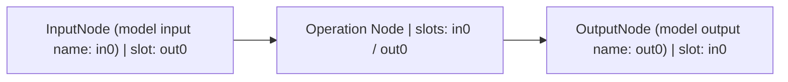

# NeuralNet

## 1. Purpose

`NeuralNet` is the **execution unit** for a graph of connected `Node` and `NodeGroup` instances. It defines external input and output boundaries, establishes node execution order, and submits GPU commands for the current inputs and branch conditions.

This document covers graph construction, `NodeSlot` structure and connection rules, graph analysis, and execution path control. For Tensor storage, Shape, Dtype, Host / Device transfers, and memory ownership, see [Tensor](tensor.md). For first-run costs and command buffer re-recording conditions, see [Execution pipeline](execution-pipeline.md).

## 2. Main objects and responsibilities

| Object | Responsibility |
|---|---|
| `NeuralNet` | Manage named input and output boundaries, sort nodes, select active inputs, prepare resources, and record, submit, and synchronize GPU commands |
| `Node` | Define and look up named slots, prepare operations with `prepare()`, and record GPU commands with `run(cmd)` |
| `NodeSlot` | Store the slot type, parent node, connected peer slots, and current `Tensor` value |
| `InputNode` | Pass external input to a graph output slot |
| `OutputNode` | Retain a reached graph output as a separate handle and record whether it was reached |
| `NodeFlow` / `NodeGroup` | Describe connections with `-` and `/`; groups expose internal slots under external names |
| `GraphController` | Determine which nodes to include in command recording based on active inputs and Gate branches |

A `NodeSlot` is a **graph connection point**, and a `Tensor` is the **data handle** currently attached to it. `Node::slot(name)` returns a `NodeSlot&`, while `Node::operator[](name)` returns the slot's `Tensor&`. For Tensor sharing and copying, see [Tensor: Data and handles](tensor.md#1-data-and-handles).

## 3. NodeSlot structure and common rules

### 3.1 Slot contents

A `NodeSlot` contains the following information.

```cpp
class NodeSlot {
public:
    enum Type { input, output, temporary, persistent, none };

private:
    Type type_;                          // Slot role
    Node& parent_;                       // Parent node
    std::vector<NodeSlot*> connections_; // Connected peer slots (non-owning pointers)
    Tensor value_;                       // Current Tensor handle in the slot
};
```

Slots are added with `addSlot(name, type)` in a `Node` subclass constructor. Adding the same name again does not create a duplicate because it uses `try_emplace`. `slot(name)` and `operator[](name)` throw a `std::map::at()` exception if the name does not exist.

```cpp
// Used in a Node subclass constructor
addSlot("in0", NodeSlot::input);
addSlot("out0", NodeSlot::output);
addSlot("weight", NodeSlot::persistent);
addSlot("workspace", NodeSlot::temporary);
```

For slot types and their basic roles, see [Node: Slots](node.md#1-slots).

### 3.2 Common rules for slot types

- **Allowed connections:** `NodeSlot::connect(a, b)` allows a connection only when `a.type() == output` and `b.type() == input`.
- **Buffers and slots are separate:** Slots hold Tensor handles. An `input` / `output` connection passes a handle without copying Tensor data.
- **Cleanup after recording:** Slot values other than `persistent` are reset after execution commands have been recorded. Final outputs are retained separately in `OutputNode::cachedOutput_`.
- **Inactive nodes:** Slots of nodes excluded from execution are also reset, except for `persistent` slots.

## 4. Graph construction and connection DSL

### 4.1 Input and output boundaries

`NeuralNet::input(name)` returns a named `InputNode`, and `NeuralNet::output(name)` returns a named `OutputNode`. Both use `std::map::try_emplace()` internally: the first call creates a boundary, and subsequent calls with the same name return the existing one. **The current API requires the name argument.**

`InputNode` has `in0` (`input`) and `out0` (`output`) slots. `OutputNode` has only an `in0` (`input`) slot.

**Model input and output names are separate from internal node slot names.** The `"in0"` in `input("in0")` is the name used to specify input from the host. Even with a different name, such as `input("features")`, the slots inside that `InputNode` are still named `in0` and `out0`. Similarly, the internal slot of an `OutputNode` created with `output("out0")` is `in0`.



The following model uses `in0` as its model input name and `out0` as its output name. The `-` operator connects each node's `out0` slot to the next node's `in0` slot.

```cpp
#include "neural-net.h"
#include "graph-flow.h"
#include "vai/nodes/activation.h"

struct Model : vai::NeuralNet {
    vai::node::Activation relu;

    explicit Model(const vai::NeuralNetConfig& cfg = {})
        : NeuralNet(cfg)
        , relu({.epilogue = vai::Epilogue::Relu})
    {
        input("in0") - relu - output("out0");
    }
};
```

Other models can choose input and output names to suit their purpose. The model below uses `features` as its input name and `activated` as its output name, while keeping the internal `in0` and `out0` slots unchanged.

```cpp
struct FeatureModel : vai::NeuralNet {
    vai::node::Activation relu;

    explicit FeatureModel(const vai::NeuralNetConfig& cfg = {})
        : NeuralNet(cfg)
        , relu({.epilogue = vai::Epilogue::Relu})
    {
        input("features") - relu - output("activated");
    }
};

FeatureModel model;
vai::Tensor features({4});
features.setFloats({-1.f, 2.f, -3.f, 4.f});
vai::Tensor activated;

model({{"features", features}}, {{"activated", &activated}});
```

At the call site, use the names registered with `input(name)` and `output(name)` as map keys, rather than internal slot names. The first `Model` uses `in0` and `out0`; the second `FeatureModel` uses `features` and `activated`.

Only boundaries created with `input()` and `output()` can be addressed by name from the host. `NodeGroup::defineSlot()` exposes internal group slots for external connections; it does not create NeuralNet input or output boundaries.

### 4.2 `NodeSlot::connect()` and disconnection

The final connection operation is `NodeSlot::connect(a, b)`.

```cpp
NodeSlot::connect(producer.slot("out0"), consumer.slot("in0"));
NodeSlot::disconnect(producer.slot("out0"), consumer.slot("in0"));
```

`connect()` checks the slot types and stores the peer `NodeSlot*` in both `connections_` lists. It does not add duplicate connections in the same direction. `disconnect()` removes the peer pointer from both lists. Neither function directly updates the graph analysis or command buffer re-recording flags.

### 4.3 The `-` and `/` operators

`NodeFlow` in `graph-flow.h` temporarily holds the nodes to connect and their default slot names. `-` connects the output slot on the left to the input slot on the right, with defaults of `out0` and `in0`. `/` selects a specified slot instead of the default.

For example, a `Concat` node that joins two inputs uses `in0` and `in1` input slots and an `out0` output slot. Connect the first input through the default slot, then select `in1` with `/` for the second input.

```cpp
#include "neural-net.h"
#include "graph-flow.h"
#include "vai/nodes/concat.h"

struct ConcatModel : vai::NeuralNet {
    vai::node::Concat concat;

    explicit ConcatModel(const vai::NeuralNetConfig& cfg = {})
        : NeuralNet(cfg)
        , concat({.axis = 0, .inputCount = 2, .oDtype = vai::Dtype::Fp32})
    {
        input("a") - concat;                  // a.out0 -> concat.in0
        input("b")/"out0" - "in1"/concat;     // b.out0 -> concat.in1
        concat - output("joined");            // concat.out0 -> joined.in0
    }
};

ConcatModel model;
vai::Tensor a({1, 2});
a.setFloats({1.f, 2.f});
vai::Tensor b({1, 2});
b.setFloats({3.f, 4.f});
vai::Tensor joined;

model({{"a", a}, {"b", b}}, {{"joined", &joined}});
// Shape of joined: [2, 2] (concatenated along axis = 0)
const float* values = joined.getData<float>(); // Download the GPU result to Host
// values[0..3]: 1, 2, 3, 4
```

`input("b")/"out0"` selects the output slot of the left node, and `"in1"/concat` selects the input slot of the right node. Since `out0` is the default output slot, the second connection can also be written as `input("b") - "in1"/concat;`. The two inputs must have the same dtype and rank, with matching dimension sizes except along the concatenation axis (`axis = 0`).

`NodeGroup` exposes a **pointer** to a member slot with `defineSlot("groupName", member.slot("slotName"))`. The group neither stores separate data nor duplicates slots. The DSL also skips a connection point when a `std::optional<Node subclass>` or `std::optional<NodeGroup subclass>` is empty. For usage, see [NodeGroup](node-group.md).

### 4.4 Pointers and object lifetime

`connections_`, `sortedNodes_`, and slots exposed by `NodeGroup` use non-owning pointers. If a node or slot changes address or is destroyed, the connection information may become invalid. Keep node member addresses stable, and prevent element relocation due to reallocation when using `std::vector`.

The `Node` constructor stores the current NeuralNet pointer through `NeuralNet::current()`. This pointer is non-owning. The `NeuralNet` constructor sets the thread-local `currentNet_`, but the provided destructor does not reset it. Do not access that pointer after the model is destroyed.

## 5. External inputs and outputs

The current call interface is:

```cpp
using TensorDict = std::map<std::string, Tensor>;
using TensorRefDict = std::map<std::string, Tensor*>;

void operator()(TensorDict inputs, TensorRefDict outputs,
                bool syncPrev = true);
```

```cpp
Model model;
vai::Tensor x({4});
x.setFloats(std::vector<float>{-1.f, 2.f, -3.f, 4.f});
vai::Tensor y;

model({{"in0", x}}, {{"out0", &y}});
// See tensor.md for reading results on the CPU
```

The input map must not be empty. Input keys must match existing `input(name)` boundaries, and output keys must match existing `output(name)` boundaries. Output pointers must not be null.

External inputs are assigned to the corresponding `InputNode`'s `in0` and passed to `out0` in `InputNode::prepare()`. Between ordinary nodes, output slot values propagate to connected input slots. `OutputNode::run()` moves the reached `in0` value to `cachedOutput_` and sets `reached_`. If no path reaches a requested output, the caller receives an **empty `Tensor`**.

**The active inputs are the set of input names actually supplied in the current call.** Not every registered input needs to be supplied on every call. Previous values of omitted inputs are not automatically reused; paths that lack required inputs are excluded from the current command recording. See §7 for details.

`model(...)` returns after submitting GPU commands, which does not mean that the current GPU computation has finished. For downloading data and preserving results, see [Tensor: Reading output data](tensor.md#7-reading-output-data).

## 6. Graph sorting

`NeuralNet::sortNodes()` starts from **all input boundaries** and follows each node's `output` slot connections with DFS. It computes incoming degrees for the reached nodes and edges, performs a topological sort with **Kahn's algorithm**, and stores the result in `sortedNodes_`. If the number of sorted nodes differs from the number visited, it raises a cycle error.

The sort includes **all nodes reachable from input boundaries**, rather than the minimal subgraph traced backward from output boundaries. Unreachable isolated nodes are excluded. After the topological sort, `GraphController::build(sortedNodes_, totalInputs)` runs and checks for multiple producers on input slots that are not Gate merges.

Graph sorting itself neither allocates GPU buffers nor records commands. Structural analysis, parameter preparation, and command buffer recording are separate stages.

### 6.1 Finalize the structure before the first run

`needToRebuildGraph_` starts as `true` and becomes `false` after `sortNodes()` runs during the first execution. The provided code has no API that automatically detects connection changes and sets this flag back to `true`. Therefore, **finalize node creation, boundary registration, and slot connections and disconnections before the first run**.

Although `sortNodes()` is public, calling it directly does not invalidate all resources and commands. `invalidateCommandBuffer()` **requests only command re-recording for the existing graph**; it does not sort the graph again. If the structure must change, constructing a new `NeuralNet` instance is recommended.

## 7. GraphController and execution paths

### 7.1 Precomputation and selection during recording

`GraphController::build()` reads the sorted graph and computes the Gate branches that reach each node and the **minimal combinations of active inputs** needed to execute it. There can be up to 64 Gates and up to 64 input boundaries.

When recording a command buffer, `beginRecord(activeInputs)` incorporates each Gate's current `isOpen()` state and the inputs supplied for this call. `prepare()` and `run(cmd)` are called for a node only when `hasNeedsFed(nodeIdx)` is `true`. Nodes outside the active path are omitted from command recording.

### 7.2 Ordinary nodes and `partialInputs` nodes

An ordinary node can run only when the required values are supplied to **each connected input slot**. If a slot has multiple producers, a path from one valid producer must be selected. An input slot with no producer connection is excluded from `GraphController`'s input dependency combinations; whether it can actually be used depends on the individual Node's `prepare()` and `run()` contracts.

A node with the `Node::partialInputs` flag can be activated by **at least one** valid connected supply path. This does not mean every slot always has a value. The node implementation decides which inputs to read.

### 7.3 Gate branches and merges

A Gate includes only the path corresponding to its current state, either the `then` or `else` output, in the commands. A node where the two branches merge can execute whichever branch is selected, as long as it receives the required values. Multiple producers on one `input` slot are allowed only when recognized as a merge of **mutually exclusive branches from a single Gate**.

A Gate state change is a **condition that changes the command path to record**, rather than a reason to sort the graph again. The provided `NeuralNet::operator()` does not directly compare Gate states to request re-recording automatically. Check the Gate implementation to determine whether its setter calls `invalidateCommandBuffer()`. If it does not, invalidate the recording explicitly after changing the state.

## 8. Graphs and execution resources

| Stage | Main function | Effect on the graph and slots |
|---|---|---|
| Graph analysis | `sortNodes()` | Sort nodes reachable from inputs and build control information |
| Input preparation | `prepareInputs()` | Prepare the current active external inputs for GPU use |
| Parameter preparation | `uploadModelParams()` | Inspect sorted nodes' `persistent` slots and prepare initial GPU buffers |
| Command recording | `recordCommands()` | Select nodes, call `prepare()`, connect outputs and prepare temporary buffers, then call `run(cmd)` |
| Cleanup after recording | Inside `recordCommands()` | Reset non-`persistent` slot handles; cache final outputs separately |
| Execution submission | `operator()` | Submit the command buffer to the GPU queue and assign requested output handles |
| Completion wait | `sync()` | Wait for GPU work submitted by this NeuralNet to finish |

`NeuralNetConfig` can specify the device, default weight and output dtypes, buffer pool, pipeline pool, and upload chunk size. GPU memory allocation and reuse, and command buffer re-recording decisions, are covered in [Tensor](tensor.md) and [Execution pipeline](execution-pipeline.md).

**Command recording and GPU computation occur at different times.** With the same recording conditions, the existing command buffer can be reused without calling `Node::prepare()` and `Node::run()` again on each call. GPU computation still runs on every submission.

### 8.1 Graph changes and recording invalidation

| Change | Automatic graph re-sort | Handling for command recording |
|---|---|---|
| Create input or output boundaries, or change slot connections | No | Must be finalized before the first run |
| Add, move, or remove a Node | No | Do not change the structure during execution, as existing non-owning pointers may become invalid |
| Change the active input set for this call | Not needed | `operator()` requests re-recording |
| Change input Shape, GPU buffer, or base Offset | Not needed | `operator()` requests re-recording |
| Change Gate selection | Not needed | Check the Gate setter contract; explicitly invalidate recording if needed |
| Change profile tags | Not needed | `setProfileTag()` and `clearProfileTags()` request re-recording |
| Call `invalidateCommandBuffer()` | No | Requests command re-recording only |

## 9. Synchronization and state between calls

The default `syncPrev = true` **waits for the previous execution to finish before preparing the current one**. Calling `NeuralNet::sync()` separately waits for GPU work submitted to this NeuralNet. `syncPrev = false` skips that default wait, but separate waits can still occur during command re-recording or temporary upload buffer reuse.

When the CPU modifies shared state that the GPU reads **outside** a call, call `sync()` before making the change. Changing only the contents of the same buffer and changing values recorded directly in a command buffer have different re-recording requirements. The provided `neural-net.h/.cpp` has no `onForwardBegin()` or `syncPrevForward()` interface, so these APIs are not described as the default execution hooks in this document.
