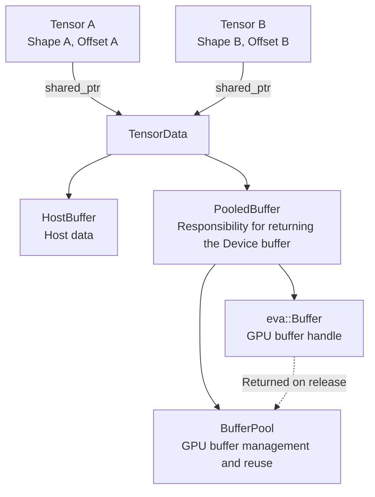
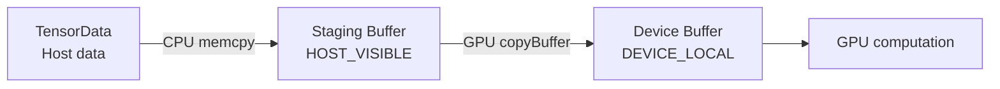
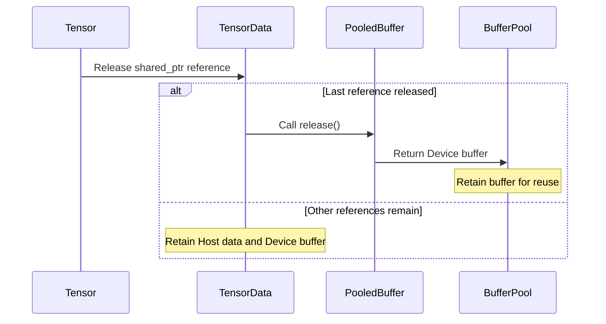

# Tensor

`Tensor` is a data structure that stores and manages input data, weights, and intermediate results needed for inference.

Data is stored in Host memory used by the CPU or in Device buffers used for GPU computation. `Tensor` manages the data's Shape and references to memory. The internal `TensorData` manages the actual Host memory and Device buffers.

A `Tensor` is stored in a [Node slot](node.md#1-slots) and can be accessed through `NodeSlot::getValueRef()`. `Node::operator[]` also provides direct access to a `Tensor` by slot name.

```cpp
linear.slot("out0")                 // NodeSlot&: Slot object
linear.slot("out0").getValueRef()   // Tensor&: Tensor stored in the slot
linear["out0"]                      // Tensor&: Direct access by slot name
```

For slot structure and usage, see [Node](node.md#22-reading-values-and-accessing-slots).

## 1. Data and handles

`Tensor` consists internally of two classes: `Tensor` and `TensorData`. `Tensor` manages the data's Shape and Offset, while `TensorData` manages the actual data storage and memory state.

The following code shows the main members of each class.

```cpp
class TensorData
{
    HostBuffer hostData_;             // Host data (std::vector<char>)
    bool hostUploaded_ = false;       // Host data's Device upload state
    const Dtype dtype_;               // Data type
    vai::PooledBuffer buffer_;        // Device buffer and responsibility for returning it

    std::pair<NeuralNet*, uint64_t> lastSubmission_{nullptr, 0}; // Last GPU result submission
    std::pair<NeuralNet*, uint64_t> hostSyncedAt_{nullptr, 0};   // Completed Host download
};

class Tensor
{
    std::shared_ptr<TensorData> data_; // Shared data storage
    std::vector<uint32_t> shape_;      // Tensor Shape
    uint32_t baseOffset_ = 0;          // Starting data position (in elements)
};
```

`Tensor` independently manages its **Shape (`shape_`) and Offset (`baseOffset_`)**. `TensorData` manages **Host data, the Device buffer, Dtype, and data transfer state**.

`Tensor` references data storage through `std::shared_ptr<TensorData>`. Multiple `Tensor` objects can therefore share the same `TensorData`. Individual Tensors can have different Shapes and Offsets while referring to the same data storage.

```cpp
Tensor a({M, N});                // Fp32, Shape: [M, N]
Tensor b = a;                    // Share the same TensorData as a
Tensor c = a.reshape({M * N});   // Create a new Tensor with only the Shape changed
```

In this example, `b` and `c` share the same `TensorData` as `a`. No Host data or Device buffer contents are copied.

Changes to data in a shared `TensorData` are visible through all Tensors that reference it. Shape and Offset are managed independently by each Tensor, so changing one Tensor's Shape does not affect another's.

### 1.1 Shape, Dtype, Offset

`Tensor` uses **Shape, Dtype, and Offset** to manage data structure and memory access ranges.

- **Shape (`shape_`)**: Describes the Tensor's dimensions and their sizes. `numElements()` computes the total element count, and `numBytes()` multiplies it by the element size for the Dtype to return the total data size in bytes.
- **Dtype (`dtype_`)**: Describes the type of data stored in the Tensor. It is set when `TensorData` is created and cannot be changed afterward. The currently supported data types are `Dtype::Fp32` and `Dtype::Fp16`.
- **Offset (`baseOffset_`)**: Specifies where the Tensor starts accessing the shared data storage. It is measured in **elements, not bytes**. `byteOffset()` computes the byte position by multiplying the Offset by the element size.

`baseOffset_` is used to reference a specific range within one Device buffer. It allows part of an existing buffer to be used without allocating separate memory or copying data.

For example, use `view()` to reference three elements starting at the fourth element of a Device buffer containing eight Fp32 elements.

```cpp
Tensor original({8}, Dtype::Fp32);
Tensor part = original.view({3}, 3);
```

Here, `part` has Shape `{3}` and `baseOffset_` of `3`. Since an Fp32 element is 4 bytes, data access starts at byte 12.

`part` and `original` share the same `TensorData`. Calling `view()` therefore creates no new data storage and copies no data.

`view()` sets the new Tensor's Shape and Offset. If a Device buffer is attached, it checks that the specified data range does not exceed the buffer size. It performs no separate bounds check on Host data.

### 1.2 GPU buffer ownership

`TensorData` manages its Device buffer through `PooledBuffer`. `PooledBuffer` holds an `eva::Buffer` that references the actual GPU buffer and a `std::shared_ptr` to the `BufferPool` that manages it.

`PooledBuffer` is move-only so that **only one object is responsible for returning a given GPU buffer**. This prevents the same GPU buffer from being returned to `BufferPool` more than once.

Copying a `Tensor` creates a new Tensor handle without copying `PooledBuffer` or GPU data. Multiple Tensors share the same `TensorData` and access its Device buffer through one `PooledBuffer`.

When all Tensors release their references to a `TensorData`, its destructor runs. It calls `PooledBuffer::release()` to return the Device buffer to `BufferPool`.

**A Device buffer returned to BufferPool is retained for reuse by later memory requests rather than freed immediately.** Tensor destruction and actual GPU memory deallocation are therefore separate processes.



For GPU buffer allocation, return, and reuse conditions, see [Tensor memory lifecycle](#8-typical-tensor-flows-and-lifecycles).

## 2. State

`Tensor` manages a **Shape** that defines the data layout, **Host data** used by the CPU, and a **Device buffer** used for GPU computation.

Each component has an independent state, and which components are present depends on memory allocation and data transfers. The following functions report these states.

| State | Meaning | Check |
|---|---|---|
| Empty handle | Initial state without `TensorData` | `Tensor()` or `dtype() == Dtype::None` |
| Shape specified | Shape and dtype are set; data bytes may not yet exist | `validShape() == true` |
| Host data | Holds data bytes accessible by the CPU | `hasHostData() == true` |
| Device buffer | A buffer for GPU computation is attached | `gpuBufferBound() == true` |
| GPU output tracking | Submission information for the last GPU result is registered | `lastSubmission().second != 0` |

A `Tensor` can hold both Host data and a Device buffer. Host data may remain after a transfer to the Device buffer, and unnecessary Host data can be removed to reduce memory use.

`NeuralNet` uses this approach when uploading weights. After recording commands that transfer weights to Device buffers, `NeuralNet::uploadModelParams()` calls `clearHostData(true)` to remove Host data and request that its memory capacity be released.

For weight uploads and memory management, see [NeuralNet](neural-net.md).

## 3. Construction

A `Tensor` can be constructed by specifying a Shape and Dtype, or from a Safetensors file or an existing Tensor.

Depending on the construction method, it creates new data storage or shares an existing `TensorData`.

### 3.1 Specifying a Shape

A Tensor can be constructed with a Shape and Dtype.

```cpp
Tensor x({M, N});                  // Default Dtype: Fp32
Tensor y({H, W}, Dtype::Fp16);
Tensor empty;                      // Empty Tensor without TensorData
```

Specifying a Shape creates a `TensorData` object through `std::make_shared<TensorData>(dtype)`. At this point, Host data is empty and no Device buffer is allocated.

**Constructing a Tensor object and allocating actual data memory are separate processes.** Host memory is allocated when data is set or read from a file. A Device buffer is prepared separately when the data is needed on the GPU.

Dtype is set when `TensorData` is created and cannot be changed afterward. A different Dtype requires a Tensor with a new `TensorData`. Shape, however, can be changed through operations such as `reshape()`.

### 3.2 Construction from Safetensors

A Tensor can be constructed by reading data stored in a Safetensors file. This is mainly used to load model weights.

```cpp
SafetensorsParser parser(VAI_DATA_DIR "/ckpts/mnist/jroot/model.safetensors");

Tensor w(parser["fc.weight"]);                // Construct using the file's Dtype
Tensor half(parser["fc.weight"], Dtype::Fp16); // Convert to Fp16 during construction
```

`Tensor(SafetensorRef, Dtype)` reads the Shape stored in the file, obtains the required Host memory, and loads the data. If the target Dtype differs from the file's data type, it converts the data during loading.

The supported data types are:

| File data type | Default Tensor Dtype | Conversion |
|---|---|---|
| F32 | `Dtype::Fp32` | Converted according to the target Dtype |
| F16 | `Dtype::Fp16` | Converted according to the target Dtype |
| BF16 | `Dtype::Fp32` | Converted to Fp32, or to Fp16 if specified |

BF16 is not a separate Tensor Dtype. Without a target Dtype, it is converted to Fp32 during loading.

The loaded Tensor holds data in Host memory; no Device buffer has been allocated yet.

When using weights, check the Shape required by the operation Node. If the file's data Shape differs from the required structure, it can be adjusted with operations such as `permute()` and `reshape()`. A weight's Dtype is set by its Tensor, and the Node reads the Dtype of the Tensor in the slot. The loaders of the provided models load weights at the net's `wDefaultDtype` and normalization coefficients at Fp32.

```cpp
// weightDtype is the Dtype to load the weight at (e.g. net.config().wDefaultDtype)
linear["weight"] = Tensor(parser["fc.weight"], weightDtype);
```

Assigning a Tensor to a Node slot alone does not transfer data to a Device buffer. `NeuralNet` uploads weights in `persistent` slots to Device buffers while preparing the first run.

For weight upload details, see [NeuralNet](neural-net.md).

### 3.3 Construction from an existing Tensor

A new Tensor can be constructed from an existing one. Depending on the operation, it shares the existing `TensorData` or creates new data storage.

```cpp
Tensor b = a;                    // Share the existing TensorData
Tensor c = a.reshape({M * N});   // Change the Shape and share TensorData
Tensor t = a.permute(1, 0);      // Create new Host data
```

`reshape()` and `view()` share the existing `TensorData`. They create no new data storage and copy neither Host data nor Device buffers.

In contrast, `permute()`, `split()`, and `concat()` create new `TensorData` objects and copy Host data.

Therefore, **whether constructing a new Tensor from an existing one copies data depends on the operation**.

The behavior and memory costs of each operation are described in [Host-only Tensor operations](#6-host-only-tensor-operations).

### 3.4 Copy and Move

`Tensor` supports C++ copy and move semantics. Neither copies existing GPU data into a new Device buffer.

```cpp
Tensor a({4});

Tensor b = a;            // Copy: share TensorData
Tensor c = std::move(b); // Move: transfer Tensor handle state
```

**A copy creates a new Tensor handle that shares the existing `TensorData`.**

Copying the `std::shared_ptr<TensorData>` increases the reference count. Shape and Offset are copied to the new Tensor, while Host data and the Device buffer remain in the shared storage.

**A move transfers the Tensor's handle and state to a new Tensor.**

The `std::shared_ptr`, Shape, and Offset are transferred without copying actual Host data or Device buffer contents. The source Tensor remains a valid object after the move, but its previous data and state must not be assumed to remain intact.

`TensorData` internally holds a move-only `PooledBuffer`, so `TensorData` itself does not support default copying.

Moving a `PooledBuffer` transfers the GPU buffer handle and ownership of the `BufferPool`. The source `PooledBuffer`'s buffer handle becomes empty; actual GPU data is neither moved nor copied.

For copy and move ownership management and memory lifecycles, see [Tensor memory lifecycle](#8-typical-tensor-flows-and-lifecycles).

## 4. Setting Host data

`Tensor` can store data in Host memory through `setFloats()` and `setData<T>()`. The two functions differ in how they set data.

- **`setFloats()`**: Accepts Fp32 data, converts it to the Tensor's Dtype, and stores it in Host memory.
- **`setData<T>()`**: Copies the input data bytes into Host memory without Dtype conversion.

The following example sets Host data with both functions.

```cpp
// Convert Fp32 input data to Fp16 and store it
std::vector<float> pixels(28 * 28);
Tensor img({1, 28, 28}, Dtype::Fp16);
img.setFloats(pixels);

// Store integer data without conversion
std::vector<int32_t> tokenIds = {101, 102, 103};
Tensor tokens({static_cast<uint32_t>(tokenIds.size())});
tokens.setData(tokenIds.data());
```

When using `setData<T>()`, the input element size (`sizeof(T)`) must match the element size of the Tensor's Dtype. The input pointer must also reference valid memory from which all Tensor elements can be read.

In this example, `tokenIds` is not converted from integers to Fp32. Its integer data bytes are stored unchanged in the Tensor's Host memory.

Both functions call `hostData_.resize()` internally to obtain the required memory size. If the existing Host buffer has sufficient capacity, the data can be updated without further allocation.

After setting data, the internal state changes as follows.

- `hostUploaded_ = false`: Marks the new Host data as not yet uploaded to the Device buffer.
- `lastSubmission_ = {nullptr, 0}`: Resets the previous GPU result submission information.

This process neither frees the existing Device buffer nor allocates a new one.

### 4.1 Setting data with Move

`setFloats()` also provides an overload that accepts a moved `std::vector<float>`.

```cpp
std::vector<float> values = {1, 2, 3, 4};

Tensor x({4});
x.setFloats(std::move(values));
```

`setFloats(std::vector<float>&&)` moves the supplied vector into an internal temporary vector, then writes the data to the Tensor's Host storage.

Therefore, this is not a zero-copy operation that transfers the input vector's memory directly to the Tensor. Data is copied or converted depending on the Tensor's Dtype.

## 5. Host-to-Device data transfer

Data stored in Host memory can be transferred to a Device buffer for GPU computation.

`setFloats()` and `setData<T>()` only set Host data; they do not transfer it to a Device buffer. Actual data transfers are handled during `NeuralNet` execution preparation.

`NeuralNet` uses different upload paths for input Tensors and weight Tensors according to their purpose.

### 5.1 Input Tensor upload

Ordinary input Tensors are transferred to Device buffers in `NeuralNet::prepareInputs()`.

When an input Tensor has new Host data that needs uploading, the following steps run.

1. Check whether the Tensor has a Device buffer attached.
2. If not, obtain one through `BufferPool::requestBuffer()`.
3. Copy Host data into a CPU-accessible Staging Buffer.
4. Record `copyBuffer()` commands to transfer Staging Buffer data to the Device buffer.
5. Call `markHostUploaded()` to update the Host data upload state.

The Staging Buffer uses `HOST_VISIBLE | HOST_COHERENT` memory properties. The CPU writes data into it, and the GPU transfers that data to the Device buffer through the recorded copy commands.

If a Device buffer is already attached, it can be reused. Changed input data therefore does not require a new GPU buffer on every update.

Input Tensors also retain Host data after upload. Subsequent changes through `setFloats()` or `setData<T>()` can be transferred into the existing Device buffer.

### 5.2 Weight Tensor upload

`persistent` Tensors, such as weights, are transferred to Device buffers in `NeuralNet::uploadModelParams()`.

This function checks Tensors in `persistent` slots and performs the following steps for those without an attached Device buffer.

1. Obtain a Device buffer through `BufferPool::requestBuffer()`.
2. If Host data exists, record transfer commands with `TensorUploader`.
3. Call `clearHostData(true)` to remove Host data and request that its memory capacity be released.
4. Attach the obtained Device buffer to the Tensor.

`TensorUploader` transfers Host data to Device buffers through a Staging Buffer. Data larger than the Staging Buffer's capacity is transferred in multiple chunks.

Unlike input uploads, weight uploads **remove the original Host data after transferring it to a Device buffer to reduce Host memory use**.

However, `clearHostData(true)` is called after transfer commands are recorded. GPU transfer completion is guaranteed during `TensorUploader`'s `flush()`.

### 5.3 Data transfer structure

Data moves from Host to Device as follows.



Host-to-Device transfers incur CPU memory copy and GPU data transfer costs. If no Device buffer exists, GPU memory allocation can add further cost.

**Device buffer allocation and data transfer are separate operations.** An existing Device buffer can be reused while only new Host data is transferred.

For when input and weight uploads occur and when resources can be reused during repeated inference, see [Execution pipeline](execution-pipeline.md).

## 6. Host-only Tensor operations

`Tensor` provides operations for changing Shapes, rearranging data, splitting, and concatenation. These are mainly used after loading model weights to convert them into the data structure required by an operation Node.

Each operation either shares the existing `TensorData` or creates new Host data storage.

| Operation | Function | Data storage |
|---|---|---|
| `Tensor::reshape()` | Change Shape while preserving the element count | Shared with the source |
| `Tensor::view()` | Reference a range of data with a specified Shape and Offset | Shared with the source |
| `Tensor::permute()` | Change axis order and rearrange data | Creates new Host data |
| `Tensor::split()` | Split a Tensor along the first axis | Creates new Host data for each segment |
| `Tensor::concat()` | Join multiple Tensors along the first axis | Creates new Host data |

### 6.1 Data sharing operations

`reshape()` and `view()` create new Tensors that share the existing `TensorData`. They copy neither Host data nor Device buffers.

**`reshape()`** changes a Tensor's Shape while preserving its total element count.

```cpp
Tensor a({2, 4});
Tensor b = a.reshape({4, 2});
```

Here, `a` and `b` share the same data storage but have different Shapes.

**`view()`** references a specified range starting at a particular position in the existing storage. It uses `baseOffset` to set the starting position, and does not require the total element count to match the source.

```cpp
Tensor original({8}, Dtype::Fp32);
Tensor part = original.view({3}, 3);
```

`part` references three elements starting at the fourth element of the source storage. Since `baseOffset` is measured in elements, the starting position for Fp32 data is byte 12.

If a Device buffer is attached, `view()` checks that the specified range does not exceed the buffer size. It performs no separate bounds check on Host data.

Both operations share the existing `TensorData`, so changes to the shared data also affect other Tensors that reference it.

### 6.2 Data copying operations

`permute()`, `split()`, and `concat()` use existing Host data to create new Tensors and data storage.

These operations **require Host data to exist and do not execute GPU data copy commands**.

**`permute()`** rearranges data according to the specified axis order. The rearranged data is written to new Host storage.

```cpp
// Change the axis order of the weight array
Tensor transposed =
    Tensor(parser["attn.c_attn.weight"], dt).permute(1, 0);
```

**`split()`** divides data into multiple segments along the Tensor's first axis. Each segment has its own `TensorData` and Host storage.

```cpp
// Split the first axis into Q, K, and V segments
Tensor qkv = Tensor(parser["attn.c_attn.weight"], dt);

auto [q, k, v] = qkv.split(D, 2 * D);
```

**`concat()`** joins multiple Tensors along the first axis. The input Tensors must have matching Dtypes and sizes in the remaining dimensions.

```cpp
// Concatenate Tensors along the first axis
Tensor combined =
    Tensor(parser["gate.weight"], dt)
        .concat(Tensor(parser["up.weight"], dt));
```

`split()` copies the divided data into new Host storage. In contrast, `view()` references a range of the existing storage without copying it.

Therefore, **if independent data storage is unnecessary, `view()` can reduce memory allocation and copy costs**. Keep in mind that the source and result Tensors share the same storage.

## 7. Reading output data

GPU inference can still be running when the `NeuralNet` call returns. To use its results on the CPU, Device buffer data must be transferred into Host memory.

`Tensor` provides `downloadToHost()` and `getData<T>()` for reading GPU results.

### 7.1 downloadToHost()

`downloadToHost()` copies GPU results from a Device buffer into Host memory.

The download proceeds as follows.

1. Check that the Tensor has an attached Device buffer and valid GPU submission information.
2. Obtain a Readback Buffer from `BufferPool` to hold the GPU result.
3. Copy Device buffer data into the Readback Buffer with `copyBuffer()` commands.
4. Submit the GPU copy commands and wait for completion.
5. Call `map()` and `invalidate()` on the Readback Buffer so the CPU can read the latest data.
6. Copy the data into `TensorData::hostData_` and update the download state.

The Readback Buffer uses `HOST_CACHED | HOST_VISIBLE` memory properties. The CPU reads its data after the GPU transfer finishes.

This process incurs GPU data transfer, synchronization wait, and Host memory copy costs.

### 7.2 getData<T>()

`getData<T>()` brings GPU results into Host memory and returns a pointer to the data.

It calls `downloadToHost()` internally, so a separate download call is not required beforehand.

```cpp
Tensor out;

model({{"x", inputTensor}}, {{"y", &out}});

const float* values = out.getData<float>();
```

`getData<T>()` returns Host data as `const T*` without Dtype conversion.

The template type `T` must therefore match the actual data storage format.

The returned pointer references `TensorData`'s Host storage. It is not an independent copy, so the pointer cannot continue to be used after the Host buffer is changed or freed.

**Use `downloadToHost()` and `getData<T>()` on Tensors with valid GPU output submission information.** They are not general accessors for ordinary Tensors that hold only Host data.

### 7.3 Avoiding duplicate downloads

`TensorData` compares the last GPU output information with the Host download information to avoid unnecessary transfers.

`downloadToHost()` compares `hostSyncedAt_` with `lastSubmission_`.

If they match, that GPU result has already been copied into Host memory, so the existing Host data is reused. If they differ, a new download is performed.

Repeatedly reading the same GPU result therefore does not transfer data from Device to Host each time.

### 7.4 Host data and Device buffer synchronization state

`TensorData` maintains the following state to manage Host data uploads and GPU result downloads.

| State | Role | Updated when |
|---|---|---|
| `hostUploaded_` | Track whether Host data has been uploaded to Device | Set to `false` by a setter and `true` during input upload preparation |
| `lastSubmission_` | Store the last GPU output submission information | Updated on GPU output submission and reset by a setter |
| `hostSyncedAt_` | Identify the GPU result last downloaded to Host memory | Updated when `downloadToHost()` completes |

These fields do not store Host data or Device buffers directly. They are bookkeeping information used to decide whether data transfers are needed.

### 7.5 Using Device buffers directly

GPU results do not always need to be downloaded into Host memory.

A Tensor with an attached Device buffer can pass that buffer as input to another GPU operation. Using the existing Device buffer directly, without going through Host memory, reduces unnecessary transfers.

However, when multiple operations use the same Device buffer, GPU execution order and resource lifetimes must be managed to prevent data from being overwritten.

For GPU result passing and synchronization between executions, see [Execution pipeline](execution-pipeline.md).

## 8. Typical Tensor flows and lifecycles

How a `Tensor` uses Host memory and Device buffers depends on the purpose of its data. Inputs, weights, and operation results use the same `Tensor` structure, but their data is created, retained, and returned at different points.

### 8.1 Weight Tensors

Weight Tensors usually load data from Safetensors files into Host memory, then transfer it to Device buffers.

```text
Load a Safetensors file
  -> Create Host data
  -> Perform Host-only Tensor operations if needed
  -> Assign the Tensor to a persistent slot
  -> Obtain a Device buffer during first-run preparation
  -> Record Host-to-Device transfer commands
  -> Remove Host data
  -> Retain the Device buffer
```

`NeuralNet::uploadModelParams()` checks Tensors stored in `persistent` slots and obtains buffers for those without an attached Device buffer.

If Host data exists, it uses `TensorUploader` to transfer it to the Device buffer. It then calls `clearHostData(true)` to remove Host data and request that its memory capacity be released.

Unlike ordinary intermediate results, Tensors in `persistent` slots are not reset during Command Buffer recording. Their Device buffers can therefore remain in use while references to their `TensorData` exist.

Weights that already have Device buffers are not uploaded again by `uploadModelParams()`.

For weight upload timing and execution preparation, see [Execution pipeline](execution-pipeline.md).

### 8.2 Input Tensors

Input Tensors store external data in Host memory and transfer it to Device buffers for use.

If the Shape stays the same, the existing Tensor and Device buffer can be reused while only the input data is changed.

```text
Create a Tensor with a Shape and Dtype
  -> Set Host data with setData() / setFloats()
  -> Obtain a Device buffer on the first run
  -> Transfer data from Host to Device
  -> Set new Host data
  -> Transfer the changed data to the existing Device buffer
```

`setData()` and `setFloats()` change Host data and reset the upload state. They do not release an already attached Device buffer.

On the next run, `NeuralNet::prepareInputs()` transfers the changed Host data to the Device buffer. If the existing Device buffer has been retained, the data can be updated without additional GPU memory allocation.

Also, if the input Tensor's Shape, Device buffer, and Offset remain the same, the existing Command Buffer can be reused despite changed input values. The other re-recording conditions must remain unchanged as well.

For Command Buffer reuse conditions during repeated inference, see [Execution pipeline](execution-pipeline.md).

### 8.3 Intermediate result Tensors

The Shapes of intermediate result Tensors are generally determined in a Node's `prepare()`, and the required Device buffers are prepared in `NeuralNet::recordCommands()`.

```text
Determine the output Shape in Node::prepare()
  -> Obtain a Device buffer from BufferPool
  -> Pass the Tensor to a downstream Node's input slot
  -> Record GPU compute commands
  -> Clean up Tensor references no longer needed during recording
  -> Return the buffer when the last TensorData reference is released
```

When an output Tensor has no attached Device buffer, `NeuralNet::recordCommands()` obtains one through `BufferPool::requestBuffer()`.

It then passes the output Tensor to connected input slots. This shares the same `TensorData` without copying data.

After recording a Node's GPU commands, Tensor handles are reset except in `persistent` slots. If no other references remain, the `TensorData` is destroyed and its Device buffer is returned to `BufferPool`.

**Device buffers returned to BufferPool are retained for reuse by later operations rather than freed immediately.**

This allows multiple intermediate results to use the same GPU buffer at different times. Separate GPU memory is therefore not required for every intermediate result.

### 8.4 Final output Tensors

A final output Tensor holds GPU results and makes them accessible externally.

`OutputNode` retains the Tensor received through its input slot in `cachedOutput_`. After submitting GPU commands, `NeuralNet::operator()` assigns that Tensor to the user's specified output Tensor.

```text
Submit GPU compute commands
  -> Reference OutputNode's result Tensor
  -> Assign the handle to the user's output Tensor
  -> Return from the NeuralNet call
        |
        +-- Use on CPU
        |    -> downloadToHost() / getData<T>()
        |    -> Transfer data from Device to Host
        |
        +-- Use on GPU
             -> Pass the existing Device buffer as input to the next operation
```

GPU computation may still be incomplete when the `NeuralNet` call returns.

To use results on the CPU, call `downloadToHost()` or `getData<T>()` to copy Device data into Host memory. This submits GPU transfer commands and waits for the copy to finish.

If a GPU result is used as input to another operation, the existing Device buffer can be passed directly without downloading it to Host memory.

**Copying an output Tensor does not create an independent copy of the GPU result.**

```cpp
Tensor saved = out;  // Share the same TensorData
```

Reusing the same output storage during repeated inference can overwrite previous data with new results. To preserve a previous result, copy the data separately before that storage is updated.

---

### 8.5 Tensor destruction and Device buffer return

`Tensor` shares ownership of data storage through `std::shared_ptr<TensorData>`.

Destroying a Tensor object releases its reference to the `TensorData`. If another Tensor still references the same `TensorData`, the Host data and Device buffer remain.

When the last reference is released, the `TensorData` destructor runs. It calls `PooledBuffer::release()` to return the Device buffer to `BufferPool`.



Here, **Tensor object destruction, returning a buffer to BufferPool, and actual GPU memory deallocation are separate processes**.

`PooledBuffer::release()` registers the Device buffer in the pool's free buffer list. It does not directly call `destroy()` on the GPU buffer.

The Device buffer can therefore remain in `BufferPool` even after the last Tensor is destroyed. Returned buffers are reused for later memory requests.

### 8.6 Device buffer reuse in BufferPool

`BufferPool` retains returned Device buffers and checks whether an existing buffer can be reused when a new request arrives.

`BufferPool::requestBuffer()` checks the following conditions.

1. **Usage Flags**: The buffer must belong to the same usage flag group as the requested `usageFlags`.
2. **Buffer Size**: Its size must be at least `minSize` and no greater than `maxSize`.
3. **Memory Properties**: Its memory properties must include all requested `reqMemProps`.

If a matching buffer exists, it is removed from the cache and returned as a new `PooledBuffer`. No new GPU buffer is created.

If no buffer matches, `device_.createBuffer()` creates a new GPU buffer.

Also, **a Device buffer currently used by another Tensor is not in BufferPool's free cache and cannot be lent out again**.

`PooledBuffer` holds a `std::shared_ptr<BufferPool>`, so the `BufferPool` object also remains alive while the Device buffer is in use.

When memory for returned buffers is ultimately freed depends on the pool's lifetime and the underlying GPU resource management.

## 9. Performance and considerations

Tensor construction, copying, moving, data transfers, and buffer returns incur different costs.

The following table compares memory use and data copy costs for the main operations.

| Operation | Host data copy | GPU data transfer | Main cost |
|---|---|---|---|
| `Tensor b = a` | None | None | Shape copy and shared reference count increase |
| `Tensor b = std::move(a)` | None | None | Handle and ownership transfer |
| `reshape()` / `view()` | None | None | Tensor handle creation and data sharing |
| `permute()` / `split()` / `concat()` | Yes | None | Host memory allocation and data copy |
| `setFloats()` | Copy or conversion | None | Host data write and memory reallocation if needed |
| Host-to-Device upload | Copy to Staging Buffer | Yes | Data transfer and Device buffer allocation if needed |
| `downloadToHost()` | Host copy after Readback | Yes | GPU transfer, synchronization wait, and Host memory copy |
| `PooledBuffer::release()` | None | None | Buffer return to BufferPool |

### 9.1 Reusing Tensors and Device buffers

During repeated inference, retaining the same Tensor and Device buffer while updating only input data is beneficial.

`setFloats()` or `setData<T>()` can set new Host data while retaining the existing Device buffer. Execution preparation then transfers the changed data to the Device buffer.

This can reduce unnecessary GPU memory allocation. The existing Command Buffer can also be reused if input Shapes, Device buffers, and other recording conditions are unchanged.

### 9.2 Tensor sharing and data changes

Copying a `Tensor` or creating a new one with `reshape()` or `view()` shares the existing `TensorData`.

Changes to data in shared storage therefore affect other Tensors that reference the same `TensorData`.

In particular, copying a Tensor handle alone cannot preserve a previous GPU result. Independent results require copying data into separate memory.

### 9.3 GPU resource lifetime management

`TensorData` stores the last GPU output submission information in `lastSubmission_`. It includes a pointer to the `NeuralNet` object that produced the output.

This pointer does not own the `NeuralNet`. The related GPU resource lifetimes and execution completion order must therefore be managed while the output Tensor is in use.

For `NeuralNet` execution synchronization, Command Buffer reuse, and GPU resource management, see [Execution pipeline](execution-pipeline.md).
