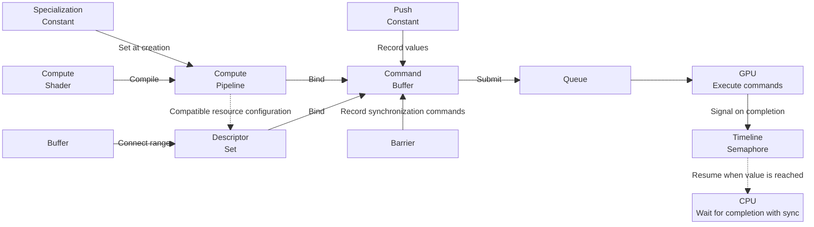

# Vulkan basic concepts

This document explains the basic Vulkan objects, synchronization, and shader parameter passing needed to understand GPU execution in vAi. It describes how Vulkan expresses the data storage, computation preparation, and command execution that a library handles when array operations are called from Python.

**Host** refers to the program running on the CPU, while **Device** refers to the device performing work on the GPU.

vAi uses [EVA](https://github.com/vaistrata/eva), a C++ library that wraps Vulkan. Each section explains a Vulkan concept first, then connects it to EVA code. The inference call sequence in vAi is covered in [Execution pipeline](03-usage/execution-pipeline.md), and tensor data sharing and buffer management are covered in [Tensor](03-usage/tensor.md).



## 1. Preparing data and computation

### 1.1 Buffer

A buffer is a resource for storing and using data represented as contiguous bytes, such as input arrays, weights, and computation results. For example, storing 65 FP32 elements requires a buffer of at least 260 bytes, the size of the data.

To use a buffer, memory must be allocated to hold its data and bound to the buffer. EVA's `Device::createBuffer()` combines these steps and provides an `eva::Buffer`.

A buffer itself has no ML tensor Shape or Dtype. The tensor and shader determine which data type and dimensions to use when interpreting the same 260 bytes. In vAi, `Tensor` manages the Shape and Offset, while the internal `TensorData` manages the Dtype and storage.

#### Buffer usage and memory properties

A buffer's **usage** determines which kinds of operations are allowed on it. In the following table, a **Shader** is a program executed by the GPU.

| Usage | Meaning |
|---|---|
| `STORAGE_BUFFER` | Use as a storage buffer for a shader to read or write data such as arrays |
| `TRANSFER_SRC` | Use as the source of a buffer copy |
| `TRANSFER_DST` | Use as the destination of a buffer copy |

For a buffer that receives copied input and is then read by a shader, combine usages as `TRANSFER_DST | STORAGE_BUFFER`.

**Memory properties** describe the access characteristics of the storage bound to a buffer. Whether a buffer can be used for copying and whether the CPU can directly access its memory are separate questions.

| Memory property | Meaning |
|---|---|
| `HOST_VISIBLE` | Can be mapped into the CPU address space for access |
| `DEVICE_LOCAL` | Memory suited to access by the device |
| `HOST_COHERENT` | Does not require explicit flush and invalidate calls for Host access cache management |
| `HOST_CACHED` | Uses the CPU cache for Host access |

`HOST_VISIBLE` and `DEVICE_LOCAL` can coexist. `HOST_COHERENT` is a cache management property; it does not guarantee completion of GPU work. [Memory property definitions](https://docs.vulkan.org/refpages/latest/refpages/source/VkMemoryPropertyFlagBits.html)

#### Reading and writing data on the CPU

Writing data to `HOST_VISIBLE` memory from the CPU consists of mapping, copying, and unmapping.

- **map**: Map memory into the CPU address space and obtain a pointer for access. This operation itself does not copy data.
- **memcpy**: Copy the actual bytes into the region referenced by that pointer.
- **unmap**: Remove the mapping to the CPU address space. This neither erases the data nor frees the memory allocation. The pointer obtained by mapping can no longer be used.

For memory without `HOST_COHERENT`, **flush** must be called after CPU writes and before GPU reads to make the Host writes available. Conversely, before reading GPU-written results on the CPU, **invalidate** must be called to update the Host cache contents. These calls do not wait for GPU completion. `unmap` does not replace flush either. Coordinating access with the GPU is explained in [Synchronization](#3-synchronization). [Mapping and access synchronization](https://docs.vulkan.org/refpages/latest/refpages/source/vkMapMemory.html), [Cache management for non-coherent memory](https://docs.vulkan.org/spec/latest/chapters/memory.html#memory-device-hostaccess)

An intermediate buffer used to copy CPU-written input data into a compute buffer is called a **Staging Buffer**. A buffer that receives a copy of GPU results for reading on the CPU is called a **Readback Buffer**. Staging uses `HOST_VISIBLE` memory with `TRANSFER_SRC` usage, while readback uses `HOST_VISIBLE` memory with `TRANSFER_DST` usage.

#### Buffers in EVA

The following example writes CPU data into a new Staging Buffer. `device` is an initialized `eva::Device`, `values` is the array to copy, and `bytes` is its size in bytes.

```cpp
auto staging = device.createBuffer({
    .size = bytes,
    .usage = eva::BUFFER_USAGE::TRANSFER_SRC,
    .reqMemProps = eva::MEMORY_PROPERTY::HOST_VISIBLE
                | eva::MEMORY_PROPERTY::HOST_COHERENT
});

auto* mapped = staging.map();
std::memcpy(mapped, values.data(), bytes);
staging.unmap();
```

This code writes data into the Staging Buffer. Copying it into a compute buffer requires a separate copy command. No explicit flush is needed here because `HOST_COHERENT` memory was requested.

`buffer(offset, size)` creates an `eva::BufferRange` that combines a buffer with a byte range. vAi's `Tensor::buffer()` also passes the buffer and `byteOffset()` in this form. For the valid data size of a tensor and storage sharing rules, see [Tensor](03-usage/tensor.md).

### 1.2 Descriptor Set

Even when buffers contain data, the shader cannot tell which buffer is the input and which is the output. A **Descriptor** holds resource binding information for a shader, and a **Descriptor Set** is an object that groups this information.

The shader uses a **Set number** to specify the location of a resource group and a **Binding number** within that set to specify an individual binding location. For example, vAi's Activation shader finds the output at Binding 0 and the input at Binding 1 of Set 0.

```text
Shader Set 0
  Binding 0 -> Specified range of the output buffer
  Binding 1 -> Specified range of the input buffer
```

A buffer descriptor contains a **handle** identifying the buffer, an **offset** giving the byte position from the start of the buffer, and a **range** giving the number of bytes to use. The shader reads and writes data relative to this starting position. Updating a descriptor writes binding information; it does not copy the numbers in the buffer. [Buffer descriptor fields](https://docs.vulkan.org/refpages/latest/refpages/source/VkDescriptorBufferInfo.html)

Preparing descriptors involves defining the structure of the buffer bindings, then filling in the actual binding information.

| Concept | Role |
|---|---|
| Descriptor Set Layout | Define which kind of resource is bound at each Binding |
| Descriptor Pool | Manage space for allocating Descriptor Sets |
| Descriptor Set | Hold the actual binding information allocated according to a layout |
| Descriptor Write | Write or update the buffers and ranges used by a set |

If only the numbers in the same range of the same buffer have changed, the descriptor does not need to be rewritten. To use a different buffer or range, change the binding information.

EVA expresses these roles through `eva::DescriptorSetLayout`, `eva::DescriptorPool`, and `eva::DescriptorSet`. vAi's Activation allocates a set matching `pipe.descSetLayout(0)` and connects the output and input ranges with `descSet.write({outBuf, inBuf})`.

A Descriptor Set must match the resource configuration required by the pipeline. For execution, the pipeline and set are each bound in the Command Buffer. Binding is covered in [Command Buffer](#21-command-buffer), and restrictions on updating sets referenced by commands already recorded or submitted are covered in [Reuse and updates](#52-reuse-and-updates).

### 1.3 Compute Pipeline

A **Compute Shader** is a program that performs operations such as array computations on the GPU. GPU compute code is also called a **kernel**. For example, an elementwise activation function can be written as a shader that reads each input `x[i]` and computes `y[i] = max(x[i], 0)`.

A **Compute Pipeline** is an object that combines the shader to execute with its settings. vAi compiles shaders written in GLSL into an intermediate representation called **SPIR-V**, then prepares pipelines from this code and the settings.

**Specialization Constants** specify shader constant values when a pipeline is created. Even with the same shader, different pipelines can be used depending on settings such as the input data type. When values are passed is explained in [Shader parameters](#4-shader-parameters).

The actual input and output buffers are connected through Descriptor Sets. If only the data in the buffers changes, the pipeline can be reused. vAi's [PipelinePool](../../vai/engine/pipeline-pool.h) reuses pipelines requested with the same shader and settings.

#### Invocations and workgroups

Elementwise operations apply the same shader code to multiple elements. An **Invocation** is one individual execution of a shader. A shader can be written so that each invocation processes one element at its own index.

A **Workgroup** is a group of invocations. Its size is set by the shader's `local_size_x/y/z`. For example, if `local_size_x = 64` and the Y and Z sizes are 1, each group contains 64 invocations. The command that executes a specified number of groups is dispatch, covered in the next section. [Compute shader execution model](https://docs.vulkan.org/spec/latest/chapters/shaders.html#shaders-compute)

## 2. Command recording and submission

### 2.1 Command Buffer

A **Command Buffer** is an object that records commands for the GPU to execute. After preparing the buffers and pipeline needed for an operation, commands are recorded to specify which pipeline and Descriptor Sets to use and how many workgroups to execute. Buffer copy commands can also be recorded.

A **Dispatch** is a command that executes a compute shader with a specified number of workgroups. The arguments of `dispatch(2, 1, 1)` are the group counts in the X, Y, and Z directions. This call does not directly specify the number of invocations or array elements. [Dispatch group counts](https://docs.vulkan.org/refpages/latest/refpages/source/vkCmdDispatch.html)

To process 65 elements with a group size of 64, the required group count is `ceil(65 / 64) = 2`.

```text
1 dispatch: 2 groups, 128 invocations in total
  Group 0: global indices  0~63  -> Process 64 elements
  Group 1: global indices 64~127 -> Process only index 64
```

Indices 65~127 do not refer to valid elements, so the shader must check bounds before accessing the buffer. In GLSL, `gl_GlobalInvocationID.x` is the X-axis index across the entire dispatch. The body of an elementwise shader that receives the element count `N` has the following form.

```glsl
uint i = gl_GlobalInvocationID.x;
if (i >= N) return;
// Read the input at valid index i and write the result.
```

Command **recording**, **submission**, and **execution** are separate processes. A `cmd.dispatch(...)` call on the CPU records a command in the Command Buffer. Once recording is finished and the buffer is submitted to a queue, it can execute on the GPU. A return from the submission function does not mean GPU computation has finished.

In EVA, commands are recorded between `begin()` and `end()` using `eva::CommandBuffer`.

| EVA call | What it records |
|---|---|
| `bindPipeline(pipe)` | The pipeline to use for subsequent dispatches |
| `bindDescSets({descSet})` | The Descriptor Sets to bind to the shader's resource locations |
| `setPushConstants(...)` | Small parameter values to pass to the shader |
| `dispatch(x, y, z)` | Execution with the specified workgroup counts |
| `dispatch2(N)` | Execution with the required group count rounded up based on the pipeline's workgroup size |
| `copyBuffer(...)` | A data copy from the source buffer to the destination buffer |
| `barrier(...)` | Synchronization between preceding and following work |

**Binding** a pipeline and set specifies which objects subsequent recorded commands will use. It neither copies data nor waits for preceding operations to finish.

### 2.2 Queue

A **Queue** is the channel through which recorded Command Buffers are submitted to the GPU. In EVA, `Device::queue()` obtains a queue, and `Queue::submit()` submits commands.

Even when work is submitted in order to the same queue, synchronization is needed when a later operation reads results written by an earlier one. Before reading results on the CPU, GPU work must also be checked for completion. [Vulkan queues](https://docs.vulkan.org/guide/latest/queues.html)

## 3. Synchronization

For an operation to read results written to buffer `X` by a preceding operation, the two must be connected so that the results can be read after the writes finish. vAi uses **Barriers** between operations and **Timeline Semaphores** for inference submission and CPU waits for completion.

### 3.1 Barrier

A **Barrier** is a synchronization command recorded in a Command Buffer. It specifies the execution ordering and memory accesses needed between preceding and following work on the same queue. For example, if operation B reads results written to `X` by operation A, the following relationship is recorded.

```text
Dispatch A: write to X
  -> Barrier: Compute write -> Compute read
  -> Dispatch B: read X
```

A barrier uses **Stage** to specify the processing stages to synchronize and **Access** to specify the access types, such as reads or writes. EVA's `SYNC_SCOPE` combines the two.

| EVA synchronization scope | Meaning |
|---|---|
| `COMPUTE_WRITE` | Writes by a compute shader |
| `COMPUTE_READ` | Reads by a compute shader |
| `TRANSFER_WRITE` | Writes to a destination by transfer operations such as buffer copies |

Activation connects output buffer writes to reads by subsequent operations as follows. `/` is EVA's notation for combining the preceding access, target buffer range, and following access.

```cpp
cmdBuff.barrier(
    eva::SYNC_SCOPE::COMPUTE_WRITE / outBuf / eva::SYNC_SCOPE::COMPUTE_READ
);
```

When a shader reads input copied from a Staging Buffer, the connection is `TRANSFER_WRITE -> COMPUTE_READ`. Access specifies the accesses synchronized by this barrier; it does not set read or write permissions on the buffer. [Synchronization examples for compute operations and copies](https://docs.vulkan.org/guide/latest/synchronization_examples.html#_compute_to_compute_dependencies)

Recording or submitting a barrier does not make the CPU wait for GPU completion. Before reading results on the CPU, synchronization must make the results available for Host reads, and completion of the work must be awaited. For memory without `HOST_COHERENT`, invalidate is also required before reading. For data downloads in vAi, see [Tensor](03-usage/tensor.md). For the Vulkan synchronization sequence, see the [CPU readback example](https://docs.vulkan.org/guide/latest/synchronization_examples.html#_cpu_read_back_of_data_written_by_a_compute_shader).

### 3.2 Timeline Semaphore

A **Semaphore** is a synchronization object that connects signals and waits between submissions. A submission that produces data can send a **signal**, while a consuming submission can be configured to **wait** for that signal. This connection synchronizes work ordering and the availability of written results.

A **Timeline Semaphore** uses increasing integer values. For example, one submission can signal value 1 when its work finishes, and the next can be set to wait for value 1. The wait ends when the value reaches or exceeds the requested value. The CPU can also wait for a specific value to be reached. [Timeline semaphores](https://docs.vulkan.org/samples/latest/samples/extensions/timeline_semaphore/README.html)

When submitting inference, vAi specifies a completion value as follows.

```cpp
device_.queue() << cmdBuffer_ / timeline_(++submitCount_);
```

`submitCount_` increases with each submission. `/` combines the Command Buffer with signal information, and `<<` is EVA's notation for submitting to a queue. When the commands in this submission finish, the timeline value reaches the specified value.

`NeuralNet::sync()` makes the CPU wait until the value of the last submission is reached. The full flow of inference submission, waiting for completion, and command reuse is explained in [Execution pipeline](03-usage/execution-pipeline.md).

## 4. Shader parameters

### 4.1 Push Constant

An element count `N` or a small scalar value used in computation can be passed within commands without creating a separate buffer. **Push Constants** specify values this way during command recording.

In EVA, values are recorded with `setPushConstants()` after binding the pipeline.

```cpp
uint32_t N = 65;
cmdBuff.setPushConstants(0, sizeof(N), &N);
```

This call records the bytes of `N` in the command starting at offset 0. Changing only the CPU variable `N` afterward does not change the recorded value. Resubmitting the same Command Buffer uses the value from the time of recording, so passing a different value requires re-recording the Command Buffer, including the Push Constant command. The pipeline can be reused when only the value changes. [Push constants](https://docs.vulkan.org/guide/latest/push_constants.html)

### 4.2 Specialization Constant

**Specialization Constants** specify shader constant values at pipeline creation. For example, they can select whether the same shader uses one buffer for both input and output, or which data type it uses to interpret the data.

Because the values are determined at pipeline creation, the driver can use them for optimizations such as removing unused branches. To change a value, use a pipeline created with a different value. There is no need to rewrite the entire shader source. [Specialization constant usage and optimization](https://docs.vulkan.org/samples/latest/samples/performance/specialization_constants/README.html)

In EVA, `eva::constant_id<ID>(value)` associates a value with an ID declared in the shader. Activation requests its pipeline as follows.

```cpp
pipe = pipelinePool().request("activation", {
    eva::constant_id<0>(config_.inPlace ? 1u : 0u),
    eva::constant_id<SPEC_ID_TYPE_O>(oDtype),
    eva::constant_id<SPEC_ID_TYPE_I>(iDtype),
    eva::constant_id<SPEC_ID_EPILOGUE>((uint32_t) config_.epilogue)
});
```

These settings determine whether input and output share a buffer, the input and output Dtypes, and post-processing operations such as activation functions. `N`, which specifies the execution range, is a Push Constant, while these settings are Specialization Constants set at pipeline creation. If a pipeline with the same settings already exists, `PipelinePool` reuses it.

| Aspect | Push Constant | Specialization Constant |
|---|---|---|
| When the value is set | During Command Buffer recording | At pipeline creation |
| Changing the value | Re-record the corresponding command | Use a pipeline created with a different value |
| Activation example | Number of elements `N` to process | In-place setting, Dtype, post-processing operation |

## 5. Connecting the concepts through Activation

### 5.1 Recording commands with the prepared objects

vAi's [Activation](../../vai/nodes/activation.h) requests a pipeline in `prepare()` and allocates a Descriptor Set matching its layout. In `run()`, it connects the actual buffer ranges to the set, then records commands. The following code is from `run()`.

```cpp
auto outBuf = (*this)["out0"].buffer();
auto inBuf  = config_.inPlace ? eva::Buffer() : (*this)["in0"].buffer();

descSet.write({ outBuf, inBuf });

uint32_t N = (*this)["out0"].numElements();
struct {
    uint32_t N;
} constants = { N };

cmdBuff
    .bindPipeline(pipe)
    .bindDescSets({descSet})
    .setPushConstants(0, sizeof(constants), &constants)
    .dispatch2(N)
    .barrier(eva::SYNC_SCOPE::COMPUTE_WRITE / outBuf / eva::SYNC_SCOPE::COMPUTE_READ);
```

`descSet.write()` updates binding information on the Host. The subsequent calls from `bindPipeline()` through `barrier()` record commands in the Command Buffer. The dispatch uses the selected shader, buffers, and element count, and the final barrier connects output writes to subsequent compute reads. Actual GPU execution is requested later, when `NeuralNet` submits this Command Buffer to the queue.

Input transfers using a Staging Buffer take place before this operation. For the command sequence that connects input copies to computation, see [Execution pipeline](03-usage/execution-pipeline.md).

The [Activation shader](../../vai/shaders/activation.comp) has a workgroup size of 256. `dispatch2(N)` calculates the group count based on this size, and the shader's `if (i >= N) return;` terminates out-of-range invocations.

When `inPlace` is enabled, no separate input buffer is connected. The shader reads values from the output buffer and writes results back to the same locations.

### 5.2 Reuse and updates

When repeating the same operation, what needs updating depends on what has changed. The following table assumes the same shader buffer configuration.

| What changes | What to update | What can be reused |
|---|---|---|
| Only the numbers in the same range of the same buffer | Buffer data, required transfers, and access synchronization | Descriptor Sets, pipelines, and Command Buffers whose other recording conditions are unchanged |
| The bound buffer or its offset/range | Descriptor Write or selection of another set, and corresponding command re-recording | Pipeline |
| Push Constant value | Re-record the new value and required dispatch size in the commands | Descriptor Sets and pipeline |
| Specialization Constant value | Prepare a pipeline with that value and re-record binding commands | Buffers and Descriptor Sets |

Buffers or Descriptor Sets in use by the GPU must not be modified, and Command Buffers that are executing must not be re-recorded. Wait for the previous work to finish first.

When changing descriptor binding information, also re-record the Command Buffers that use that set. If only the set is updated and the existing commands are resubmitted unchanged, those commands may have been invalidated. [Descriptor update rules](https://docs.vulkan.org/refpages/latest/refpages/source/vkUpdateDescriptorSets.html)

For the conditions under which vAi detects input changes, waits for previous work, and re-records commands, see the repeated inference and command reuse section in [Execution pipeline](03-usage/execution-pipeline.md).
