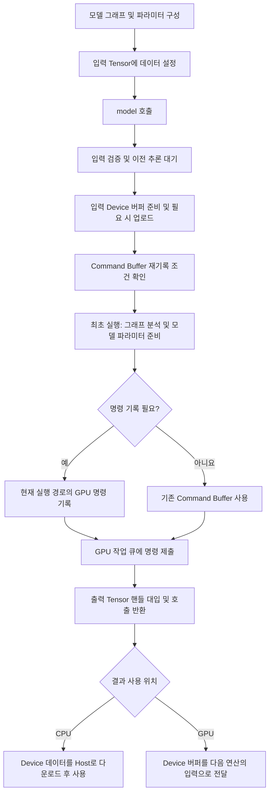

# 실행 파이프라인

`NeuralNet`은 연결된 그래프에 입력 Tensor를 전달하고, GPU에서 추론 연산을 수행한 후 출력 Tensor를 제공합니다. 런타임은 이 과정에서 데이터 전송, 연산 순서 결정, GPU 명령 기록 및 실행을 관리합니다.

이 문서는 **입력 설정부터 추론 결과를 사용하는 시점까지의 실행 흐름**을 설명합니다. 그래프 구성과 Slot 연결 규칙은 [NeuralNet](neural-net.md)을, 데이터 저장 구조와 메모리 소유권은 [Tensor](tensor.md)를 참조하십시오.

## 1. 추론 실행 흐름

단일 추론은 `model(inputs, outputs)`를 한 번 호출하는 것을 뜻합니다. 호출 전에 모델의 그래프와 파라미터를 구성하고 입력 데이터를 설정합니다. 호출이 시작되면 런타임은 입력과 실행 리소스를 준비하고 GPU에 연산 명령을 제출합니다.

```text
model(inputs, outputs)
  ① 입력 검증과 대입                 InputNode::in0
  ② 이전 추론 대기 (기본값)          sync()
  ③ 입력 준비 및 업로드              prepareInputs()
  ④ Command Buffer 재기록 판정
  ⑤ 그래프 분석 (최초 1회)           sortNodes()
  ⑥ 모델 파라미터 준비 (최초 1회)    uploadModelParams()
  ⑦ Command Buffer 기록 (필요 시)    recordCommands()
  ⑧ GPU 작업 큐에 제출 (비동기)
  ⑨ 출력 Tensor 핸들 대입
```

[단일 추론의 단계별 동작](#3-단일-추론의-단계별-동작)에서는 ①~⑨ 순서에 따라 각 단계의 함수 호출과 데이터 전달 과정을 설명합니다.

다음 그림은 호출 전 모델 구성부터 호출 후 결과 사용까지 포함한 전체 흐름입니다.



**최초 추론에서는 그래프 분석, 모델 파라미터 준비 및 GPU 명령 기록을 수행합니다.** 이후 같은 기록 조건으로 추론을 반복하면 기존 명령을 재사용합니다. GPU 연산은 명령을 제출할 때마다 다시 수행됩니다.

또한 **`model(...)` 호출의 반환은 이번 GPU 연산의 완료를 의미하지 않습니다.** 출력 Tensor는 결과 데이터에 접근할 수 있는 핸들입니다. CPU에서 값을 읽으려면 Device 데이터를 Host 메모리로 가져와야 합니다.

## 2. 실행을 구성하는 주요 개념

### 2.1 Host 메모리와 Device 버퍼

Host 메모리는 CPU가 사용하는 데이터 저장소이고, Device 버퍼는 GPU 연산에 사용하는 저장소입니다. CPU에서 설정한 입력과 가중치를 GPU에서 사용하려면 Host 데이터를 Device 버퍼로 전송해야 합니다.

반대로 GPU 결과를 CPU에서 사용하려면 Device 데이터를 Host 메모리로 가져옵니다. 이미 Device 버퍼에 있는 결과를 다음 GPU 연산에 전달하는 경우에는 Host 메모리를 거칠 필요가 없습니다.

`Tensor`는 이러한 저장소를 참조하는 데이터 핸들입니다. Node 사이에서 Tensor를 전달하거나 사용자 출력 Tensor에 대입할 때는 데이터 자체를 복사하지 않고 내부 `TensorData`를 공유합니다.

### 2.2 Vulkan과 Command Buffer

Vulkan은 GPU의 메모리와 실행 명령을 제어하는 API입니다. 런타임은 Vulkan 기반 GPU 실행 계층인 `eva`를 통해 데이터 전송과 연산 명령을 처리합니다.

Command Buffer는 **GPU가 수행할 명령을 기록하는 객체**입니다. CPU는 데이터 복사와 연산 명령을 Command Buffer에 기록하고, 기록을 마친 뒤 GPU 작업 큐에 제출합니다. GPU는 제출된 명령을 실행합니다.

```text
CPU: 입력과 리소스 준비 → GPU 명령 기록 → 작업 큐에 제출 → 호출 반환
                                             │
GPU:                                         └→ 명령 실행 → 완료
```

따라서 명령의 **기록, 제출, 실행 및 완료 대기**는 서로 다른 과정입니다. `Node::run(cmdBuffer)`는 명령을 기록하며, 호출 시점에 GPU 계산을 완료하는 함수가 아닙니다.

입력 데이터 전송용 Command Buffer와 연산용 Command Buffer도 별도로 관리합니다. 입력값이 바뀌어 전송 명령을 새로 기록하더라도 연산 명령은 재사용할 수 있습니다. 이하에서 재기록과 재사용은 별도 언급이 없으면 연산용 Command Buffer를 기준으로 설명합니다.

### 2.3 모델 파라미터와 실행 리소스

모델 파라미터는 가중치처럼 추론 중 계속 사용하는 데이터입니다. 일반적으로 모델 구성 과정에서 Host 메모리로 읽고 Node의 `persistent` Slot에 저장합니다. 런타임은 최초 추론에서 해당 Tensor에 Device 버퍼를 준비하고, Host 데이터가 있으면 GPU로 전송합니다.

중간 연산 결과와 임시 Tensor는 명령 기록 과정에서 Shape와 필요한 버퍼가 결정됩니다. `BufferPool`은 반환된 Device 버퍼를 보관하고, 이후 요청에 맞는 버퍼가 있으면 재사용합니다.

| 구성 요소 | 실행 흐름에서의 역할 |
|---|---|
| `NeuralNet` | 입력·출력 경계 관리, 실행 준비, 명령 기록·제출 및 완료 대기 |
| `GraphController` | 활성 입력과 Gate 상태에 따라 이번 기록에 포함할 Node 선택 |
| `Node` | `prepare()`로 연산에 필요한 Tensor 준비, `run(cmdBuffer)`로 GPU 명령 기록 |
| `Tensor` | 입력, 파라미터, 중간 결과 및 최종 출력의 데이터 저장소 참조 |
| `BufferPool` | Device 버퍼 확보 및 반환된 버퍼 재사용 |
| Command Buffer | GPU에 제출할 데이터 전송 또는 연산 명령 보관 |

## 3. 단일 추론의 단계별 동작

추론 호출은 `NeuralNet::operator()`를 통해 수행합니다.

```cpp
using TensorDict = std::map<std::string, Tensor>;
using TensorRefDict = std::map<std::string, Tensor*>;

void operator()(TensorDict inputs, TensorRefDict outputs, bool syncPrev = true);
```

`inputs`에는 모델 입력 이름과 Tensor를, `outputs`에는 모델 출력 이름과 결과를 받을 Tensor의 포인터를 전달합니다. 반환형은 `void`이며, 결과 핸들은 출력 포인터를 통해 제공합니다.

아래의 3.1~3.9는 앞서 제시한 실행 순서 ①~⑨에 대응합니다.

### 3.1 입력 검증과 대입

먼저 입력 맵이 비어 있지 않은지, 각 입력 이름이 모델에 등록된 `InputNode` 이름과 일치하는지 확인합니다. 입력 Tensor는 해당 `InputNode`의 `in0` Slot에 대입합니다.

이 과정에서는 `TensorData`의 공유 참조를 전달하며, Host 데이터나 Device 버퍼의 내용을 복사하지 않습니다.

**활성 입력은 이번 호출에 실제로 전달한 입력 이름의 집합입니다.** 등록된 모든 입력을 매번 전달할 필요는 없지만, 생략한 입력의 이전 값이 자동으로 재사용되는 것은 아닙니다. 현재 입력으로 실행할 수 있는 경로는 명령 기록 시 `GraphController`가 판단합니다.

활성 입력 집합이 이전 호출과 다르면 Command Buffer를 재기록하도록 표시합니다.

### 3.2 이전 추론 대기

이전 호출에서 제출한 GPU 연산이 진행 중일 수 있으므로, 기본값인 `syncPrev = true`에서는 `NeuralNet::sync()`로 이전 작업의 완료를 기다립니다.

`sync()`는 Timeline Semaphore와 제출 번호를 사용합니다. Timeline Semaphore는 GPU 작업의 완료 지점을 번호로 추적하는 동기화 객체입니다. 이미 동기화한 제출에 대해서는 다시 기다리지 않습니다.

`syncPrev = false`는 이 단계의 대기를 생략합니다. 다만 명령 재기록 전에는 `recordCommands()`가 자체적으로 `sync()`를 호출하고, 입력 업로드용 Command Buffer를 순환 재사용할 때도 대기가 발생할 수 있습니다.

따라서 이 옵션은 호출 전체에서 CPU 대기가 발생하지 않는다는 의미가 아닙니다.

### 3.3 입력 준비 및 업로드

`prepareInputs()`는 활성 입력의 `in0` Slot을 확인합니다. 새로운 Host 데이터가 있고 아직 Device에 업로드하지 않은 입력은 GPU에서 사용할 수 있도록 전송합니다.

```text
setFloats() / setData()로 설정한 Host 데이터
  → Staging Buffer에 복사
  → 입력 Device 버퍼로 전송
  → GPU 연산에서 사용
```

Staging Buffer는 CPU가 기록한 데이터를 Device 버퍼로 전달하기 위한 중간 버퍼입니다. 입력 업로드는 다음 순서로 수행됩니다.

1. 입력에 Device 버퍼가 없으면 `BufferPool::requestBuffer()`로 `DEVICE_LOCAL` 버퍼를 확보합니다.
2. CPU에서 접근할 수 있는 `HOST_VISIBLE | HOST_COHERENT` 속성의 Staging Buffer를 확보하고 Host 데이터를 복사합니다.
3. 입력 업로드용 Command Buffer에 전송과 연산의 접근 순서를 맞추는 배리어 및 `copyBuffer()` 명령을 기록합니다.
4. 업로드 명령을 제출하고 `markHostUploaded()`로 중복 업로드를 방지합니다.

업로드에 사용한 Staging Buffer는 GPU 전송이 끝날 때까지 유지합니다.

입력에 이미 Device 버퍼가 있고 새로운 Host 데이터의 업로드가 필요하지 않으면 복사를 생략합니다. 다른 추론의 출력을 입력으로 사용하는 경우도 여기에 해당합니다. 이때는 해당 데이터를 생성하는 연산과 사용하는 연산의 실행 순서 및 공유 버퍼 수명을 관리해야 합니다.

### 3.4 Command Buffer 재기록 판정

런타임은 현재 입력·출력 상태를 이전 기록의 바인딩 정보와 비교합니다. 바인딩 정보는 GPU 명령이 참조하는 버퍼와 데이터 범위 등을 뜻합니다.

입력 Shape, Device 버퍼 또는 Offset이 달라지면 기존 명령이 참조하는 데이터 구조나 위치도 바뀔 수 있으므로 재기록이 필요합니다. 요청한 출력 Tensor의 저장소가 달라진 경우에도 재기록하도록 표시합니다.

**입력 데이터 값 자체는 비교하지 않습니다.** 같은 Tensor의 Host 값만 갱신하고 다른 기록 조건이 유지되면, 변경된 데이터를 업로드한 뒤 기존 연산 명령을 재사용할 수 있습니다. 전체 재기록 조건은 [반복 추론과 명령 재사용](#4-반복-추론과-명령-재사용)을 참조하십시오.

### 3.5 그래프 분석

최초 실행에서 `sortNodes()`는 등록된 모든 입력 경계로부터 도달 가능한 Node를 탐색하고, 데이터를 생성하는 Node가 해당 데이터를 사용하는 Node보다 앞서도록 위상 정렬합니다. Kahn 알고리즘을 사용하며, 사이클이 있으면 예외를 발생시킵니다.

이어서 `GraphController::build()`가 입력 의존성과 Gate 분기의 도달 관계를 계산합니다. Gate는 조건에 따라 실행할 가지를 선택하는 Node입니다. 이 단계에서는 정상적인 Gate 분기 합류가 아닌 입력 Slot의 다중 생산자 연결도 검사합니다.

정렬 결과는 `sortedNodes_`에 저장됩니다. 이후 명령 기록에서는 이 순서를 따르되, 현재 활성 입력과 Gate 상태에 맞는 Node만 포함합니다.

**그래프 분석과 Command Buffer 재기록은 별도의 작업입니다.** 입력 Shape나 값이 바뀌어도 그래프를 자동으로 다시 정렬하지 않습니다. Node 생성과 Slot 연결은 첫 실행 전에 확정해야 합니다. 자세한 내용은 [그래프 정렬](neural-net.md#6-그래프-정렬graph-sorting)을 참조하십시오.

### 3.6 모델 파라미터 준비

`uploadModelParams()`는 정렬된 모든 Node의 `persistent` Slot을 확인하고, 추론에서 계속 사용할 데이터의 Device 버퍼를 준비합니다.

이미 Device 버퍼가 연결된 Tensor는 건너뜁니다. 그렇지 않은 Tensor에는 Device 버퍼를 확보하고, Host 데이터가 있으면 `TensorUploader`를 통해 전송합니다. 큰 가중치는 설정된 청크 크기(기본 256 MiB)로 나누어 처리합니다.

업로드 명령은 `flush()`에서 제출하며 완료될 때까지 기다립니다. 전송을 준비한 Host 가중치는 `clearHostData(true)`로 제거하여 중복 보관을 줄입니다.

이 단계는 현재 Gate에서 선택하지 않은 가지의 `persistent` Slot도 포함합니다. Host 데이터가 없는 Tensor도 Device 버퍼를 확보할 수 있으므로, 모든 Slot에서 실제 데이터 전송이 발생하는 것은 아닙니다.

일반적인 Command Buffer 재기록에서는 모델 파라미터 준비를 다시 수행하지 않습니다.

### 3.7 Command Buffer 기록

최초 실행이거나 재기록이 필요한 경우 `recordCommands()`를 호출합니다. 먼저 `sync()`로 이전 연산 완료를 확인하고, `GraphController::beginRecord(activeInputs_)`로 현재 활성 입력과 Gate 상태를 기록에 반영합니다.

이후 정렬된 Node를 순회하며 다음 작업을 수행합니다.

1. `GraphController::hasNeedsFed()`로 현재 실행 경로에 필요한 Node인지 판단합니다.
2. 실행할 Node의 `prepare()`를 호출하여 입력을 검증하고 출력·임시 Tensor의 Shape를 준비합니다.
3. `output`과 유효한 `temporary` Slot에 필요한 Device 버퍼를 확보합니다.
4. 출력 Tensor 핸들을 연결된 후속 Node의 `input` Slot에 전달합니다.
5. `Node::run(cmdBuffer)`를 호출하여 GPU 연산 명령을 기록합니다.

버퍼가 아직 연결되지 않은 출력 Tensor는 사용자가 제공한 출력 버퍼를 직접 공유할 수 있습니다. 이때 사용자 버퍼의 Offset은 0이어야 하고, Dtype이 일치하며, 버퍼 크기가 필요한 크기 이상이어야 합니다. 그 외에 버퍼 확보가 필요한 경우에는 `BufferPool`을 사용합니다. 풀에 적합한 버퍼가 있으면 재사용하고, 없을 때 새로운 GPU 버퍼를 생성합니다.

```text
InputNode의 in0
  → InputNode::prepare()에서 out0에 입력 Tensor 공유
  → 연결된 Node의 input Slot에 Tensor 전달
  → Node::prepare()로 출력 준비 및 run()으로 명령 기록
  → 후속 Node의 input Slot에 출력 Tensor 전달
  → OutputNode::run()에서 cachedOutput_에 결과 핸들 보관
```

이 흐름은 **명령을 기록하면서 Tensor 핸들을 연결하는 과정**입니다. 실제 GPU 계산은 기록된 명령을 제출한 뒤 수행됩니다.

Node의 명령을 기록한 후에는 `persistent`를 제외한 Slot의 Tensor 핸들을 초기화합니다. 실행에서 제외된 Node도 같은 방식으로 정리합니다. 마지막 참조가 해제된 중간 Tensor의 버퍼는 풀로 반환되어, 사용 시점이 겹치지 않는 연산에서 재사용할 수 있습니다.

최종 출력은 `OutputNode::cachedOutput_`에 별도 참조로 유지합니다. 버퍼 반환과 수명에 대한 자세한 내용은 [Tensor 메모리 생명주기](tensor.md#8-대표적인-tensor-흐름-및-생명주기)를 참조하십시오.

### 3.8 GPU 작업 큐에 제출

기록된 Command Buffer를 GPU 작업 큐에 제출합니다. 제출할 때마다 `submitCount_`를 증가시키고 Timeline Semaphore에 해당 번호를 연결하여 완료 지점을 추적합니다.

재기록 조건이 바뀌지 않았다면 기존 Command Buffer를 다시 제출합니다. 이 경우 `Node::prepare()`와 `Node::run()`을 다시 호출하지 않지만, GPU는 기록된 연산을 다시 실행합니다.

제출 후에는 이번 GPU 작업의 완료를 기다리지 않고 출력 핸들 대입 단계로 진행합니다. 다만 최초 실행 준비, 이전 추론 대기, 명령 재기록 및 내부 업로드 동기화로 인해 `model(...)` 호출 자체에는 대기 시간이 발생할 수 있습니다.

### 3.9 출력 Tensor 핸들 대입과 결과 사용

도달한 출력 경계의 `cachedOutput_`에 마지막 GPU 제출 정보를 기록하고, 호출자가 지정한 `Tensor*`에 해당 Tensor 핸들을 대입합니다. 현재 기록에서 도달하지 않은 출력 경계에는 빈 `Tensor`를 대입합니다.

이후 결과를 사용할 위치에 따라 처리 방식이 달라집니다.

| 사용 위치 | 처리 방식 |
|---|---|
| CPU | `downloadToHost()` 또는 `getData<T>()`로 Device 데이터를 Host 메모리에 복사한 후 사용 |
| GPU | 기존 Device 버퍼를 다음 연산의 입력으로 전달하고 실행 순서 및 버퍼 수명 관리 |

CPU에서 결과를 읽을 때는 필요한 경우 별도의 Readback Buffer로 복사 명령을 제출하고, 복사가 완료될 때까지 기다립니다. `NeuralNet::sync()`는 제출한 GPU 작업의 완료를 기다리는 함수이며, 결과 데이터를 Host 메모리로 복사하지는 않습니다.

다음 추론에서 같은 출력 버퍼를 재사용하면 기존 결과가 덮어써질 수 있습니다. **Tensor 핸들 복사는 결과 데이터의 독립적인 사본을 생성하지 않습니다.** 이전 결과를 유지하려면 저장소가 갱신되기 전에 Host로 읽고 별도 메모리에 복사해야 합니다.

데이터 다운로드와 포인터의 수명은 [출력 데이터 읽기](tensor.md#7-출력-데이터-읽기)를 참조하십시오.

## 4. 반복 추론과 명령 재사용

반복 추론은 동일한 모델을 여러 번 호출하는 경우를 뜻합니다. 런타임은 최초 실행에서 준비한 그래프, 파라미터 및 명령을 재사용하여 매 호출의 준비 비용을 줄입니다.

### 4.1 최초 추론과 반복 추론의 차이

다음 표는 활성 입력, Shape, Device 버퍼, Offset, Gate 실행 경로, 출력 저장소 및 기타 기록 조건이 유지되는 경우를 기준으로 합니다.

| 작업 | 최초 추론 | 같은 조건의 반복 추론 |
|---|---|---|
| 입력 검증과 Slot 대입 | 수행 | 수행 |
| 이전 추론 대기 | 필요 시 | 기본값에서 수행 |
| 새로운 Host 입력 업로드 | 필요 시 | 필요 시 |
| 재기록 조건 검사 | 수행 | 수행 |
| 그래프 정렬 및 분석 | 수행 | 생략 |
| 모델 파라미터 준비 | 수행 | 생략 |
| 연산 명령 기록 | 수행 | 생략 |
| 연산 명령 제출 및 GPU 실행 | 수행 | 수행 |
| 출력 핸들 대입 | 수행 | 수행 |

**명령 재사용은 GPU 연산을 생략하는 것이 아니라 CPU의 명령 기록 작업을 줄이는 방식입니다.** 입력 Host 값이 바뀌면 입력 업로드용 Command Buffer의 별도 기록과 제출은 발생할 수 있습니다.

### 4.2 Command Buffer 재기록 조건

다음 조건에서는 연산 명령을 다시 기록하도록 표시합니다.

| 변경 조건 | 판단 기준 |
|---|---|
| 활성 입력 집합 변경 | 이전 `activeInputs_`와 비교 |
| 입력 Shape 변경 | `InputNode::recordedShape_`와 비교 |
| 입력 Device 버퍼 변경 | `recordedInputBuffer_`와 비교 |
| 입력 시작 Offset 변경 | `recordedInputBaseOffset_`와 비교 |
| 요청 출력 저장소 변경 | 출력 Tensor의 `data_`와 `cachedOutput_`의 `data_` 비교 |
| 프로파일 태그 변경 | `setProfileTag()` 또는 `clearProfileTags()`에서 기록 무효화 |
| 명시적 무효화 | `invalidateCommandBuffer()` 호출 |
| 모델 파라미터 준비 수행 | 준비 후 재기록 설정 |

Gate의 분기 선택은 명령 기록 시 `GraphController::beginRecord()`에서 읽습니다. `operator()`는 Gate 상태 변경을 직접 비교하지 않으므로, Gate 구현이 변경 시 기록을 무효화하는지 확인해야 합니다. 무효화하지 않는 구현에서는 상태 변경 후 `invalidateCommandBuffer()`를 호출해야 합니다.

## 5. 반복 추론 사용 예

다음 예는 입력 이름이 `in0`, 출력 이름이 `out0`인 모델을 구성한 상태를 전제로 하며, 출력 Dtype은 Fp32로 가정합니다. 입력과 출력 Tensor를 유지하면서 입력값만 변경합니다.

```cpp
vai::Tensor x({4});
x.setFloats(std::vector<float>{1.f, 2.f, 3.f, 4.f});
vai::Tensor y;

// 최초 실행: 그래프 분석, 파라미터 준비, 명령 기록 및 제출
model({{"in0", x}}, {{"out0", &y}});

// CPU에서 결과를 읽고 별도 메모리에 보관
const float* first = y.getData<float>();
std::vector<float> saved(first, first + y.numElements());

// 기존 Tensor와 Device 버퍼를 유지하면서 Host 입력값 갱신
x.setFloats(std::vector<float>{5.f, 6.f, 7.f, 8.f});

// 다른 기록 조건도 유지되면 기존 연산 명령 재사용
model({{"in0", x}}, {{"out0", &y}});
const float* second = y.getData<float>();
```

`setFloats()`는 Host 데이터를 변경하고 업로드 상태를 초기화하며, 기존 Device 버퍼는 유지합니다. 다음 추론의 `prepareInputs()`에서 변경된 데이터를 전송합니다.

`saved`는 첫 결과의 독립적인 복사본입니다. 반면 `first`와 `second`는 Tensor의 Host 저장소를 참조하는 포인터이므로, 저장소가 갱신되거나 해제된 후에는 기존 값을 유지한다고 가정할 수 없습니다.

입력·출력 이름은 모델이 실제로 등록한 이름과 일치해야 합니다. 모델 구성과 호출 방법은 [NeuralNet의 외부 입력과 출력](neural-net.md#5-외부-입력과-출력)을 참조하십시오.

## 6. 실행 시 주의사항

### 6.1 그래프 구조 변경

첫 실행 이후 Slot 연결이나 Node 구성의 변경을 자동으로 감지하여 그래프를 다시 분석하는 경로는 없습니다. `invalidateCommandBuffer()`도 연산 명령만 무효화하며 그래프 재정렬은 요청하지 않습니다.

따라서 그래프 구조는 최초 추론 전에 확정해야 합니다. 구조 변경이 필요하면 새로운 `NeuralNet` 인스턴스를 구성하는 방식을 권장합니다.

### 6.2 동적 Shape와 버퍼 크기

입력 Shape가 바뀌면 연산 명령을 재기록합니다. 다만 이 동작이 이미 연결된 입력 Device 버퍼의 자동 확장을 보장하지는 않습니다.

Shape를 변경할 때는 새로운 데이터 범위를 기존 버퍼에 저장할 수 있는지 확인해야 합니다.

### 6.3 GPU 실행 순서와 리소스 수명

GPU가 사용하는 공유 데이터를 호출 밖에서 수정하는 경우에는 수정 전에 해당 GPU 작업의 완료를 확인해야 합니다. 같은 `NeuralNet`에 제출한 작업은 `sync()`로 기다릴 수 있습니다.

출력 다운로드의 현재 구현은 Readback 복사 명령에 대해 `submit().wait()`를 수행합니다. 다만 `lastSubmission_`에 저장된 Timeline 값을 함수 내부에서 명시적으로 기다리지는 않습니다. 서로 다른 큐나 외부 GPU 작업과 데이터를 공유하는 경우에는 하위 `eva` 실행 계층의 큐 순서와 동기화 계약을 확인해야 합니다.

출력 Tensor를 사용하는 동안에는 관련 GPU 리소스의 수명도 유지해야 합니다. Tensor에 저장된 마지막 제출 정보는 결과를 생성한 `NeuralNet`의 소유권을 갖지 않습니다. 자세한 내용은 [Tensor의 GPU 리소스 수명 관리](tensor.md#93-gpu-리소스-수명-관리)를 참조하십시오.
