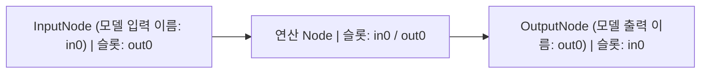

# NeuralNet

## 1. 목적

`NeuralNet`은 여러 `Node`와 `NodeGroup`을 연결한 그래프의 **실행 단위**입니다. 외부 입력·출력 경계를 정의하고, 노드의 실행 순서를 확정하며, 현재 입력과 분기 조건에 맞는 GPU 명령을 제출합니다.

이 문서는 그래프 구성, `NodeSlot`의 구조와 연결 규칙, 그래프 분석과 실행 경로 제어를 설명합니다. Tensor의 저장 구조·Shape · Dtype · Host / Device 전송·메모리 소유권은 [Tensor](tensor.md)를, 첫 실행 비용과 커맨드버퍼 재기록 조건은 [실행 파이프라인](execution-pipeline.md)을 참조하십시오.

## 2. 주요 객체와 책임

| 객체 | 책임 |
|---|---|
| `NeuralNet` | 이름별 입력·출력 경계 관리, 노드 정렬, 활성 입력 선택, 리소스 준비, GPU 명령 기록·제출·동기화 |
| `Node` | 이름별 슬롯 정의·조회, `prepare()`로 연산 준비, `run(cmd)`로 GPU 명령 기록 |
| `NodeSlot` | 슬롯 타입, 소속 노드, 연결된 상대 슬롯 목록 및 현재 `Tensor` 값 보관 |
| `InputNode` | 외부 입력을 그래프의 출력 슬롯으로 전달 |
| `OutputNode` | 도달한 그래프 출력을 별도 핸들로 보관하고 도달 여부 기록 |
| `NodeFlow` / `NodeGroup` | `-`와 `/`로 연결을 기술하며, 그룹은 내부 슬롯을 외부 이름으로 노출 |
| `GraphController` | 활성 입력과 Gate 분기에 따라 명령 기록에 포함할 노드 판정 |

`NodeSlot`은 **그래프 연결 위치**이고, `Tensor`는 그 슬롯에 현재 연결된 **데이터 핸들**입니다. `Node::slot(name)`은 `NodeSlot&`를 반환하며, `Node::operator[](name)`은 슬롯의 `Tensor&`를 반환합니다. Tensor의 내부 공유·복사 방식은 [Tensor: 데이터와 핸들](tensor.md#1-데이터와-핸들)을 참조하십시오.

## 3. NodeSlot의 구조와 공통 규칙

### 3.1 Slot의 구성

`NodeSlot`은 다음 정보로 구성됩니다.

```cpp
class NodeSlot {
public:
    enum Type { input, output, temporary, persistent, none };

private:
    Type type_;                          // 슬롯의 역할
    Node& parent_;                       // 소속 노드
    std::vector<NodeSlot*> connections_; // 연결된 상대 슬롯 (비소유 포인터)
    Tensor value_;                       // 슬롯의 현재 Tensor 핸들
};
```

슬롯은 `Node` 파생 클래스의 생성자에서 `addSlot(name, type)`으로 추가합니다. 동일한 이름의 슬롯을 다시 추가하면 `try_emplace`에 의해 중복 생성되지 않습니다. `slot(name)`과 `operator[](name)`은 해당 이름이 없을 경우 `std::map::at()`의 예외를 발생시킵니다.

```cpp
// Node 파생 클래스의 생성자에서 사용
addSlot("in0", NodeSlot::input);
addSlot("out0", NodeSlot::output);
addSlot("weight", NodeSlot::persistent);
addSlot("workspace", NodeSlot::temporary);
```

슬롯의 종류와 기본 역할은 [노드: 슬롯](node.md#1-슬롯)을 참조하십시오.

### 3.2 Slot 타입의 공통 규칙

- **연결 가능 조합:** `NodeSlot::connect(a, b)`는 `a.type() == output`이고 `b.type() == input`인 경우만 허용합니다.
- **버퍼와 슬롯은 별개:** 슬롯은 Tensor 핸들을 담습니다. `input`과 `output` 연결은 Tensor 데이터 복사가 아닌 핸들 전달입니다.
- **기록 후 정리:** `persistent`를 제외한 슬롯 값은 실행 명령을 기록한 뒤 초기화됩니다. 단, 최종 출력은 `OutputNode::cachedOutput_`에 별도로 보관됩니다.
- **비활성 노드:** 실행에서 제외된 노드의 슬롯도 `persistent`를 제외하고 초기화됩니다.

## 4. 그래프 생성과 연결 DSL

### 4.1 입력·출력 경계

`NeuralNet::input(name)`은 이름별 `InputNode`를, `NeuralNet::output(name)`은 이름별 `OutputNode`를 반환합니다. 내부적으로 `std::map::try_emplace()`를 사용하므로 처음 호출할 때 생성하며 같은 이름을 다시 부르면 기존 경계를 반환합니다. **현재 API는 이름 인자가 필수입니다.**

`InputNode`에는 `in0` (`input`)와 `out0` (`output`) 슬롯이 있습니다. `OutputNode`에는 `in0` (`input`) 슬롯만 있습니다.

여기서 **모델의 입력·출력 이름과 노드 내부의 슬롯 이름은 별개**입니다. `input("in0")`의 `"in0"`은 호스트에서 입력을 지정할 때 사용하는 이름이고, `input("features")`처럼 다른 이름을 지정해도 해당 `InputNode` 내부의 슬롯 이름은 여전히 `in0`과 `out0`입니다. 마찬가지로 `output("out0")`으로 만든 `OutputNode`의 내부 슬롯은 `in0`입니다.



다음은 모델의 입력 이름을 `in0`, 출력 이름을 `out0`으로 지정한 모델입니다. `-` 연산자는 각 노드의 `out0` 슬롯과 다음 노드의 `in0` 슬롯을 연결합니다.

```cpp
#include "neural-net.h"
#include "graph-flow.h"
#include "vai/nodes/activation.h"

struct Model : vai::NeuralNet {
    vai::node::Activation relu;

    explicit Model(const vai::NeuralNetConfig& cfg = {})
        : NeuralNet(cfg)
        , relu({.epilogue = vai::Epilogue::Relu})
    {
        input("in0") - relu - output("out0");
    }
};
```

다른 모델에서는 입력·출력 이름을 용도에 맞게 지정할 수 있습니다. 아래 모델은 `features`를 입력 이름으로, `activated`를 출력 이름으로 사용하며, 노드 내부의 `in0`·`out0` 슬롯은 그대로 사용합니다.

```cpp
struct FeatureModel : vai::NeuralNet {
    vai::node::Activation relu;

    explicit FeatureModel(const vai::NeuralNetConfig& cfg = {})
        : NeuralNet(cfg)
        , relu({.epilogue = vai::Epilogue::Relu})
    {
        input("features") - relu - output("activated");
    }
};

FeatureModel model;
vai::Tensor features({4});
features.setFloats({-1.f, 2.f, -3.f, 4.f});
vai::Tensor activated;

model({{"features", features}}, {{"activated", &activated}});
```

호출할 때는 내부 슬롯 이름이 아니라 `input(name)`과 `output(name)`으로 등록한 이름을 맵의 키로 사용합니다. 첫 번째 `Model`은 `in0`·`out0`, 두 번째 `FeatureModel`은 `features`·`activated`로 지정합니다.

`input()`과 `output()`으로 만든 경계만 호스트에서 이름으로 지정할 수 있습니다. `NodeGroup::defineSlot()`은 그룹 내부 슬롯을 외부에서 연결하도록 노출할 뿐, NeuralNet의 입력·출력 경계를 새로 만들지는 않습니다.

### 4.2 `NodeSlot::connect()`와 해제

연결의 최종 동작은 `NodeSlot::connect(a, b)`입니다.

```cpp
NodeSlot::connect(producer.slot("out0"), consumer.slot("in0"));
NodeSlot::disconnect(producer.slot("out0"), consumer.slot("in0"));
```

`connect()`는 슬롯 타입을 검사하고 양쪽 `connections_`에 상대 `NodeSlot*`를 저장합니다. 동일한 방향의 중복 연결은 추가하지 않습니다. `disconnect()`는 양쪽 목록에서 상대 포인터를 제거합니다. 두 함수 모두 그래프 재분석이나 커맨드버퍼 재기록 플래그를 직접 갱신하지 않습니다.

### 4.3 `-` 및 `/` 연산자

`graph-flow.h`의 `NodeFlow`는 연결할 노드와 기본 슬롯 이름을 임시로 보관합니다. `-`는 왼쪽의 출력 슬롯을 오른쪽의 입력 슬롯에 연결하며, 기본 이름은 `out0`과 `in0`입니다. `/`는 기본 슬롯 대신 지정한 슬롯을 선택합니다.

예를 들어 두 입력을 합치는 `Concat` 노드는 `in0`, `in1` 입력 슬롯과 `out0` 출력 슬롯을 사용합니다. 첫 번째 입력은 기본 슬롯으로 연결하고, 두 번째 입력은 `/`로 `in1`을 선택합니다.

```cpp
#include "neural-net.h"
#include "graph-flow.h"
#include "vai/nodes/concat.h"

struct ConcatModel : vai::NeuralNet {
    vai::node::Concat concat;

    explicit ConcatModel(const vai::NeuralNetConfig& cfg = {})
        : NeuralNet(cfg)
        , concat({.axis = 0, .inputCount = 2})
    {
        input("a") - concat;                  // a.out0 -> concat.in0
        input("b")/"out0" - "in1"/concat;     // b.out0 -> concat.in1
        concat - output("joined");            // concat.out0 -> joined.in0
    }
};

ConcatModel model;
vai::Tensor a({1, 2});
a.setFloats({1.f, 2.f});
vai::Tensor b({1, 2});
b.setFloats({3.f, 4.f});
vai::Tensor joined;

model({{"a", a}, {"b", b}}, {{"joined", &joined}});
// joined의 Shape: [2, 2] (axis = 0으로 연결)
const float* values = joined.getData<float>(); // GPU 결과를 Host로 다운로드
// values[0..3]: 1, 2, 3, 4
```

`input("b")/"out0"`은 왼쪽 노드의 출력 슬롯을, `"in1"/concat`은 오른쪽 노드의 입력 슬롯을 선택합니다. `out0`은 기본 출력 슬롯이므로 두 번째 연결은 `input("b") - "in1"/concat;`으로도 쓸 수 있습니다. 두 입력은 같은 dtype과 차원 수를 가져야 하며, 연결 축(`axis = 0`)을 제외한 차원 크기가 같아야 합니다.

`NodeGroup`은 `defineSlot("groupName", member.slot("slotName"))`으로 멤버 슬롯의 **포인터**를 공개합니다. 그룹은 별도의 데이터를 보관하거나 새 슬롯을 복제하지 않습니다. 또한 `std::optional<Node 파생형>` 및 `std::optional<NodeGroup 파생형>`이 비어 있을 때 해당 연결 지점을 건너뛰는 DSL을 제공합니다. 사용 시에는 [노드그룹](node-group.md)을 참조하십시오.

### 4.4 포인터와 객체 수명

`connections_`, `sortedNodes_`, `NodeGroup`에 노출한 슬롯은 소유권이 없는 포인터를 사용합니다. 노드나 슬롯의 주소가 바뀌거나 해당 객체가 소멸하면 연결 정보가 무효화될 수 있습니다. 노드 멤버의 주소를 안정적으로 유지하고, `std::vector` 사용 시 재할당으로 요소가 이동하지 않도록 구성하십시오.

`Node` 생성자는 `NeuralNet::current()`를 통해 현재 NeuralNet 포인터를 보관합니다. 이 값은 소유권을 갖지 않습니다. `NeuralNet` 생성자는 thread-local `currentNet_`을 설정하지만, 제공된 소멸자는 이를 초기화하지 않습니다. 모델 소멸 후 해당 포인터를 참조하면 안 됩니다.

## 5. 외부 입력과 출력

현재 호출 인터페이스는 다음과 같습니다.

```cpp
using TensorDict = std::map<std::string, Tensor>;
using TensorRefDict = std::map<std::string, Tensor*>;

void operator()(TensorDict inputs, TensorRefDict outputs,
                bool syncPrev = true);
```

```cpp
Model model;
vai::Tensor x({4});
x.setFloats(std::vector<float>{-1.f, 2.f, -3.f, 4.f});
vai::Tensor y;

model({{"in0", x}}, {{"out0", &y}});
// CPU에서 결과를 읽는 방법은 tensor.md 참조
```

입력 맵은 비어 있으면 안 됩니다. 입력 키는 이미 만든 `input(name)`과 일치해야 하며, 출력 키는 기존 `output(name)`과 일치해야 합니다. 출력 포인터는 null일 수 없습니다.

외부 입력은 해당 `InputNode`의 `in0`에 대입되고, `InputNode::prepare()`에서 `out0`으로 전달됩니다. 일반 노드 사이에서는 출력 슬롯의 값이 연결된 입력 슬롯으로 전파됩니다. `OutputNode::run()`은 도달한 `in0` 값을 `cachedOutput_`에 옮기고 `reached_`를 표시합니다. 요청한 출력에 경로가 도달하지 못한 경우 호출자는 **빈 `Tensor`**를 받습니다.

**활성 입력은 이번 호출에 실제로 제공한 입력 이름의 집합입니다.** 모든 등록 입력을 매번 전달할 필요는 없습니다. 생략된 입력의 이전 값이 자동 재사용되는 것은 아니며, 필요한 입력을 받지 못한 경로는 이번 명령 기록에서 제외됩니다. 상세 조건은 §7을 참조하십시오.

`model(...)`은 GPU 명령 제출 후 반환하므로 이번 GPU 연산이 끝났다는 뜻은 아닙니다. 데이터 다운로드와 결과 보존은 [Tensor: 출력 데이터 읽기](tensor.md#7-출력-데이터-읽기)를 참조하십시오.

## 6. 그래프 정렬(Graph Sorting)

`NeuralNet::sortNodes()`는 **모든 입력 경계**를 시작점으로 각 노드의 `output` 슬롯 연결을 DFS로 추적합니다. 도달한 노드와 간선을 대상으로 진입 차수를 계산하고 **Kahn 알고리즘**으로 위상 정렬하여 `sortedNodes_`에 저장합니다. 정렬된 노드 수와 방문한 노드 수가 다르면 사이클 오류를 발생시킵니다.

정렬 대상은 출력 경계에서 역으로 추적한 최소 부분 그래프가 아니라 **입력 경계에서 도달 가능한 모든 노드**입니다. 도달할 수 없는 고립 노드는 포함되지 않습니다. 위상 정렬 뒤에는 `GraphController::build(sortedNodes_, totalInputs)`를 수행하고, Gate 합류가 아닌 입력 슬롯의 다중 생산자를 검사합니다.

그래프 정렬 자체는 GPU 버퍼를 할당하거나 명령을 기록하지 않습니다. 구조 분석, 파라미터 준비, 커맨드버퍼 기록은 서로 다른 단계입니다.

### 6.1 첫 실행 전에 구조 확정

`needToRebuildGraph_`의 초기값은 `true`이며, 첫 실행에서 `sortNodes()`를 호출한 후 `false`로 변경됩니다. 현재 제공된 코드에는 연결 변경을 자동 감지해 이 플래그를 다시 `true`로 만드는 API가 없습니다. 따라서 **노드 생성·경계 등록·슬롯 연결·해제는 첫 실행 전에 확정**하십시오.

`sortNodes()`는 공개 함수이지만 직접 호출해도 모든 리소스·명령 무효화가 함께 처리되지는 않습니다. `invalidateCommandBuffer()`는 **기존 그래프에 대한 명령 재기록만 요청**하며 그래프를 다시 정렬하지 않습니다. 구조를 변경해야 한다면 새로운 `NeuralNet` 인스턴스를 구성하는 방식을 권장합니다.

## 7. GraphController와 실행 경로

### 7.1 사전 계산과 기록 시 선택

`GraphController::build()`는 정렬된 그래프를 읽고, 각 노드에 도달하는 Gate 가지와 그 노드를 실행하기 위한 **최소 활성 입력 조합**을 계산합니다. Gate 수와 입력 경계 수는 각각 최대 64개입니다.

커맨드버퍼를 기록할 때 `beginRecord(activeInputs)`는 현재 Gate의 `isOpen()` 상태와 이번에 제공된 입력 집합을 반영합니다. 각 노드에 대해 `hasNeedsFed(nodeIdx)`가 `true`인 경우에만 `prepare()`와 `run(cmd)`가 호출됩니다. 활성 경로에 포함되지 않은 노드는 명령 기록에서 빠집니다.

### 7.2 일반 노드와 `partialInputs` 노드

일반 노드는 **연결된 각 입력 슬롯**에 필요한 값이 공급되어야 실행 가능합니다. 한 슬롯에 여러 생산자가 있다면 유효한 생산자 중 하나의 경로가 선택되어야 합니다. 입력 슬롯에 생산자 연결이 전혀 없는 경우 그 슬롯은 `GraphController`의 입력 의존성 조합에서 제외되며, 실제 사용 가능 여부는 개별 Node의 `prepare()`·`run()` 계약에 달려 있습니다.

`Node::partialInputs` 플래그가 있는 노드는 연결된 유효 공급 경로 **하나 이상**으로 활성화될 수 있습니다. 이는 모든 슬롯에 값이 항상 있다는 뜻이 아닙니다. 노드 구현이 실제로 어떤 입력을 읽을지 결정합니다.

### 7.3 Gate와 분기 합류

Gate는 `then`과 `else` 출력 중 현재 상태에 맞는 경로만 명령에 포함합니다. 두 가지가 다시 합류하는 노드는 어느 가지가 선택되더라도 필요한 값이 공급되면 실행할 수 있습니다. 한 `input` 슬롯에 두 개 이상의 생산자가 연결된 형태는 이러한 **단일 Gate의 상호 배타적 분기 합류**로 판정될 때만 허용됩니다.

Gate 상태는 그래프 정렬을 다시 수행할 이유가 아니라, **이번에 기록할 명령 경로를 바꾸는 조건**입니다. 제공된 `NeuralNet::operator()`에는 Gate 상태 변화를 직접 비교하여 자동 재기록을 요청하는 코드가 없습니다. Gate setter 내부에서 `invalidateCommandBuffer()`를 호출하는지는 해당 Gate 구현을 확인해야 합니다. 그렇지 않다면 상태를 바꾼 뒤 명시적으로 무효화해야 합니다.

## 8. 그래프와 실행 리소스의 관계

| 단계 | 핵심 함수 | 그래프·슬롯에 대한 동작 |
|---|---|---|
| 그래프 분석 | `sortNodes()` | 입력에서 도달 가능한 노드를 정렬하고 제어 정보 구축 |
| 입력 준비 | `prepareInputs()` | 이번에 활성화된 외부 입력을 GPU에서 사용할 수 있도록 준비 |
| 파라미터 준비 | `uploadModelParams()` | 정렬된 노드의 `persistent` 슬롯 검사 및 초기 GPU 버퍼 준비 |
| 명령 기록 | `recordCommands()` | 노드 선택, `prepare()`, 출력 연결·임시 버퍼 준비, `run(cmd)` |
| 기록 후 정리 | `recordCommands()` 내부 | `persistent` 이외 슬롯 핸들 초기화; 최종 출력은 별도 캐시 |
| 실행 제출 | `operator()` | GPU 큐에 커맨드버퍼 제출, 요청된 출력 핸들 대입 |
| 완료 대기 | `sync()` | 해당 NeuralNet에서 제출한 GPU 작업 완료 대기 |

`NeuralNetConfig`에는 사용할 디바이스, 기본 가중치·출력 dtype, 버퍼 풀, 파이프라인 풀, 업로드 청크 크기를 지정할 수 있습니다. GPU 메모리 할당·재사용 및 커맨드버퍼 재기록 판단은 [Tensor](tensor.md)와 [실행 파이프라인](execution-pipeline.md)에서 다룹니다.

**명령 기록과 GPU 계산은 다른 시점에 수행됩니다.** 같은 기록 조건이면 기존 커맨드버퍼를 재사용할 수 있으며, 이때 매 호출마다 `Node::prepare()`와 `Node::run()`을 다시 호출하지 않습니다. 반면 GPU 계산은 제출마다 수행됩니다.

### 8.1 그래프 변경과 기록 무효화

| 변경 | 그래프 재정렬 자동 실행 | 기록 관점의 처리 |
|---|---|---|
| 입력·출력 경계 생성 또는 슬롯 연결 변경 | 아니요 | 첫 실행 전에 확정해야 함 |
| Node 추가·이동·제거 | 아니요 | 기존 비소유 포인터가 무효화될 수 있으므로 실행 중 구조 변경 금지 |
| 이번 호출의 활성 입력 집합 변경 | 필요 없음 | `operator()`가 재기록 요청 |
| 입력 Shape·GPU 버퍼·기본 Offset 변경 | 필요 없음 | `operator()`가 재기록 요청 |
| Gate 선택 변경 | 필요 없음 | Gate setter 계약 확인; 필요하면 명시적으로 기록 무효화 |
| 프로파일 태그 변경 | 필요 없음 | `setProfileTag()`·`clearProfileTags()`가 재기록 요청 |
| `invalidateCommandBuffer()` 호출 | 아니요 | 명령 재기록만 요청 |

## 9. 동기화와 호출 간 상태

기본 호출의 `syncPrev = true`는 **이번 실행을 준비하기 전 이전 실행의 완료를 대기**합니다. `NeuralNet::sync()`를 별도로 호출하면 이 NeuralNet에 제출된 GPU 작업이 완료되기를 기다릴 수 있습니다. `syncPrev = false`는 해당 기본 대기를 생략하지만, 명령 재기록이나 임시 업로드 버퍼 재사용 과정에서 별도 대기가 발생할 수 있습니다.

GPU가 읽는 공유 상태를 호출 **밖에서** CPU가 수정할 때는 수정 전에 `sync()`를 수행해야 합니다. 동일 버퍼의 내용만 바꾸는 방식과 커맨드버퍼에 직접 기록된 값을 바꾸는 방식은 재기록 필요성이 다릅니다. 제공된 `neural-net.h/.cpp`에는 `onForwardBegin()` 또는 `syncPrevForward()` 인터페이스가 없으므로 이 API를 현재 문서의 기본 실행 훅으로 설명하지 않습니다.
