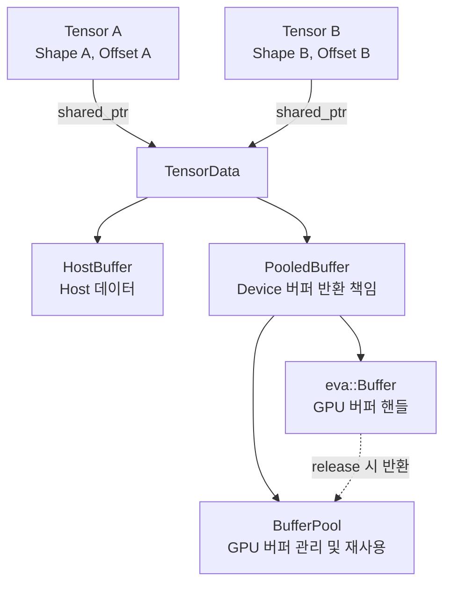
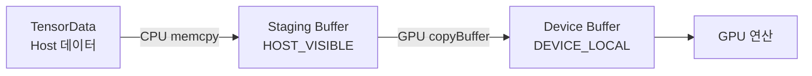
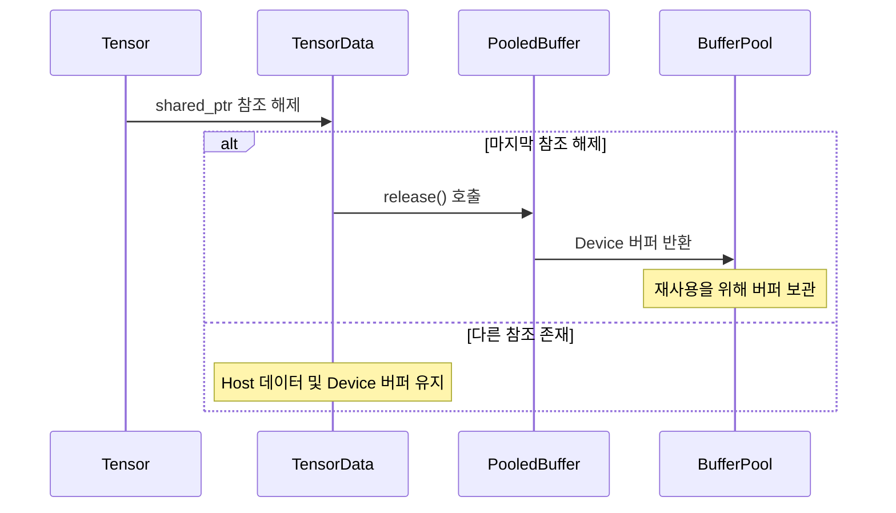

# Tensor

`Tensor`는 추론 연산에 필요한 입력 데이터, 가중치, 중간 연산 결과를 저장하고 관리하는 데이터 구조입니다.

데이터는 CPU가 사용하는 Host 메모리 또는 GPU 연산에 사용하는 Device 버퍼에 저장됩니다. `Tensor`는 데이터의 Shape와 메모리에 대한 참조를 관리합니다. 실제 Host 메모리 및 Device 버퍼는 내부의 `TensorData`가 관리합니다.

`Tensor`는 [Node의 Slot](node.md#1-슬롯)에 저장되며, `NodeSlot::getValueRef()`를 통해 접근할 수 있습니다. 또한 `Node::operator[]`를 사용하면 Slot 이름으로 `Tensor`에 직접 접근할 수 있습니다.

```cpp
linear.slot("out0")                 // NodeSlot& — Slot 객체
linear.slot("out0").getValueRef()   // Tensor&   — Slot에 저장된 Tensor
linear["out0"]                      // Tensor&   — Slot 이름으로 Tensor에 직접 접근
```

Slot의 구조와 사용 방법에 대한 자세한 내용은 [Node](node.md#22-값-읽기와-슬롯-접근)를 참조하십시오.

## 1. 데이터와 핸들

`Tensor`는 내부적으로 `Tensor`와 `TensorData`의 두 클래스로 구성됩니다. `Tensor`는 데이터의 Shape와 Offset을 관리하며, `TensorData`는 실제 데이터 저장소와 메모리 상태를 관리합니다.

다음 코드는 각 클래스의 주요 멤버를 나타냅니다.

```cpp
class TensorData
{
    HostBuffer hostData_;             // Host 데이터 (std::vector<char>)
    bool hostUploaded_ = false;       // Host 데이터의 Device 업로드 상태
    const Dtype dtype_;               // 데이터 타입
    vai::PooledBuffer buffer_;        // Device 버퍼 및 반환 책임

    std::pair<NeuralNet*, uint64_t> lastSubmission_{nullptr, 0}; // 마지막 GPU 결과 제출 정보
    std::pair<NeuralNet*, uint64_t> hostSyncedAt_{nullptr, 0};   // Host 다운로드 완료 정보
};

class Tensor
{
    std::shared_ptr<TensorData> data_; // 공유 데이터 저장소
    std::vector<uint32_t> shape_;      // Tensor의 Shape
    uint32_t baseOffset_ = 0;          // 데이터의 시작 위치 (원소 단위)
};
```

`Tensor`는 **Shape(`shape_`)와 Offset(`baseOffset_`)**을 독립적으로 관리합니다. 반면 `TensorData`는 **Host 데이터, Device 버퍼, Dtype 및 데이터 전송 상태**를 관리합니다.

`Tensor`는 `std::shared_ptr<TensorData>`를 통해 데이터 저장소를 참조합니다. 따라서 여러 `Tensor` 객체가 동일한 `TensorData`를 공유할 수 있습니다. 각 Tensor의 Shape와 Offset은 서로 달라도 실제 데이터 저장소는 동일하게 유지됩니다.

```cpp
Tensor a({M, N});                // Fp32, Shape: [M, N]
Tensor b = a;                    // a와 동일한 TensorData 공유
Tensor c = a.reshape({M * N});   // Shape만 변경한 새로운 Tensor 생성
```

위 예제에서 `b`와 `c`는 `a`와 동일한 `TensorData`를 공유합니다. 이 과정에서 Host 데이터나 Device 버퍼의 내용은 복사되지 않습니다.

공유된 `TensorData`의 데이터가 변경되면 이를 참조하는 모든 Tensor에 변경 사항이 반영됩니다. 반면 Shape와 Offset은 각 Tensor가 독립적으로 관리하므로, 한 Tensor의 Shape를 변경하더라도 다른 Tensor의 Shape에는 영향을 주지 않습니다.

### 1.1 Shape, Dtype, Offset

`Tensor`는 데이터의 구조와 메모리 접근 범위를 관리하기 위해 **Shape, Dtype, Offset**을 사용합니다.

- **Shape (`shape_`)**: Tensor의 차원과 각 차원의 크기를 나타냅니다. `numElements()`는 전체 원소 수를 계산하며, `numBytes()`는 원소 수에 Dtype별 원소 크기를 곱하여 데이터의 전체 바이트 크기를 반환합니다.
- **Dtype (`dtype_`)**: Tensor에 저장되는 데이터의 타입을 나타냅니다. `TensorData` 생성 시 설정되며 이후 변경할 수 없습니다. 현재 지원하는 데이터 타입은 `Dtype::Fp32`와 `Dtype::Fp16`입니다.
- **Offset (`baseOffset_`)**: Tensor가 공유 데이터 저장소에서 접근할 시작 위치를 나타냅니다. Offset은 바이트가 아닌 **원소(Element) 단위**로 관리합니다. 실제 바이트 위치는 `byteOffset()`에서 Offset과 원소 크기를 곱하여 계산합니다.

`baseOffset_`은 하나의 Device 버퍼에서 특정 데이터 구간을 참조할 때 사용합니다. 이를 통해 별도의 메모리를 할당하거나 데이터를 복사하지 않고 기존 버퍼의 일부를 사용할 수 있습니다.

예를 들어 Fp32 원소 8개가 저장된 Device 버퍼에서 네 번째 원소부터 3개를 참조하려면 `view()`를 사용합니다.

```cpp
Tensor original({8}, Dtype::Fp32);
Tensor part = original.view({3}, 3);
```

이 경우 `part`의 Shape는 `{3}`, `baseOffset_`은 `3`으로 설정됩니다. Fp32 원소의 크기는 4바이트이므로 실제 데이터 접근 시작 위치는 12바이트입니다.

`part`와 `original`은 동일한 `TensorData`를 공유합니다. 따라서 `view()`를 호출할 때 새로운 데이터 저장소를 생성하거나 데이터를 복사하지 않습니다.

`view()`는 새로운 Tensor의 Shape와 Offset을 설정합니다. Device 버퍼가 연결되어 있으면 지정한 데이터 범위가 버퍼 크기를 초과하지 않는지 검사합니다. Host 데이터에 대해서는 별도의 범위 검사를 수행하지 않습니다.

### 1.2 GPU 버퍼의 소유권

`TensorData`는 `PooledBuffer`를 통해 Device 버퍼를 관리합니다. `PooledBuffer`는 실제 GPU 버퍼를 참조하는 `eva::Buffer`와 해당 버퍼를 관리하는 `BufferPool`의 `std::shared_ptr`를 보유합니다.

`PooledBuffer`는 **하나의 GPU 버퍼에 대한 반환 책임을 하나의 객체만 갖도록** Copy를 금지하고 Move만 허용합니다. 이를 통해 동일한 GPU 버퍼가 `BufferPool`에 중복 반환되는 것을 방지합니다.

`Tensor`를 복사하면 새로운 Tensor 핸들이 생성되지만, `PooledBuffer`나 GPU 데이터는 복사되지 않습니다. 여러 Tensor는 동일한 `TensorData`를 공유하며, 하나의 `PooledBuffer`를 통해 Device 버퍼에 접근합니다.

모든 Tensor가 해당 `TensorData`에 대한 참조를 해제하면 `TensorData`의 소멸자가 실행됩니다. 이때 `PooledBuffer::release()`가 호출되어 Device 버퍼를 `BufferPool`에 반환합니다.

**BufferPool에 반환된 Device 버퍼는 즉시 해제되지 않고, 이후 메모리 요청에서 재사용할 수 있도록 보관됩니다.** 따라서 Tensor의 소멸과 실제 GPU 메모리의 해제는 서로 다른 과정입니다.



GPU 버퍼의 할당, 반환 및 재사용 조건에 대한 자세한 내용은 [Tensor 메모리 생명주기](#8-대표적인-tensor-흐름-및-생명주기)를 참조하십시오.

## 2. 상태

`Tensor`는 데이터의 형태를 정의하는 **Shape**, CPU에서 사용하는 **Host 데이터**, GPU 연산에 사용하는 **Device 버퍼**를 관리합니다.

각 구성 요소는 독립적인 상태를 가지며, 메모리 할당 및 데이터 전송 여부에 따라 보유 상태가 달라집니다. 이러한 상태는 다음 함수를 통해 확인할 수 있습니다.

| 상태 | 뜻 | 확인 |
|---|---|---|
| 빈 핸들 | `TensorData`가 없는 초기 상태 | `Tensor()` 또는 `dtype() == Dtype::None` |
| 형상 지정 | Shape와 dtype이 정해진 상태. 데이터 바이트는 아직 없을 수 있음 | `validShape() == true` |
| Host 데이터 | CPU에서 접근할 데이터 바이트를 보유한 상태 | `hasHostData() == true` |
| Device 버퍼 | GPU 연산이 사용할 버퍼가 연결된 상태 | `gpuBufferBound() == true` |
| GPU 출력 추적 | 마지막 GPU 결과의 제출 정보가 등록된 상태 | `lastSubmission().second != 0` |

`Tensor`는 Host 데이터와 Device 버퍼를 동시에 보유할 수 있습니다. Device 버퍼로 데이터를 전송한 이후에도 Host 데이터는 유지될 수 있으며, 메모리 사용량을 줄이기 위해 불필요한 Host 데이터를 제거할 수 있습니다.

`NeuralNet`은 가중치 업로드 과정에서 이러한 방식을 사용합니다. `NeuralNet::uploadModelParams()`는 가중치를 Device 버퍼로 전송하는 명령을 기록한 후 `clearHostData(true)`를 호출하여 Host 데이터를 제거하고 메모리 용량의 반환을 요청합니다.

가중치 업로드 과정과 메모리 관리에 대한 자세한 내용은 [NeuralNet](neural-net.md)을 참조하십시오.

## 3. 생성

`Tensor`는 Shape와 Dtype을 지정하거나, Safetensors 파일 또는 기존 Tensor를 이용하여 생성할 수 있습니다.

생성 방법에 따라 새로운 데이터 저장소를 생성하거나 기존 `TensorData`를 공유합니다.

### 3.1 Shape 지정

Shape와 Dtype을 지정하여 Tensor를 생성할 수 있습니다.

```cpp
Tensor x({M, N});                  // 기본 Dtype: Fp32
Tensor y({H, W}, Dtype::Fp16);
Tensor empty;                      // TensorData가 없는 빈 Tensor
```

Shape를 지정하면 `std::make_shared<TensorData>(dtype)`를 통해 `TensorData` 객체가 생성됩니다. 이때 Host 데이터는 비어 있으며, Device 버퍼도 할당되지 않습니다.

**Tensor 객체의 생성과 실제 데이터 메모리의 할당은 별개의 과정입니다.** Host 메모리는 데이터를 설정하거나 파일에서 읽을 때 할당되며, Device 버퍼는 GPU에서 해당 데이터를 사용할 때 별도로 준비됩니다.

Dtype은 `TensorData` 생성 시 설정되며 이후 변경할 수 없습니다. 다른 Dtype이 필요한 경우 새로운 `TensorData`를 가진 Tensor를 생성해야 합니다. 반면 Shape는 `reshape()`와 같은 연산을 통해 변경할 수 있습니다.

### 3.2 Safetensors에서 생성

Safetensors 파일에 저장된 데이터를 읽어 Tensor를 생성할 수 있습니다. 주로 모델의 가중치를 로드할 때 사용합니다.

```cpp
SafetensorsParser parser(VAI_DATA_DIR "/ckpts/mnist/jroot/model.safetensors");

Tensor w(parser["fc.weight"]);                // 파일의 Dtype에 따라 생성
Tensor half(parser["fc.weight"], Dtype::Fp16); // Fp16으로 변환하여 생성
```

`Tensor(SafetensorRef, Dtype)`는 파일에 저장된 Shape를 읽고, 필요한 크기의 Host 메모리를 확보한 후 데이터를 로드합니다. 목표 Dtype이 파일의 데이터 타입과 다르면 로드 과정에서 변환합니다.

지원하는 데이터 타입은 다음과 같습니다.

| 파일 데이터 타입 | 기본 Tensor Dtype | 변환 |
|---|---|---|
| F32 | `Dtype::Fp32` | 목표 Dtype에 따라 변환 |
| F16 | `Dtype::Fp16` | 목표 Dtype에 따라 변환 |
| BF16 | `Dtype::Fp32` | Fp32 또는 지정한 Fp16으로 변환 |

BF16은 Tensor의 독립적인 Dtype으로 사용하지 않습니다. 목표 Dtype을 지정하지 않으면 Fp32로 변환하여 로드합니다.

로드한 Tensor는 Host 메모리에 데이터를 보유하며, Device 버퍼는 아직 할당되지 않습니다.

가중치를 사용할 때는 연산 Node가 요구하는 Dtype과 Shape를 확인해야 합니다. 파일에 저장된 데이터의 Shape가 연산에 필요한 구조와 다르면 `permute()`, `reshape()` 등의 연산으로 조정할 수 있습니다.

```cpp
// weightDtype은 연산 Node가 요구하는 Dtype
linear["weight"] = Tensor(parser["fc.weight"], weightDtype);
```

Tensor를 Node의 Slot에 대입하는 것만으로 데이터가 Device 버퍼에 전송되지는 않습니다. `NeuralNet`은 최초 실행 준비 과정에서 `persistent` Slot의 가중치를 Device 버퍼로 업로드합니다.

가중치의 업로드 과정에 대한 자세한 내용은 [NeuralNet](neural-net.md)을 참조하십시오.

### 3.3 기존 Tensor에서 생성

기존 Tensor를 이용하여 새로운 Tensor를 생성할 수 있습니다. 이때 연산에 따라 기존 `TensorData`를 공유하거나 새로운 데이터 저장소를 생성합니다.

```cpp
Tensor b = a;                    // 기존 TensorData 공유
Tensor c = a.reshape({M * N});   // Shape 변경, TensorData 공유
Tensor t = a.permute(1, 0);      // 새로운 Host 데이터 생성
```

`reshape()`와 `view()`는 기존 `TensorData`를 공유합니다. 새로운 데이터 저장소를 생성하지 않으므로 Host 데이터와 Device 버퍼를 복사하지 않습니다.

반면 `permute()`, `split()`, `concat()`은 새로운 `TensorData`를 생성하고 Host 데이터를 복사합니다.

따라서 **기존 Tensor로부터 새로운 Tensor를 생성하더라도 실제 데이터 복사 여부는 연산에 따라 달라집니다.**

각 연산의 동작 방식과 메모리 비용은 [Host 전용 Tensor 연산](#6-host-전용-tensor-연산)에서 설명합니다.

### 3.4 Copy와 Move

`Tensor`는 C++의 Copy Semantics와 Move Semantics를 지원합니다. 두 방식 모두 기존 GPU 데이터를 새로운 Device 버퍼로 복사하지 않습니다.

```cpp
Tensor a({4});

Tensor b = a;            // Copy: TensorData 공유
Tensor c = std::move(b); // Move: Tensor 핸들의 상태 이전
```

**Copy는 기존 `TensorData`를 공유하는 새로운 Tensor 핸들을 생성합니다.**

`std::shared_ptr<TensorData>`가 복사되므로 참조 수가 증가합니다. Shape와 Offset은 새로운 Tensor에 복사되지만, Host 데이터와 Device 버퍼는 기존 저장소를 공유합니다.

**Move는 Tensor가 보유한 핸들과 상태를 새로운 Tensor로 이전합니다.**

`std::shared_ptr`, Shape 및 Offset이 이동하며, Host 데이터와 Device 버퍼의 실제 데이터 복사는 발생하지 않습니다. Move 이후 원본 Tensor는 유효한 객체로 유지되지만, 이동 이전의 데이터와 상태가 그대로 남아 있다고 가정해서는 안 됩니다.

`TensorData`는 내부적으로 Move-only 객체인 `PooledBuffer`를 보유합니다. 따라서 `TensorData` 자체는 기본 Copy를 지원하지 않습니다.

`PooledBuffer`를 Move하면 GPU 버퍼 핸들과 `BufferPool`에 대한 소유권이 이전됩니다. 이때 원본 `PooledBuffer`의 버퍼 핸들은 빈 상태로 변경되며, 실제 GPU 데이터는 이동하거나 복사하지 않습니다.

Copy와 Move의 소유권 관리 및 메모리 생명주기에 대한 자세한 내용은 [Tensor 메모리 생명주기](#8-대표적인-tensor-흐름-및-생명주기)를 참조하십시오.

## 4. Host 데이터 설정

`Tensor`는 `setFloats()`와 `setData<T>()`를 통해 Host 메모리에 데이터를 저장할 수 있습니다. 두 함수는 데이터를 설정하는 방식에 차이가 있습니다.

- **`setFloats()`**: Fp32 데이터를 입력받아 Tensor의 Dtype에 맞게 변환한 후 Host 메모리에 저장합니다.
- **`setData<T>()`**: 입력 데이터의 바이트를 Dtype 변환 없이 Host 메모리에 복사합니다.

다음은 두 함수를 사용하여 Host 데이터를 설정하는 예제입니다.

```cpp
// Fp32 입력 데이터를 Fp16으로 변환하여 저장
std::vector<float> pixels(28 * 28);
Tensor img({1, 28, 28}, Dtype::Fp16);
img.setFloats(pixels);

// 정수 데이터를 변환하지 않고 저장
std::vector<int32_t> tokenIds = {101, 102, 103};
Tensor tokens({static_cast<uint32_t>(tokenIds.size())});
tokens.setData(tokenIds.data());
```

`setData<T>()`를 사용할 때는 입력 데이터의 원소 크기(`sizeof(T)`)가 Tensor의 Dtype에 따른 원소 크기와 일치해야 합니다. 또한 입력 포인터는 Tensor의 전체 원소를 읽을 수 있는 유효한 메모리를 가리켜야 합니다.

위 예제에서 `tokenIds`는 정수 데이터를 Fp32로 변환하지 않습니다. 정수 데이터의 바이트를 Tensor의 Host 메모리에 그대로 저장합니다.

두 함수는 내부적으로 `hostData_.resize()`를 호출하여 필요한 메모리 크기를 확보합니다. 기존 Host 버퍼의 용량이 충분하면 추가 메모리 할당 없이 데이터를 갱신할 수 있습니다.

데이터를 설정한 후에는 다음과 같이 내부 상태가 변경됩니다.

- `hostUploaded_ = false`: 새로운 Host 데이터가 Device 버퍼에 업로드되지 않았음을 표시합니다.
- `lastSubmission_ = {nullptr, 0}`: 이전 GPU 결과 제출 정보를 초기화합니다.

이 과정에서는 기존 Device 버퍼를 해제하거나 새로 할당하지 않습니다.

### 4.1 Move를 이용한 데이터 설정

`setFloats()`는 `std::vector<float>`의 Move를 받는 오버로드도 제공합니다.

```cpp
std::vector<float> values = {1, 2, 3, 4};

Tensor x({4});
x.setFloats(std::move(values));
```

`setFloats(std::vector<float>&&)`는 전달받은 벡터를 내부 임시 벡터로 Move한 후, 데이터를 Tensor의 Host 저장소에 기록합니다.

따라서 입력 벡터의 메모리를 Tensor가 직접 인수하는 Zero-copy 방식은 아닙니다. Tensor의 Dtype에 따라 데이터 복사 또는 변환이 수행됩니다.

## 5. Host → Device 데이터 전송

Host 메모리에 저장된 데이터는 GPU 연산에 사용하기 위해 Device 버퍼로 전송할 수 있습니다.

`setFloats()`와 `setData<T>()`는 Host 데이터만 설정하며, Device 버퍼로의 전송은 수행하지 않습니다. 실제 데이터 전송은 `NeuralNet`의 실행 준비 과정에서 처리됩니다.

`NeuralNet`은 데이터의 용도에 따라 입력 Tensor와 가중치 Tensor의 업로드 경로를 구분합니다.

### 5.1 입력 Tensor 업로드

일반 입력 Tensor는 `NeuralNet::prepareInputs()`에서 Device 버퍼로 전송합니다.

입력 Tensor에 새로운 Host 데이터가 있고 업로드가 필요한 경우, 다음 순서로 처리합니다.

1. Tensor에 Device 버퍼가 연결되어 있는지 확인합니다.
2. Device 버퍼가 없으면 `BufferPool::requestBuffer()`를 통해 버퍼를 확보합니다.
3. Host 데이터를 CPU에서 접근할 수 있는 Staging Buffer에 복사합니다.
4. `copyBuffer()` 명령을 기록하여 Staging Buffer의 데이터를 Device 버퍼로 전송합니다.
5. `markHostUploaded()`를 호출하여 Host 데이터의 업로드 상태를 갱신합니다.

Staging Buffer는 `HOST_VISIBLE | HOST_COHERENT` 메모리 속성을 사용합니다. CPU는 해당 버퍼에 데이터를 기록하고, GPU는 기록된 복사 명령을 통해 Device 버퍼로 데이터를 전송합니다.

이미 Device 버퍼가 연결되어 있다면 기존 버퍼를 그대로 사용할 수 있습니다. 따라서 입력 데이터가 변경되더라도 매번 새로운 GPU 버퍼를 할당할 필요는 없습니다.

또한 입력 Tensor는 업로드 이후에도 Host 데이터를 유지합니다. 이후 `setFloats()` 또는 `setData<T>()`로 데이터를 변경하면 기존 Device 버퍼에 새로운 데이터를 전송할 수 있습니다.

### 5.2 가중치 Tensor 업로드

가중치와 같은 `persistent` Tensor는 `NeuralNet::uploadModelParams()`에서 Device 버퍼로 전송합니다.

이 함수는 `persistent` Slot의 Tensor를 검사하고, Device 버퍼가 연결되지 않은 Tensor에 대해 다음 작업을 수행합니다.

1. `BufferPool::requestBuffer()`를 통해 Device 버퍼를 확보합니다.
2. Host 데이터가 존재하면 `TensorUploader`를 사용하여 전송 명령을 기록합니다.
3. `clearHostData(true)`를 호출하여 Host 데이터를 제거하고 메모리 용량의 반환을 요청합니다.
4. 확보한 Device 버퍼를 Tensor에 연결합니다.

`TensorUploader`는 Staging Buffer를 사용하여 Host 데이터를 Device 버퍼로 전송합니다. 데이터가 Staging Buffer의 용량보다 크면 여러 구간으로 나누어 전송합니다.

가중치 업로드는 입력 데이터 업로드와 달리, **Device 버퍼로 데이터를 전송한 후 기존 Host 데이터를 제거하여 Host 메모리 사용량을 줄입니다.**

단, `clearHostData(true)`는 전송 명령을 기록한 후 호출됩니다. GPU 전송 완료는 `TensorUploader`의 `flush()` 과정에서 보장됩니다.

### 5.3 데이터 전송 구조

Host에서 Device로 데이터가 전송되는 과정은 다음과 같습니다.



Host → Device 전송 과정에서는 CPU 메모리 복사와 GPU 데이터 전송 비용이 발생합니다. Device 버퍼가 없는 경우에는 GPU 메모리 할당 비용도 추가될 수 있습니다.

**Device 버퍼 할당과 데이터 전송은 서로 다른 작업입니다.** 기존 Device 버퍼를 재사용하면서 새로운 Host 데이터만 전송할 수 있습니다.

입력 및 가중치 업로드가 실행되는 시점과 반복 추론에서의 리소스 재사용 조건은 [실행 파이프라인](execution-pipeline.md)을 참조하십시오.

## 6. Host 전용 Tensor 연산

`Tensor`는 Shape 변경, 데이터 재배열, 분할 및 결합을 위한 연산을 제공합니다. 이러한 연산은 주로 모델의 가중치를 로드한 후, 연산 Node가 요구하는 데이터 구조로 변환할 때 사용합니다.

각 연산은 기존 `TensorData`를 공유하거나 새로운 Host 데이터 저장소를 생성하는 방식으로 동작합니다.

| 연산 | 기능 | 데이터 저장소 |
|---|---|---|
| `Tensor::reshape()` | 원소 수를 유지하면서 Shape 변경 | 원본과 공유 |
| `Tensor::view()` | Shape와 Offset을 지정하여 데이터의 일부 구간 참조 | 원본과 공유 |
| `Tensor::permute()` | 축 순서 변경 및 데이터 재배열 | 새로운 Host 데이터 생성 |
| `Tensor::split()` | 첫 번째 축을 기준으로 Tensor 분할 | 분할된 구간마다 새로운 Host 데이터 생성 |
| `Tensor::concat()` | 첫 번째 축을 기준으로 여러 Tensor 결합 | 새로운 Host 데이터 생성 |

### 6.1 데이터 공유 연산

`reshape()`와 `view()`는 기존 `TensorData`를 공유하면서 새로운 Tensor를 생성합니다. 이 과정에서는 Host 데이터나 Device 버퍼를 복사하지 않습니다.

**`reshape()`**는 Tensor의 전체 원소 수를 유지하면서 Shape를 변경합니다.

```cpp
Tensor a({2, 4});
Tensor b = a.reshape({4, 2});
```

위 예제에서 `a`와 `b`는 동일한 데이터 저장소를 공유하지만 서로 다른 Shape를 가집니다.

**`view()`**는 기존 데이터 저장소의 특정 위치부터 지정한 범위를 참조합니다. `baseOffset`을 사용하여 시작 위치를 설정하며, 전체 원소 수를 원본과 동일하게 유지할 필요는 없습니다.

```cpp
Tensor original({8}, Dtype::Fp32);
Tensor part = original.view({3}, 3);
```

`part`는 원본 저장소의 네 번째 원소부터 3개 원소를 참조합니다. `baseOffset`은 원소 단위이므로 Fp32 데이터에서 시작 위치는 12바이트입니다.

Device 버퍼가 연결되어 있다면 `view()`는 지정한 범위가 버퍼 크기를 초과하지 않는지 검사합니다. Host 데이터에 대해서는 별도의 범위 검사를 수행하지 않습니다.

두 연산 모두 기존 `TensorData`를 공유하므로, 공유된 데이터가 변경되면 이를 참조하는 다른 Tensor에도 영향을 줍니다.

### 6.2 데이터 복사 연산

`permute()`, `split()`, `concat()`은 기존 Host 데이터를 사용하여 새로운 Tensor와 데이터 저장소를 생성합니다.

이 연산들은 **Host 데이터가 존재해야 실행할 수 있으며, GPU 데이터 복사 명령은 수행하지 않습니다.**

**`permute()`**는 지정한 축 순서에 따라 데이터를 재배열합니다. 변경된 데이터는 새로운 Host 저장소에 기록됩니다.

```cpp
// 가중치 배열의 축 순서 변경
Tensor transposed =
    Tensor(parser["attn.c_attn.weight"], dt).permute(1, 0);
```

**`split()`**은 Tensor의 첫 번째 축을 기준으로 데이터를 여러 구간으로 분할합니다. 각 구간은 독립적인 `TensorData`와 Host 저장소를 가집니다.

```cpp
// 첫 번째 축을 Q, K, V 구간으로 분할
Tensor qkv = Tensor(parser["attn.c_attn.weight"], dt);

auto [q, k, v] = qkv.split(D, 2 * D);
```

**`concat()`**은 여러 Tensor를 첫 번째 축을 기준으로 결합합니다. 입력 Tensor의 Dtype과 나머지 차원 크기가 일치해야 합니다.

```cpp
// 첫 번째 축을 기준으로 Tensor 결합
Tensor combined =
    Tensor(parser["gate.weight"], dt)
        .concat(Tensor(parser["up.weight"], dt));
```

`split()`은 분할된 데이터를 새로운 Host 저장소에 복사합니다. 반면 `view()`는 기존 저장소의 일부 구간을 복사 없이 참조합니다.

따라서 **데이터의 독립적인 저장이 필요하지 않다면 `view()`를 사용하여 메모리 할당과 복사 비용을 줄일 수 있습니다.** 단, 원본과 결과 Tensor가 동일한 저장소를 공유한다는 점을 고려해야 합니다.

## 7. 출력 데이터 읽기

GPU에서 실행한 추론 연산은 `NeuralNet` 호출이 반환된 시점에도 진행 중일 수 있습니다. 따라서 GPU 연산 결과를 CPU에서 사용하려면 Device 버퍼의 데이터를 Host 메모리로 전송해야 합니다.

`Tensor`는 GPU 결과를 읽기 위해 `downloadToHost()`와 `getData<T>()`를 제공합니다.

### 7.1 downloadToHost()

`downloadToHost()`는 Device 버퍼에 저장된 GPU 연산 결과를 Host 메모리로 복사합니다.

데이터 다운로드는 다음 순서로 수행됩니다.

1. Tensor에 Device 버퍼가 연결되어 있고 유효한 GPU 제출 정보가 있는지 확인합니다.
2. GPU 결과를 저장할 Readback Buffer를 `BufferPool`에서 확보합니다.
3. `copyBuffer()` 명령으로 Device 버퍼의 데이터를 Readback Buffer에 복사합니다.
4. GPU 복사 명령을 제출하고 완료될 때까지 대기합니다.
5. Readback Buffer를 `map()`하고 `invalidate()`하여 CPU에서 최신 데이터를 읽을 수 있도록 합니다.
6. 데이터를 `TensorData::hostData_`에 복사하고 다운로드 상태를 갱신합니다.

Readback Buffer는 `HOST_CACHED | HOST_VISIBLE` 메모리 속성을 사용합니다. CPU는 GPU 전송이 완료된 후 해당 버퍼의 데이터를 읽습니다.

이 과정에서 GPU 데이터 전송, 동기화 대기 및 Host 메모리 복사 비용이 발생합니다.

### 7.2 getData<T>()

`getData<T>()`는 GPU 연산 결과를 Host 메모리로 가져온 후 데이터 포인터를 반환합니다.

내부적으로 `downloadToHost()`를 호출하므로 별도의 다운로드 함수를 먼저 실행할 필요는 없습니다.

```cpp
Tensor out;

model({{"x", inputTensor}}, {{"y", &out}});

const float* values = out.getData<float>();
```

`getData<T>()`는 Host 메모리에 저장된 데이터를 `const T*`로 반환하며, Dtype 변환은 수행하지 않습니다.

따라서 템플릿 타입 `T`는 실제 데이터의 저장 형식과 일치해야 합니다.

또한 반환된 포인터는 `TensorData`의 Host 저장소를 참조합니다. 독립적인 데이터 복사본이 아니므로 Host 버퍼가 변경되거나 해제되면 기존 포인터를 계속 사용할 수 없습니다.

**`downloadToHost()`와 `getData<T>()`는 유효한 GPU 출력 제출 정보가 있는 Tensor에서 사용합니다.** Host 데이터만 가진 일반 Tensor의 데이터를 읽기 위한 공통 접근 함수는 아닙니다.

### 7.3 중복 다운로드 방지

`TensorData`는 마지막 GPU 출력 정보와 Host 다운로드 정보를 비교하여 불필요한 데이터 전송을 방지합니다.

`downloadToHost()`는 `hostSyncedAt_`와 `lastSubmission_`을 비교합니다.

두 값이 같으면 해당 GPU 결과가 이미 Host 메모리에 복사된 상태이므로 기존 Host 데이터를 재사용합니다. 값이 다르면 새로운 다운로드를 수행합니다.

따라서 동일한 GPU 실행 결과를 반복해서 읽더라도 매번 Device에서 Host로 데이터를 전송하지 않습니다.

### 7.4 Host 데이터와 Device 버퍼의 동기화 상태

`TensorData`는 Host 데이터 업로드와 GPU 결과 다운로드를 관리하기 위해 다음 상태를 유지합니다.

| 상태 | 역할 | 변경 시점 |
|---|---|---|
| `hostUploaded_` | Host 데이터의 Device 업로드 여부 관리 | Setter 호출 시 `false`, 입력 업로드 준비 시 `true` |
| `lastSubmission_` | 마지막 GPU 출력의 제출 정보 저장 | GPU 출력 제출 시 갱신, Setter 호출 시 초기화 |
| `hostSyncedAt_` | Host 메모리에 마지막으로 다운로드한 GPU 결과 식별 | `downloadToHost()` 완료 시 갱신 |

이 상태들은 Host 데이터나 Device 버퍼를 직접 저장하지 않습니다. 데이터 전송 여부를 판단하기 위한 관리 정보입니다.

### 7.5 Device 버퍼의 직접 사용

GPU 연산 결과를 항상 Host 메모리로 다운로드할 필요는 없습니다.

Device 버퍼가 연결된 Tensor는 해당 버퍼를 다른 GPU 연산의 입력으로 전달할 수 있습니다. 이 경우 Host 메모리를 거치지 않고 기존 Device 버퍼를 직접 사용하므로 불필요한 데이터 전송을 줄일 수 있습니다.

다만 여러 연산이 동일한 Device 버퍼를 사용하는 경우에는 데이터가 덮어써지지 않도록 GPU 실행 순서와 리소스 수명을 관리해야 합니다.

GPU 결과의 전달 방식과 실행 간 동기화에 대한 자세한 내용은 [실행 파이프라인](execution-pipeline.md)을 참조하십시오.

## 8. 대표적인 Tensor 흐름 및 생명주기

`Tensor`는 데이터의 용도에 따라 Host 메모리와 Device 버퍼를 사용하는 방식이 다릅니다. 입력 데이터, 가중치, 연산 결과는 동일한 `Tensor` 구조를 사용하지만, 데이터가 생성되고 유지되거나 반환되는 시점은 서로 다릅니다.

### 8.1 가중치 Tensor

가중치 Tensor는 일반적으로 Safetensors 파일에서 Host 메모리로 데이터를 로드한 후 Device 버퍼로 전송합니다.

```text
Safetensors 파일 로드
  → Host 데이터 생성
  → 필요한 경우 Host 전용 Tensor 연산 수행
  → persistent Slot에 Tensor 대입
  → 최초 실행 준비에서 Device 버퍼 확보
  → Host → Device 데이터 전송 명령 기록
  → Host 데이터 제거
  → Device 버퍼 유지
```

`NeuralNet::uploadModelParams()`는 `persistent` Slot에 저장된 Tensor를 확인하고, Device 버퍼가 연결되지 않은 경우 버퍼를 확보합니다.

Host 데이터가 존재하면 `TensorUploader`를 사용하여 Device 버퍼로 전송합니다. 이후 `clearHostData(true)`를 호출하여 Host 데이터를 제거하고 메모리 용량의 반환을 요청합니다.

`persistent` Slot의 Tensor는 일반적인 중간 연산 결과와 달리 Command Buffer 기록 과정에서 초기화되지 않습니다. 따라서 `TensorData`에 대한 참조가 유지되는 동안 Device 버퍼를 계속 사용할 수 있습니다.

이미 Device 버퍼가 연결된 가중치는 `uploadModelParams()`에서 다시 업로드하지 않습니다.

가중치 업로드 시점과 실행 준비 과정에 대한 자세한 내용은 [실행 파이프라인](execution-pipeline.md)을 참조하십시오.

### 8.2 입력 Tensor

입력 Tensor는 외부 데이터를 Host 메모리에 저장한 후 Device 버퍼로 전송하여 사용합니다.

동일한 Shape를 유지하는 경우 기존 Tensor와 Device 버퍼를 재사용하면서 입력 데이터만 변경할 수 있습니다.

```text
Shape와 Dtype을 지정하여 Tensor 생성
  → setData() / setFloats()로 Host 데이터 설정
  → 최초 실행 시 Device 버퍼 확보
  → Host → Device 데이터 전송
  → 새로운 Host 데이터 설정
  → 기존 Device 버퍼에 변경된 데이터 전송
```

`setData()`와 `setFloats()`는 Host 데이터를 변경하고 업로드 상태를 초기화합니다. 이 과정에서 이미 연결된 Device 버퍼는 해제하지 않습니다.

다음 실행에서 `NeuralNet::prepareInputs()`는 변경된 Host 데이터를 Device 버퍼로 전송합니다. 기존 Device 버퍼가 유지되어 있다면 추가 GPU 메모리 할당 없이 데이터를 갱신할 수 있습니다.

또한 입력 Tensor의 Shape, Device 버퍼 및 Offset이 동일하면 입력값이 변경되더라도 기존 Command Buffer를 재사용할 수 있습니다. 다만 다른 재기록 조건도 변경되지 않아야 합니다.

반복 추론에서의 Command Buffer 재사용 조건은 [실행 파이프라인](execution-pipeline.md)을 참조하십시오.

### 8.3 중간 연산 결과 Tensor

중간 연산 결과 Tensor는 일반적으로 Node의 `prepare()` 과정에서 Shape가 결정되고, `NeuralNet::recordCommands()`에서 필요한 Device 버퍼가 준비됩니다.

```text
Node::prepare()에서 출력 Shape 결정
  → BufferPool에서 Device 버퍼 확보
  → 후속 Node의 입력 Slot에 Tensor 전달
  → GPU 연산 명령 기록
  → 기록 과정에서 사용이 끝난 Tensor 참조 정리
  → 마지막 TensorData 참조 해제 시 버퍼 반환
```

`NeuralNet::recordCommands()`는 출력 Tensor에 Device 버퍼가 연결되지 않은 경우 `BufferPool::requestBuffer()`를 통해 버퍼를 확보합니다.

이후 출력 Tensor를 연결된 입력 Slot에 전달합니다. 이 과정에서 새로운 데이터를 복사하지 않고 동일한 `TensorData`를 공유합니다.

Node의 GPU 명령을 기록한 후에는 `persistent` Slot을 제외한 Tensor 핸들을 초기화합니다. 다른 참조가 남아 있지 않으면 해당 `TensorData`가 소멸하고 Device 버퍼가 `BufferPool`로 반환됩니다.

**BufferPool로 반환된 Device 버퍼는 즉시 해제되지 않고 이후 연산에서 재사용할 수 있도록 보관됩니다.**

이러한 방식은 여러 중간 연산 결과가 동일한 GPU 버퍼를 서로 다른 시점에 사용할 수 있도록 합니다. 따라서 모든 중간 결과에 독립적인 GPU 메모리를 할당할 필요가 없습니다.

### 8.4 최종 출력 Tensor

최종 출력 Tensor는 GPU 연산 결과를 보관하고 외부에서 접근할 수 있도록 제공하는 Tensor입니다.

`OutputNode`는 입력 Slot으로 전달된 Tensor를 `cachedOutput_`에 보관합니다. `NeuralNet::operator()`는 GPU 명령을 제출한 후 해당 Tensor를 사용자가 지정한 출력 Tensor에 대입합니다.

```text
GPU 연산 명령 제출
  → OutputNode의 결과 Tensor 참조
  → 사용자 출력 Tensor에 핸들 대입
  → NeuralNet 호출 반환
        │
        ├─ CPU에서 사용
        │    → downloadToHost() / getData<T>()
        │    → Device → Host 데이터 전송
        │
        └─ GPU에서 사용
             → 기존 Device 버퍼를 다음 연산 입력으로 전달
```

`NeuralNet` 호출이 반환되더라도 GPU 연산이 완료된 것은 아닐 수 있습니다.

CPU에서 결과를 사용하려면 `downloadToHost()` 또는 `getData<T>()`를 호출하여 Device 데이터를 Host 메모리로 복사합니다. 이 과정에서는 GPU 전송 명령을 제출하고 복사가 완료될 때까지 대기합니다.

반면 GPU 연산 결과를 다른 연산의 입력으로 사용하는 경우에는 Host 메모리로 다운로드하지 않고 기존 Device 버퍼를 직접 전달할 수 있습니다.

**출력 Tensor를 복사하더라도 GPU 결과의 독립적인 사본이 생성되는 것은 아닙니다.**

```cpp
Tensor saved = out;  // 동일한 TensorData 공유
```

반복 추론에서 동일한 출력 저장소를 재사용하면 새로운 실행 결과가 이전 데이터를 덮어쓸 수 있습니다. 이전 결과를 보존해야 한다면 해당 저장소가 갱신되기 전에 데이터를 별도로 복사해야 합니다.

---

### 8.5 Tensor 소멸과 Device 버퍼 반환

`Tensor`는 `std::shared_ptr<TensorData>`를 통해 데이터 저장소의 소유권을 공유합니다.

Tensor 객체가 소멸하면 해당 `TensorData`에 대한 참조가 해제됩니다. 다른 Tensor가 동일한 `TensorData`를 참조하고 있다면 Host 데이터와 Device 버퍼는 유지됩니다.

마지막 참조가 해제되면 `TensorData`의 소멸자가 실행됩니다. 이때 `PooledBuffer::release()`를 호출하여 Device 버퍼를 `BufferPool`에 반환합니다.



여기서 **Tensor 객체의 소멸, BufferPool로의 버퍼 반환, 실제 GPU 메모리 해제는 서로 다른 과정**입니다.

`PooledBuffer::release()`는 Device 버퍼를 풀의 여유 버퍼 목록에 등록합니다. 이 과정에서 GPU 버퍼의 `destroy()`를 직접 호출하지 않습니다.

따라서 마지막 Tensor가 소멸하더라도 Device 버퍼는 `BufferPool`에 유지될 수 있습니다. 반환된 버퍼는 이후 메모리 요청에서 재사용됩니다.

### 8.6 BufferPool의 Device 버퍼 재사용

`BufferPool`은 반환된 Device 버퍼를 보관하고, 새로운 버퍼 요청이 발생하면 기존 버퍼를 재사용할 수 있는지 확인합니다.

`BufferPool::requestBuffer()`는 다음 조건을 검사합니다.

1. **Usage Flags**: 요청한 `usageFlags`와 동일한 사용 플래그 그룹에 속해야 합니다.
2. **Buffer Size**: 버퍼 크기가 요청한 `minSize` 이상, `maxSize` 이하여야 합니다.
3. **Memory Properties**: 기존 버퍼의 메모리 속성이 요청한 `reqMemProps`를 모두 포함해야 합니다.

조건에 맞는 버퍼가 존재하면 해당 버퍼를 캐시에서 제거하고 새로운 `PooledBuffer`로 반환합니다. 이 과정에서는 새로운 GPU 버퍼를 생성하지 않습니다.

조건에 맞는 버퍼가 없으면 `device_.createBuffer()`를 호출하여 새로운 GPU 버퍼를 생성합니다.

또한 **현재 다른 Tensor에서 사용 중인 Device 버퍼는 BufferPool의 여유 캐시에 포함되지 않으므로 재대여할 수 없습니다.**

`PooledBuffer`는 `std::shared_ptr<BufferPool>`을 보유합니다. 따라서 Device 버퍼를 사용하는 동안 해당 `BufferPool` 객체의 수명도 유지됩니다.

BufferPool에 반환된 버퍼의 최종 메모리 해제는 풀의 수명 및 하위 GPU 리소스 관리 방식에 따라 결정됩니다.

## 9. 성능 및 주의사항

Tensor의 생성, 복사, 이동, 데이터 전송 및 버퍼 반환 과정에서는 서로 다른 비용이 발생합니다.

다음 표는 주요 동작에 따른 메모리 사용과 데이터 복사 비용을 비교합니다.

| 동작 | Host 데이터 복사 | GPU 데이터 전송 | 주요 비용 |
|---|---|---|---|
| `Tensor b = a` | 없음 | 없음 | Shape 복사 및 공유 참조 증가 |
| `Tensor b = std::move(a)` | 없음 | 없음 | 핸들 및 소유권 이동 |
| `reshape()` / `view()` | 없음 | 없음 | Tensor 핸들 생성 및 데이터 공유 |
| `permute()` / `split()` / `concat()` | 발생 | 없음 | Host 메모리 할당 및 데이터 복사 |
| `setFloats()` | 복사 또는 변환 | 없음 | Host 데이터 기록 및 필요 시 메모리 재할당 |
| Host → Device 업로드 | Staging Buffer 복사 | 발생 | 데이터 전송 및 필요 시 Device 버퍼 할당 |
| `downloadToHost()` | Readback 후 Host 복사 | 발생 | GPU 전송, 동기화 대기 및 Host 메모리 복사 |
| `PooledBuffer::release()` | 없음 | 없음 | 버퍼의 BufferPool 반환 |

### 9.1 Tensor 및 Device 버퍼 재사용

반복 추론에서는 동일한 Tensor와 Device 버퍼를 유지하면서 입력 데이터만 갱신하는 방식이 유리합니다.

`setFloats()` 또는 `setData<T>()`를 사용하면 기존 Device 버퍼를 유지한 상태에서 새로운 Host 데이터를 설정할 수 있습니다. 이후 실행 준비 과정에서 변경된 데이터만 Device 버퍼로 전송합니다.

이 방식은 불필요한 GPU 메모리 할당을 줄일 수 있습니다. 또한 입력 Shape와 Device 버퍼 및 기타 기록 조건이 유지되면 기존 Command Buffer를 재사용할 수 있습니다.

### 9.2 Tensor 공유와 데이터 변경

`Tensor`를 복사하거나 `reshape()`, `view()`로 새로운 Tensor를 생성하면 기존 `TensorData`를 공유합니다.

따라서 공유 저장소의 데이터가 변경되면 동일한 `TensorData`를 참조하는 다른 Tensor에도 영향을 줍니다.

특히 GPU 연산 결과를 보존하려는 경우에는 단순히 Tensor 핸들을 복사하는 방식으로 이전 데이터를 저장할 수 없습니다. 독립적인 결과가 필요하다면 데이터를 별도 메모리에 복사해야 합니다.

### 9.3 GPU 리소스 수명 관리

`TensorData`는 GPU 출력의 마지막 제출 정보를 `lastSubmission_`에 보관합니다. 이 정보에는 해당 출력을 생성한 `NeuralNet` 객체의 포인터가 포함됩니다.

이 포인터는 `NeuralNet`의 소유권을 갖지 않습니다. 따라서 출력 Tensor를 사용하는 동안 관련 GPU 리소스의 수명과 실행 완료 순서를 관리해야 합니다.

`NeuralNet`의 실행 동기화, Command Buffer 재사용 및 GPU 리소스 관리에 대한 자세한 내용은 [실행 파이프라인](execution-pipeline.md)을 참조하십시오.