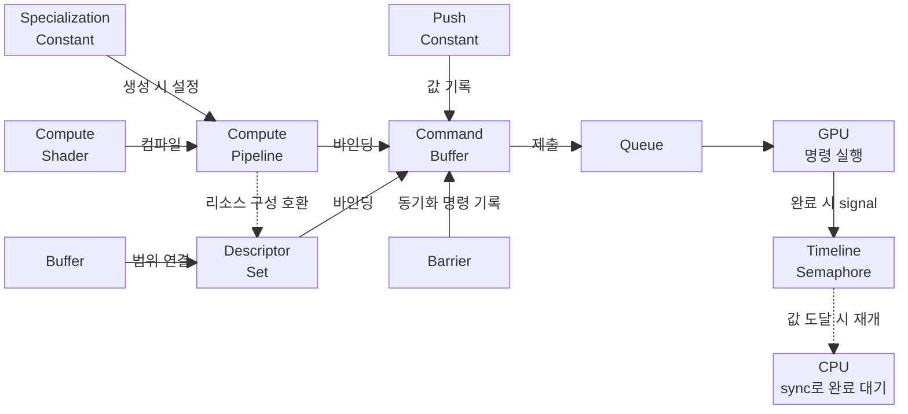

# Vulkan 기본 개념

이 문서는 vAi의 GPU 실행을 이해하는 데 필요한 Vulkan 기본 객체, 동기화, 셰이더 파라미터 전달을 설명합니다. Python에서 배열 연산을 호출할 때 라이브러리가 처리하던 데이터 저장, 연산 준비, 명령 실행을 Vulkan에서는 어떻게 표현하는지 살펴봅니다.

**Host**는 CPU에서 실행되는 프로그램 측, **Device**는 GPU에서 작업을 수행하는 장치 측을 뜻합니다.

vAi는 Vulkan을 감싼 C++ 라이브러리인 [EVA](https://github.com/vaistrata/eva)를 사용합니다. 각 절에서는 Vulkan 개념을 먼저 설명하고 EVA 코드와 연결합니다. vAi의 추론 호출 순서는 [실행 파이프라인](03-usage/execution-pipeline.md), 텐서의 데이터 공유와 버퍼 관리는 [Tensor](03-usage/tensor.md)에서 다룹니다.



## 1. 데이터와 연산 준비

### 1.1 버퍼 (Buffer)

버퍼는 입력 배열, 가중치, 연산 결과처럼 연속된 바이트로 표현할 데이터를 저장하고 사용하는 리소스입니다. 예를 들어 FP32 원소 65개를 담으려면 데이터 크기만큼인 260바이트 이상의 버퍼가 필요합니다.

버퍼를 사용하려면 데이터를 담을 메모리를 할당하고 버퍼에 연결해야 합니다. EVA의 `Device::createBuffer()`는 이 과정을 묶어 `eva::Buffer`로 제공합니다.

버퍼 자체에는 ML 텐서의 Shape나 Dtype이 없습니다. 같은 260바이트를 어떤 자료형과 차원으로 해석할지는 텐서와 셰이더가 정합니다. vAi에서는 `Tensor`가 Shape와 Offset을, 내부 `TensorData`가 Dtype과 저장소를 관리합니다.

#### 버퍼 용도와 메모리 속성

버퍼의 **용도(usage)**는 그 버퍼에 어떤 종류의 작업을 허용할지 정합니다. 아래에서 **셰이더(Shader)**는 GPU가 실행할 프로그램을 뜻합니다.

| 용도 | 의미 |
|---|---|
| `STORAGE_BUFFER` | 셰이더가 배열 등의 데이터를 읽거나 쓰는 스토리지 버퍼로 사용 |
| `TRANSFER_SRC` | 버퍼 복사의 원본으로 사용 |
| `TRANSFER_DST` | 버퍼 복사의 대상으로 사용 |

입력을 복사받은 뒤 셰이더가 읽을 버퍼라면 `TRANSFER_DST | STORAGE_BUFFER`처럼 용도를 조합합니다.

**메모리 속성(memory property)**은 버퍼에 연결할 저장 공간의 접근 특성을 나타냅니다. 버퍼를 복사에 쓸 수 있는지와 CPU가 그 메모리에 직접 접근할 수 있는지는 별개입니다.

| 메모리 속성 | 의미 |
|---|---|
| `HOST_VISIBLE` | CPU 주소 공간에 매핑하여 접근할 수 있음 |
| `DEVICE_LOCAL` | 장치가 접근하기에 적합한 메모리 |
| `HOST_COHERENT` | Host 접근의 캐시 관리를 위한 명시적 flush와 invalidate 호출이 필요 없음 |
| `HOST_CACHED` | Host 접근에 CPU 캐시를 사용함 |

`HOST_VISIBLE`과 `DEVICE_LOCAL`은 함께 존재할 수 있습니다. `HOST_COHERENT`는 캐시 관리에 관한 속성이며, GPU 작업의 완료를 보장하지 않습니다. [메모리 속성 정의](https://docs.vulkan.org/refpages/latest/refpages/source/VkMemoryPropertyFlagBits.html)

#### CPU에서 데이터 읽고 쓰기

CPU가 `HOST_VISIBLE` 메모리에 데이터를 쓰는 과정은 매핑, 복사, 매핑 해제로 나눕니다.

- **map**: 메모리를 CPU 주소 공간에 매핑하고 접근할 포인터를 얻습니다. 이 동작 자체로 데이터가 복사되지는 않습니다.
- **memcpy**: 그 포인터가 가리키는 영역에 실제 바이트를 복사합니다.
- **unmap**: CPU 주소로의 매핑을 해제합니다. 데이터를 지우거나 메모리 할당을 해제하지 않습니다. 매핑으로 얻었던 포인터는 이후 사용할 수 없습니다.

`HOST_COHERENT`가 없는 메모리는 CPU가 쓴 뒤 GPU가 읽기 전에 **flush**로 Host 쓰기를 전달할 준비를 해야 합니다. 반대로 GPU가 쓴 결과를 CPU에서 읽기 전에는 **invalidate**로 Host 캐시의 내용을 갱신해야 합니다. 이 호출들은 GPU의 완료를 기다리지 않습니다. `unmap`도 flush를 대신하지 않습니다. GPU와 접근 시점을 맞추는 방법은 [동기화](#3-동기화)에서 설명합니다. [매핑과 접근 동기화](https://docs.vulkan.org/refpages/latest/refpages/source/vkMapMemory.html), [non-coherent 메모리의 캐시 관리](https://docs.vulkan.org/spec/latest/chapters/memory.html#memory-device-hostaccess)

입력 데이터를 CPU에서 작성한 뒤 연산용 버퍼로 복사할 때 쓰는 중간 버퍼를 **스테이징 버퍼(Staging Buffer)**라고 합니다. GPU 결과를 복사받아 CPU에서 읽는 버퍼는 **리드백 버퍼(Readback Buffer)**라고 합니다. 스테이징에는 `HOST_VISIBLE` 메모리와 `TRANSFER_SRC` 용도를, 리드백에는 `HOST_VISIBLE` 메모리와 `TRANSFER_DST` 용도를 사용합니다.

#### EVA에서 사용하는 버퍼

다음은 새 스테이징 버퍼에 CPU 데이터를 쓰는 예입니다. `device`는 준비된 `eva::Device`, `values`는 복사할 배열이며 `bytes`는 그 바이트 크기입니다.

```cpp
auto staging = device.createBuffer({
    .size = bytes,
    .usage = eva::BUFFER_USAGE::TRANSFER_SRC,
    .reqMemProps = eva::MEMORY_PROPERTY::HOST_VISIBLE
                | eva::MEMORY_PROPERTY::HOST_COHERENT
});

auto* mapped = staging.map();
std::memcpy(mapped, values.data(), bytes);
staging.unmap();
```

이 코드는 스테이징 버퍼에 데이터를 씁니다. 연산용 버퍼로 복사하려면 별도의 복사 명령이 필요합니다. 여기서는 `HOST_COHERENT` 메모리를 요청했으므로 명시적 flush가 필요 없습니다.

`buffer(offset, size)`는 버퍼와 바이트 범위를 묶은 `eva::BufferRange`를 만듭니다. vAi의 `Tensor::buffer()`도 이 형태로 버퍼와 `byteOffset()`을 전달합니다. 텐서의 유효 데이터 크기와 저장소 공유 규칙은 [Tensor](03-usage/tensor.md)를 참조하십시오.

### 1.2 디스크립터 셋 (Descriptor Set)

버퍼에 데이터가 있어도 셰이더는 어떤 버퍼가 입력이고 출력인지 알 수 없습니다. **디스크립터(Descriptor)**는 셰이더가 사용할 리소스의 연결 정보이고, **디스크립터 셋**은 그 연결 정보를 묶은 객체입니다.

셰이더는 **Set 번호**로 리소스 묶음의 위치를, 그 안의 **Binding 번호**로 개별 연결 위치를 지정합니다. 예를 들어 vAi의 Activation 셰이더는 Set 0의 Binding 0에서 출력을, Binding 1에서 입력을 찾습니다.

```text
셰이더의 Set 0
  Binding 0 → 출력 버퍼의 지정 범위
  Binding 1 → 입력 버퍼의 지정 범위
```

버퍼 디스크립터에는 버퍼를 식별하는 **핸들(handle)**, 버퍼 시작점으로부터의 바이트 위치인 **offset**, 사용할 바이트 크기인 **range**가 들어갑니다. 셰이더는 이 시작 위치를 기준으로 데이터를 읽고 씁니다. 디스크립터를 갱신하는 것은 연결 정보를 쓰는 일이며 버퍼 안의 숫자를 복사하는 일이 아닙니다. [버퍼 디스크립터의 필드](https://docs.vulkan.org/refpages/latest/refpages/source/VkDescriptorBufferInfo.html)

디스크립터를 준비할 때는 연결할 버퍼의 구조를 정한 뒤 실제 연결 정보를 채웁니다.

| 개념 | 역할 |
|---|---|
| Descriptor Set Layout | Binding별로 어떤 종류의 리소스를 연결할지 정의 |
| Descriptor Pool | 디스크립터 셋을 할당하는 공간 관리 |
| Descriptor Set | 레이아웃에 맞춰 할당한 실제 연결 정보 묶음 |
| Descriptor Write | 셋에 사용할 버퍼와 범위를 기록하거나 갱신 |

같은 버퍼의 같은 범위에서 숫자만 바뀌었다면 디스크립터를 다시 쓸 필요가 없습니다. 다른 버퍼나 다른 범위를 사용하려면 연결 정보를 바꿉니다.

EVA에서는 `eva::DescriptorSetLayout`, `eva::DescriptorPool`, `eva::DescriptorSet`으로 이 역할을 표현합니다. vAi의 Activation은 `pipe.descSetLayout(0)`에 맞는 셋을 할당하고, `descSet.write({outBuf, inBuf})`로 출력과 입력 범위를 연결합니다.

디스크립터 셋은 파이프라인이 요구하는 리소스 구성에 맞아야 합니다. 실행할 때는 파이프라인과 셋을 커맨드 버퍼에 각각 바인딩합니다. 바인딩은 [커맨드 버퍼](#21-커맨드-버퍼-command-buffer)에서, 이미 기록하거나 제출한 명령이 참조하는 셋의 갱신 제약은 [재사용과 갱신](#52-재사용과-갱신)에서 다룹니다.

### 1.3 컴퓨트 파이프라인 (Compute Pipeline)

**컴퓨트 셰이더(Compute Shader)**는 GPU에서 배열 계산 등의 연산을 수행하는 프로그램입니다. GPU 연산 코드를 가리켜 **커널(kernel)**이라고도 부릅니다. 예를 들어 원소별 활성화 함수는 각 입력 `x[i]`를 읽어 `y[i] = max(x[i], 0)`을 계산하는 셰이더로 작성할 수 있습니다.

**컴퓨트 파이프라인**은 실행할 셰이더와 그 설정을 묶은 객체입니다. vAi는 GLSL로 작성한 셰이더를 **SPIR-V**라는 중간 표현으로 컴파일하고, 이 코드와 설정으로 파이프라인을 준비합니다.

**특수화 상수**는 파이프라인을 만들 때 셰이더의 상수 값을 정하는 방법입니다. 같은 셰이더라도 입력 자료형 등의 설정에 따라 다른 파이프라인을 사용할 수 있습니다. 값의 전달 시점은 [셰이더 파라미터](#4-셰이더-파라미터)에서 설명합니다.

실제 입력과 출력 버퍼는 디스크립터 셋으로 연결합니다. 버퍼 안의 데이터만 달라진다면 파이프라인은 재사용할 수 있습니다. vAi의 [PipelinePool](../../vai/engine/pipeline-pool.h)은 같은 셰이더와 설정으로 요청한 파이프라인을 재사용합니다.

#### 인보케이션과 워크그룹

원소별 연산에서는 같은 셰이더 코드를 여러 원소에 적용합니다. **인보케이션(Invocation)**은 셰이더의 개별 실행 하나입니다. 한 인보케이션이 자기 인덱스의 원소 하나를 처리하도록 작성할 수 있습니다.

**워크그룹(Workgroup)**은 함께 묶인 인보케이션의 집합입니다. 셰이더의 `local_size_x/y/z`로 그룹 크기를 정합니다. 예를 들어 `local_size_x = 64`이고 Y와 Z 크기가 1이면 한 그룹에는 인보케이션 64개가 있습니다. 그룹 수를 지정해 실행하는 명령은 다음 절의 디스패치입니다. [컴퓨트 셰이더 실행 모델](https://docs.vulkan.org/spec/latest/chapters/shaders.html#shaders-compute)

## 2. 명령 기록과 제출

### 2.1 커맨드 버퍼 (Command Buffer)

**커맨드 버퍼**는 GPU가 수행할 명령을 기록한 객체입니다. 연산에 필요한 버퍼와 파이프라인을 준비한 뒤, 어떤 파이프라인과 디스크립터 셋을 사용해 몇 개의 워크그룹을 실행할지 기록합니다. 버퍼 사이의 복사 명령도 기록할 수 있습니다.

**디스패치(Dispatch)**는 지정한 수의 워크그룹으로 컴퓨트 셰이더를 실행하는 명령입니다. `dispatch(2, 1, 1)`의 인수는 X, Y, Z 방향의 그룹 수입니다. 인보케이션 수나 배열 원소 수를 직접 전달하는 호출은 아닙니다. [디스패치의 그룹 수](https://docs.vulkan.org/refpages/latest/refpages/source/vkCmdDispatch.html)

원소 65개를 처리하고 그룹 크기가 64라면 필요한 그룹 수는 `ceil(65 / 64) = 2`입니다.

```text
디스패치 1회: 그룹 2개, 총 인보케이션 128개
  그룹 0: 전체 인덱스  0~63  → 64개 원소 처리
  그룹 1: 전체 인덱스 64~127 → 인덱스 64만 처리
```

인덱스 65~127은 유효한 원소를 가리키지 않으므로 셰이더가 버퍼에 접근하기 전에 범위를 검사해야 합니다. GLSL의 `gl_GlobalInvocationID.x`는 전체 디스패치 안의 X축 인덱스입니다. 원소 수 `N`을 전달받는 원소별 셰이더의 본문은 다음과 같은 형태입니다.

```glsl
uint i = gl_GlobalInvocationID.x;
if (i >= N) return;
// 유효한 i의 입력을 읽고 결과를 씁니다.
```

명령의 **기록**, **제출**, **실행**은 별개입니다. CPU의 `cmd.dispatch(...)` 호출은 커맨드 버퍼에 명령을 기록합니다. 기록을 끝내고 큐에 제출하면 GPU에서 실행할 수 있게 됩니다. 제출 함수가 반환됐다고 GPU 계산이 끝난 것은 아닙니다.

EVA에서는 `eva::CommandBuffer`를 사용하며, `begin()`과 `end()` 사이에 명령을 기록합니다.

| EVA 호출 | 기록하는 내용 |
|---|---|
| `bindPipeline(pipe)` | 이후 디스패치가 사용할 파이프라인 |
| `bindDescSets({descSet})` | 셰이더의 리소스 위치에 연결할 디스크립터 셋 |
| `setPushConstants(...)` | 셰이더에 전달할 작은 파라미터 값 |
| `dispatch(x, y, z)` | 지정한 워크그룹 수로 실행 |
| `dispatch2(N)` | 파이프라인의 워크그룹 크기로 필요한 그룹 수를 올림 계산하여 실행 |
| `copyBuffer(...)` | 원본 버퍼에서 대상 버퍼로 데이터 복사 |
| `barrier(...)` | 앞뒤 작업 사이의 동기화 |

파이프라인과 셋을 **바인딩(bind)**한다는 것은 뒤에 기록하는 명령이 사용할 대상을 지정한다는 뜻입니다. 데이터 복사나 앞 연산의 완료 대기는 수행하지 않습니다.

### 2.2 큐 (Queue)

**큐**는 기록을 마친 커맨드 버퍼를 GPU에 제출하는 통로입니다. EVA에서는 `Device::queue()`로 큐를 얻고 `Queue::submit()`으로 명령을 제출합니다.

같은 큐에 순서대로 제출하더라도 앞 연산이 쓴 결과를 뒤 연산이 읽는 관계에는 동기화가 필요합니다. CPU가 결과를 읽으려면 GPU 작업이 완료되었는지도 확인해야 합니다. [Vulkan의 큐](https://docs.vulkan.org/guide/latest/queues.html)

## 3. 동기화

앞 연산이 버퍼 `X`에 쓴 결과를 다음 연산이 읽으려면, 쓰기가 끝난 뒤 그 결과를 읽을 수 있도록 연결해야 합니다. vAi의 연산 사이에서는 **배리어**를, 추론 제출과 CPU의 완료 대기에는 **타임라인 세마포어**를 사용합니다.

### 3.1 배리어 (Barrier)

**배리어**는 커맨드 버퍼에 기록하는 동기화 명령입니다. 같은 큐의 앞뒤 작업 사이에 필요한 실행 순서와 메모리 접근을 지정합니다. 예를 들어 연산 A가 `X`에 쓴 결과를 연산 B가 읽는다면 다음 관계를 기록합니다.

```text
디스패치 A: X에 쓰기
  → 배리어: Compute 쓰기 → Compute 읽기
  → 디스패치 B: X 읽기
```

배리어는 **Stage**로 동기화할 처리 단계를, **Access**로 읽기나 쓰기 같은 접근 종류를 지정합니다. EVA의 `SYNC_SCOPE`는 이 둘을 묶은 표현입니다.

| EVA의 동기화 범위 | 의미 |
|---|---|
| `COMPUTE_WRITE` | 컴퓨트 셰이더의 쓰기 |
| `COMPUTE_READ` | 컴퓨트 셰이더의 읽기 |
| `TRANSFER_WRITE` | 버퍼 복사 등의 전송 작업이 대상에 쓰기 |

Activation에서는 다음처럼 출력 버퍼의 쓰기를 후속 연산의 읽기에 연결합니다. `/`는 앞의 접근, 대상 버퍼 범위, 뒤의 접근을 묶는 EVA 표현입니다.

```cpp
cmdBuff.barrier(
    eva::SYNC_SCOPE::COMPUTE_WRITE / outBuf / eva::SYNC_SCOPE::COMPUTE_READ
);
```

스테이징 버퍼에서 복사한 입력을 셰이더가 읽는 경우에는 `TRANSFER_WRITE → COMPUTE_READ`로 연결합니다. Access는 이 배리어가 동기화할 접근을 뜻하며, 버퍼의 읽기나 쓰기 권한을 설정하는 값은 아닙니다. [컴퓨트 연산과 복사의 동기화 예제](https://docs.vulkan.org/guide/latest/synchronization_examples.html#_compute_to_compute_dependencies)

배리어를 기록하거나 제출해도 CPU가 GPU 완료를 기다리지는 않습니다. CPU에서 결과를 읽을 때는 결과가 Host 읽기에 전달되도록 동기화하고, 작업 완료를 기다려야 합니다. `HOST_COHERENT`가 없는 메모리라면 읽기 전에 invalidate도 필요합니다. vAi의 데이터 다운로드는 [Tensor](03-usage/tensor.md), Vulkan의 동기화 순서는 [CPU readback 예제](https://docs.vulkan.org/guide/latest/synchronization_examples.html#_cpu_read_back_of_data_written_by_a_compute_shader)를 참조하십시오.

### 3.2 타임라인 세마포어 (Timeline Semaphore)

**세마포어(Semaphore)**는 제출 사이의 신호와 대기를 연결하는 동기화 객체입니다. 데이터를 생산하는 제출이 **signal**을 보내고, 소비하는 제출은 **wait**로 해당 신호를 기다리도록 구성할 수 있습니다. 이 연결로 작업 순서와 쓰기 결과의 전달을 동기화합니다.

**타임라인 세마포어**는 증가하는 정수 값을 사용합니다. 예를 들어 작업이 끝날 때 값 1을 signal하도록 하고, 다음 작업은 값 1을 기다리도록 지정합니다. 요청한 값 이상에 도달하면 대기가 끝납니다. CPU에서도 특정 값에 도달할 때까지 기다릴 수 있습니다. [타임라인 세마포어](https://docs.vulkan.org/samples/latest/samples/extensions/timeline_semaphore/README.html)

vAi는 추론을 제출할 때 다음처럼 완료 값을 지정합니다.

```cpp
device_.queue() << cmdBuffer_ / timeline_(++submitCount_);
```

`submitCount_`는 제출할 때마다 증가합니다. `/`는 커맨드 버퍼와 signal 정보를 묶고, `<<`는 큐에 제출하는 EVA 표현입니다. 이 제출의 명령이 완료되면 타임라인 값이 지정한 값에 도달합니다.

`NeuralNet::sync()`는 마지막 제출 값에 도달할 때까지 CPU를 기다리게 합니다. 추론 제출, 완료 대기, 명령 재사용의 전체 흐름은 [실행 파이프라인](03-usage/execution-pipeline.md)에서 설명합니다.

## 4. 셰이더 파라미터

### 4.1 푸시 상수 (Push Constant)

원소 수 `N`이나 계산에 사용할 작은 스칼라 값은 별도 버퍼를 만들지 않고 명령에 담아 전달할 수 있습니다. **푸시 상수**는 이렇게 명령 기록 시 값을 지정하는 방법입니다.

EVA에서는 파이프라인을 바인딩한 뒤 `setPushConstants()`로 값을 기록합니다.

```cpp
uint32_t N = 65;
cmdBuff.setPushConstants(0, sizeof(N), &N);
```

이 호출은 오프셋 0부터 `N`의 바이트를 명령에 기록합니다. 이후 CPU 변수 `N`만 바꿔도 이미 기록한 값은 바뀌지 않습니다. 같은 커맨드 버퍼를 재제출하면 기록 당시의 값을 사용하므로, 다른 값을 전달하려면 푸시 상수 명령을 포함해 커맨드 버퍼를 다시 기록해야 합니다. 값만 바꿀 때는 파이프라인을 재사용할 수 있습니다. [푸시 상수](https://docs.vulkan.org/guide/latest/push_constants.html)

### 4.2 특수화 상수 (Specialization Constant)

**특수화 상수**는 파이프라인 생성 시 셰이더의 상수 값을 지정하는 방법입니다. 예를 들어 같은 셰이더에서 입력과 출력을 같은 버퍼에 쓸지, 어떤 자료형으로 해석할지 선택할 수 있습니다.

값이 파이프라인 생성 시 정해지므로 드라이버는 이를 알고 사용하지 않는 분기를 제거하는 등의 최적화를 할 수 있습니다. 값을 바꾸려면 다른 값으로 생성한 파이프라인을 사용합니다. 셰이더 소스 전체를 다시 작성할 필요는 없습니다. [특수화 상수의 사용과 최적화](https://docs.vulkan.org/samples/latest/samples/performance/specialization_constants/README.html)

EVA에서는 `eva::constant_id<ID>(value)`로 셰이더에 선언된 ID와 값을 연결합니다. Activation의 파이프라인 요청은 다음과 같습니다.

```cpp
pipe = pipelinePool().request("activation", {
    eva::constant_id<0>(config_.inPlace ? 1u : 0u),
    eva::constant_id<SPEC_ID_TYPE_O>(oDtype),
    eva::constant_id<SPEC_ID_TYPE_I>(iDtype),
    eva::constant_id<SPEC_ID_EPILOGUE>((uint32_t) config_.epilogue)
});
```

이 설정은 입력과 출력의 버퍼 공유 여부, 입출력 Dtype, 활성화 함수 등의 후처리 연산을 결정합니다. 실행 범위를 나타내는 `N`은 푸시 상수이고, 이 설정들은 파이프라인 생성 시의 특수화 상수입니다. 이미 같은 설정의 파이프라인이 있으면 `PipelinePool`이 재사용합니다.

| 구분 | 푸시 상수 | 특수화 상수 |
|---|---|---|
| 값 지정 시점 | 커맨드 버퍼 기록 시 | 파이프라인 생성 시 |
| 값 변경 | 해당 명령을 다시 기록 | 다른 값으로 만든 파이프라인 사용 |
| Activation 예 | 처리할 원소 수 `N` | In-place 여부, Dtype, 후처리 연산 |

## 5. Activation으로 연결해 보기

### 5.1 준비한 객체로 명령 기록하기

vAi의 [Activation](../../vai/nodes/activation.h)은 `prepare()`에서 파이프라인을 요청하고 그 레이아웃에 맞는 디스크립터 셋을 할당합니다. `run()`에서는 실제 버퍼 범위를 셋에 연결한 뒤 명령을 기록합니다. 다음은 `run()`의 코드입니다.

```cpp
auto outBuf = (*this)["out0"].buffer();
auto inBuf  = config_.inPlace ? eva::Buffer() : (*this)["in0"].buffer();

descSet.write({ outBuf, inBuf });

uint32_t N = (*this)["out0"].numElements();
struct {
    uint32_t N;
} constants = { N };

cmdBuff
    .bindPipeline(pipe)
    .bindDescSets({descSet})
    .setPushConstants(0, sizeof(constants), &constants)
    .dispatch2(N)
    .barrier(eva::SYNC_SCOPE::COMPUTE_WRITE / outBuf / eva::SYNC_SCOPE::COMPUTE_READ);
```

`descSet.write()`는 Host에서 연결 정보를 갱신합니다. 이어지는 `bindPipeline()`부터 `barrier()`까지는 커맨드 버퍼에 명령을 기록합니다. 디스패치는 선택한 셰이더와 버퍼, 원소 수를 사용하고 마지막 배리어는 출력 쓰기를 후속 컴퓨트 읽기에 연결합니다. 실제 GPU 실행은 이후 `NeuralNet`이 이 커맨드 버퍼를 큐에 제출할 때 요청합니다.

스테이징 버퍼를 사용하는 입력 전송은 이 연산 전에 수행합니다. 입력 복사와 연산을 연결하는 명령 구성은 [실행 파이프라인](03-usage/execution-pipeline.md)을 참조하십시오.

[Activation 셰이더](../../vai/shaders/activation.comp)의 워크그룹 크기는 256입니다. `dispatch2(N)`은 이 크기에 맞춰 그룹 수를 계산하고, 셰이더의 `if (i >= N) return;`이 범위를 벗어난 인보케이션을 종료합니다.

`inPlace`가 켜져 있으면 별도 입력 버퍼를 연결하지 않고, 셰이더가 출력 버퍼에서 값을 읽어 같은 곳에 결과를 씁니다.

### 5.2 재사용과 갱신

같은 연산을 반복할 때 무엇이 바뀌었는지에 따라 갱신 대상이 달라집니다. 다음 표는 같은 셰이더의 버퍼 구성을 사용하는 경우를 기준으로 합니다.

| 바뀌는 것 | 갱신할 대상 | 재사용할 수 있는 것 |
|---|---|---|
| 같은 버퍼의 같은 범위에 담긴 숫자만 변경 | 버퍼 데이터와 필요한 전송, 접근 동기화 | 디스크립터 셋, 파이프라인, 나머지 기록 조건이 같은 커맨드 버퍼 |
| 연결할 버퍼 또는 offset/range 변경 | 디스크립터 Write 또는 다른 셋 선택, 이에 맞는 명령 재기록 | 파이프라인 |
| 푸시 상수 값 변경 | 새 값과 필요한 디스패치 크기를 명령에 재기록 | 디스크립터 셋과 파이프라인 |
| 특수화 상수 값 변경 | 해당 값의 파이프라인을 준비하고 바인딩 명령 재기록 | 버퍼와 디스크립터 셋 |

GPU가 사용 중인 버퍼나 디스크립터 셋을 변경하거나, 실행 중인 커맨드 버퍼를 다시 기록해서는 안 됩니다. 먼저 이전 작업의 완료를 기다려야 합니다.

디스크립터의 연결 정보를 바꿀 때는 그 셋을 사용하는 커맨드 버퍼도 다시 기록합니다. 셋만 갱신한 뒤 기존 명령을 그대로 재제출하면 명령이 무효화되어 있을 수 있습니다. [디스크립터 갱신 규칙](https://docs.vulkan.org/refpages/latest/refpages/source/vkUpdateDescriptorSets.html)

vAi가 입력 변경을 감지하고 이전 작업을 기다린 뒤 재기록하는 조건은 [실행 파이프라인](03-usage/execution-pipeline.md)의 반복 추론과 명령 재사용 절을 참조하십시오.
